# SmartCaña — Arquitectura del Sistema

**Plataforma AgTech Inteligente para la Gestión Integral de Cultivos de Caña de Azúcar**

| Campo | Detalle |
|---|---|
| **Nombre del proyecto** | SmartCaña |
| **Tipo de documento** | Arquitectura del Sistema (v1.0) |
| **Autor** | SmartCaña — Equipo de Desarrollo |
| **Fecha** | Julio 2026 |
| **Contexto** | Tesis Final — Tecnicatura Universitaria en Programación (TUP), UTN |
| **Clasificación** | Documento Confidencial — Uso Académico |
| **Estado** | Aprobado para desarrollo |

---

## Índice

1. [Arquitectura General](#1-arquitectura-general)
2. [Arquitectura Frontend](#2-arquitectura-frontend)
3. [Arquitectura Backend](#3-arquitectura-backend)
4. [Arquitectura de Base de Datos](#4-arquitectura-de-base-de-datos)
5. [Arquitectura GIS](#5-arquitectura-gis)
6. [Arquitectura IA](#6-arquitectura-ia)
7. [Arquitectura de APIs](#7-arquitectura-de-apis)
8. [Arquitectura de Seguridad](#8-arquitectura-de-seguridad)
9. [Arquitectura de Escalabilidad](#9-arquitectura-de-escalabilidad)
10. [Arquitectura Cloud](#10-arquitectura-cloud)
11. [Convenciones del Proyecto](#11-convenciones-del-proyecto)
12. [Patrones de Diseño](#12-patrones-de-diseño)
13. [Principios de Desarrollo](#13-principios-de-desarrollo)
14. [Estrategia de Versionado](#14-estrategia-de-versionado)
15. [Roadmap Técnico](#15-roadmap-técnico)

---

## 1. Arquitectura General

### 1.1 Visión de Alto Nivel

SmartCaña se construye sobre una arquitectura **monolítica modular** escalable, siguiendo el patrón **MVC extendido** en el backend (NestJS) y una arquitectura de **componentes modulares** en el frontend (Next.js). Esta decisión estratégica permite entregar un producto funcional en el plazo de una tesis académica sin sacrificar la capacidad de escalar hacia microservicios en el futuro.

La arquitectura está diseñada bajo el principio de **separación de responsabilidades**, donde cada capa tiene un rol bien definido y se comunica con las demás a través de interfaces contractuales (DTOs, servicios, contratos de API).

### 1.2 Flujo General del Sistema

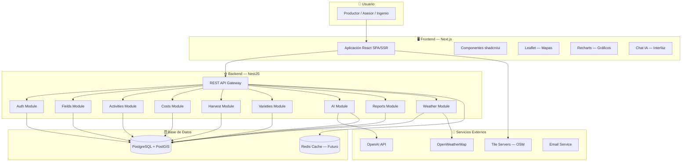

### 1.3 Diagrama de Capas

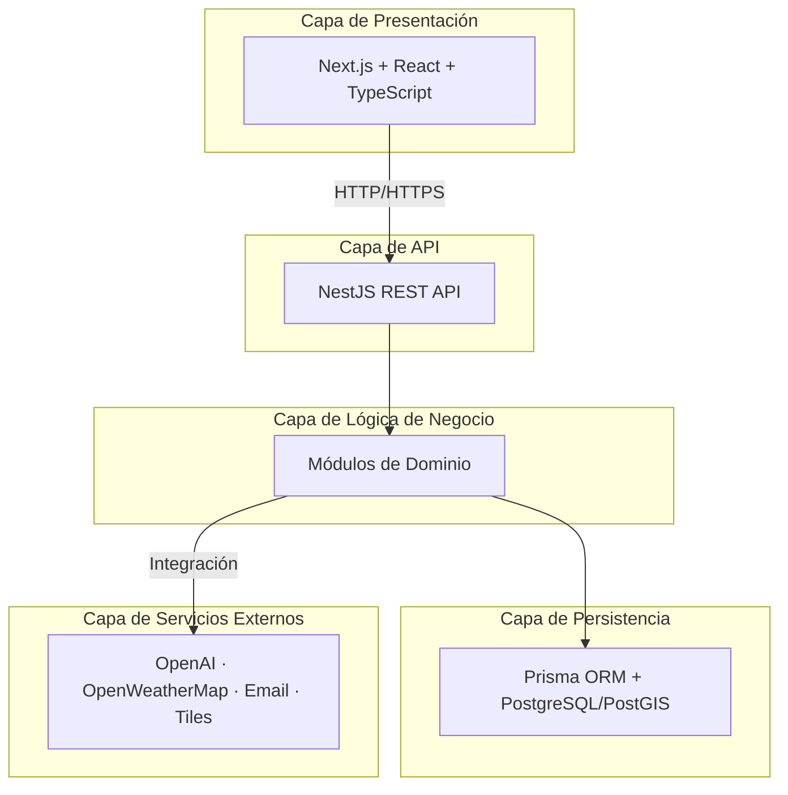

### 1.4 Decisiones Arquitectónicas Clave

| Decisión | Elección | Justificación |
|---|---|---|
| **Estilo arquitectónico** | Monolito modular | Permite entrega ágil en contexto de tesis, mantiene separación de concerns, preparado para extracción a microservicios futuro |
| **Comunicación** | REST síncrono | Estándar ampliamente soportado, fácil de consumir desde múltiples clientes, herramientas de documentación integradas (Swagger) |
| **Estado del servidor** | Stateless (JWT) | Permite escalado horizontal sin dependencia de sesión en servidor |
| **Multi-tenancy** | Row-level security | Un solo tenant por instancia de base de datos. Escalabilidad futura vía esquemas separados o bases de datos dedicadas |
| **Renderizado frontend** | ISR + CSR híbrido | Páginas estáticas revalidadas (dashboard, catálogos) + renderizado en cliente para mapas e interactividad |

---

## 2. Arquitectura Frontend

### 2.1 Stack Tecnológico

| Capa | Tecnología | Propósito |
|---|---|---|
| **Framework** | Next.js 14+ (App Router) | Routing basado en archivos, SSR/ISR, optimizaciones automáticas |
| **UI Library** | React 18+ | Componentes declarativos, concurrencia, Suspense |
| **Lenguaje** | TypeScript (strict mode) | Tipado estático, autocompletado, detección temprana de errores |
| **Estilos** | Tailwind CSS | Utility-first, diseño responsive, consistencia visual |
| **Componentes** | shadcn/ui | Componentes accesibles, personalizables, basados en Radix UI |
| **Animaciones** | Framer Motion | Transiciones suaves, animaciones declarativas |
| **Mapas** | Leaflet + react-leaflet | Visualización geoespacial interactiva |
| **Gráficos** | Recharts | Visualización de datos basada en React |
| **HTTP Client** | Axios o fetch nativo | Comunicación con el backend |
| **Formularios** | React Hook Form + Zod | Validación de schemas, manejo performante de formularios |
| **Estado global** | Zustand o React Context | Gestión de estado ligera y predecible |

### 2.2 Estructura por Módulos

El frontend se organiza siguiendo la estructura **feature-based**, donde cada módulo funcional contiene sus componentes, servicios, hooks y tipos:

```
src/
├── app/                          # Next.js App Router — Páginas y layouts
│   ├── (auth)/                   # Grupo de rutas de autenticación
│   │   ├── login/
│   │   ├── register/
│   │   └── layout.tsx
│   ├── (dashboard)/              # Grupo de rutas del panel principal
│   │   ├── page.tsx              # Dashboard principal
│   │   ├── fields/               # Módulo de campos
│   │   │   ├── page.tsx          # Lista de parcelas
│   │   │   ├── [id]/page.tsx     # Detalle de parcela
│   │   │   └── new/page.tsx      # Nueva parcela
│   │   ├── activities/           # Módulo de actividades
│   │   ├── costs/                # Módulo de costos
│   │   ├── harvest/              # Módulo de cosecha
│   │   ├── varieties/            # Módulo de variedades
│   │   ├── reports/              # Módulo de reportes
│   │   ├── ai-assistant/         # Asistente IA
│   │   ├── weather/              # Monitoreo climático
│   │   ├── settings/             # Configuración
│   │   └── layout.tsx            # Layout del dashboard
│   ├── layout.tsx                # Layout raíz
│   └── page.tsx                  # Landing / Redirect
├── components/                   # Componentes compartidos
│   ├── ui/                       # Componentes base (shadcn/ui)
│   ├── layout/                   # Componentes de layout
│   ├── maps/                     # Componentes de mapa
│   ├── charts/                   # Componentes de gráficos
│   └── shared/                   # Componentes reutilizables del dominio
├── features/                     # Lógica de negocio por módulo
│   ├── auth/
│   │   ├── hooks/
│   │   ├── services/
│   │   ├── types/
│   │   └── constants/
│   ├── fields/
│   │   ├── hooks/
│   │   ├── services/
│   │   ├── types/
│   │   ├── utils/
│   │   └── constants/
│   ├── activities/
│   ├── costs/
│   ├── harvest/
│   ├── varieties/
│   ├── ai/
│   ├── reports/
│   └── weather/
├── lib/                          # Utilidades y configuración global
│   ├── api.ts                    # Cliente HTTP configurado
│   ├── auth.ts                   # Utilidades de autenticación
│   ├── geo.ts                    # Utilidades geoespaciales
│   ├── validators.ts             # Schemas Zod compartidos
│   └── constants.ts              # Constantes globales
├── hooks/                        # Hooks compartidos
│   ├── use-auth.ts
│   ├── use-debounce.ts
│   ├── use-pagination.ts
│   └── use-media-query.ts
├── types/                        # Tipos TypeScript globales
│   └── index.ts
└── styles/                       # Estilos globales
    └── globals.css
```

### 2.3 Organización de Componentes

Los componentes se clasifican en cuatro categorías:

| Categoría | Ubicación | Descripción | Ejemplo |
|---|---|---|---|
| **UI Primitives** | `components/ui/` | Componentes base del design system | `Button`, `Input`, `Card`, `Dialog` |
| **Layout** | `components/layout/` | Componentes estructurales de la interfaz | `Sidebar`, `Header`, `PageContainer` |
| **Domain** | `components/shared/` | Componentes reutilizables del dominio | `FieldCard`, `ActivityForm`, `CostTable` |
| **Feature** | `features/*/components/` | Componentes específicos de un módulo | `FieldMapEditor`, `HarvestCalendar` |

**Reglas de composición:**
- Los componentes UI primitivos nunca contienen lógica de negocio.
- Los componentes de dominio pueden componer UI primitivos pero no pueden crear otros componentes de dominio.
- Los componentes de feature son los únicos que pueden contener lógica de negocio específica del módulo.
- Todo componente debe tener un archivo de test correspondiente.

### 2.4 Manejo de Estados

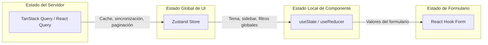

| Tipo de Estado | Solución | Uso |
|---|---|---|
| **Datos del servidor** | TanStack Query | Cache automático, revalidación, optimistic updates, paginación |
| **Estado de UI global** | Zustand | Tema (dark/light), estado del sidebar, filtros activos, notificaciones |
| **Estado local** | useState / useReducer | Estado visual de componentes (modales, acordeones, tabs) |
| **Formularios** | React Hook Form + Zod | Validación, manejo de errores, dirty state, submission |

### 2.5 Routing

Next.js App Router se utiliza con la convención de **grupos de rutas** para organizar layouts:

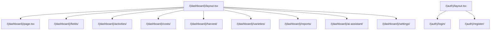

**Convenciones de rutas:**
- `[id]` — Rutas dinámicas con parámetro ID.
- `(grupo)` — Segmentos de ruta sin impacto en la URL (agrupación de layouts).
- `loading.tsx` — Estados de carga con Suspense.
- `error.tsx` — Manejo de errores por ruta.
- `not-found.tsx` — Página 404 personalizada.

### 2.6 Layouts

El sistema utiliza **tres niveles de layouts**:

1. **Layout raíz** (`app/layout.tsx`): Proveedores globales (QueryClient, Theme, Auth), tipografía, favicon.
2. **Layout de autenticación** (`app/(auth)/layout.tsx`): Centrado vertical, panel dividido, branding.
3. **Layout del dashboard** (`app/(dashboard)/layout.tsx`): Sidebar colapsable, header con usuario, área de contenido principal.

### 2.7 Diseño Responsive

La estrategia responsive se basa en **breakpoints de Tailwind CSS**:

| Breakpoint | Ancho | Dispositivo | Comportamiento |
|---|---|---|---|
| `sm` | ≥640px | Landscape phones | Layout mínimo, sidebar colapsada |
| `md` | ≥768px | Tablets | Sidebar visible, layouts de 2 columnas |
| `lg` | ≥1024px | Laptops | Layout completo, sidebar fija |
| `xl` | ≥1280px | Desktops | Layout expandido, paneles laterales |
| `2xl` | ≥1536px | Monitores grandes | Contenido ampliado, grids de 4+ columnas |

**Principios responsive:**
- **Mobile-first**: Estilos base para pantallas pequeñas, progresivamente mejorados.
- **Sidebar colapsable**: En mobile se convierte en drawer overlay.
- **Tabla responsiva**: En mobile, las tablas se convierten en cards apiladas.
- **Mapa**: En mobile ocupa pantalla completa con controles flotantes.

### 2.8 Estrategia de Renderizado

| Tipo de Página | Estrategia | Justificación |
|---|---|---|
| **Landing / Marketing** | SSG (Static Site Generation) | Rendimiento, SEO, CDN-cacheable |
| **Dashboard** | ISR (Incremental Static Regeneration) | Datos que cambian periódicamente, revalidación cada 60s |
| **Detalle de parcela** | SSR (Server-Side Rendering) | Datos dinámicos del usuario, personalización |
| **Mapa interactivo** | CSR (Client-Side Rendering) | Requiere APIs del navegador (DOM, canvas), interactividad completa |
| **Chat IA** | CSR | Streaming de respuesta, estado en tiempo real |

### 2.9 Reutilización de Componentes

El sistema de componentes sigue el patrón de **composición**:

- Los componentes se construyen componiendo piezas pequeñas, no heredando.
- Cada componente UI recibe sus propiedades a través de `props` tipadas.
- Los componentes de shadcn/ui se personalizan mediante variantes (class-variance-authority).
- Los componentes se exportan desde barrel files (`index.ts`) para imports limpios.

### 2.10 Manejo de Formularios

```
React Hook Form (estado y submit)
    ↓
Zod Schema (validación)
    ↓
DTO (transformación para API)
    ↓
API Request (comunicación con backend)
    ↓
Error Handling (display de errores de validación del servidor)
```

**Convenciones:**
- Un schema Zod por formulario, definido en el feature correspondiente.
- Los errores del backend se mapean a los campos del formulario automáticamente.
- Loading states en botones de submit durante la petición.
- Validación en tiempo real (onChange) para campos críticos, validación onBlur para el resto.

### 2.11 Lazy Loading

La carga diferida se implementa en múltiples niveles:

| Nivel | Mecanismo | Ejemplo |
|---|---|---|
| **Rutas** | `next/dynamic` con `loading` | El módulo de IA se carga bajo demanda |
| **Componentes pesados** | `React.lazy` + `Suspense` | El editor de mapa con Leaflet |
| **Gráficos** | Dynamic import | Los componentes de Recharts solo se cargan en las páginas de reportes |
| **Imágenes** | `next/image` con `loading="lazy"` | Fotografías de campo en actividades |

---

## 3. Arquitectura Backend

### 3.1 Stack Tecnológico

| Capa | Tecnología | Propósito |
|---|---|---|
| **Runtime** | Node.js 20+ LTS | Ejecución JavaScript de alto rendimiento |
| **Framework** | NestJS 10+ | Arquitectura modular, DI, decorators, middlewares |
| **ORM** | Prisma 5+ | Type-safe database access, migraciones, schema-first |
| **Base de datos** | PostgreSQL 16+ con PostGIS | Relacional + geoespacial |
| **Validación** | class-validator + class-transformer | DTOs validados automáticamente |
| **Documentación** | Swagger (OpenAPI 3.0) | Documentación auto-generada de la API |

### 3.2 Arquitectura Modular

NestJS organiza el backend en **módulos**, cada uno encapsulando un dominio del negocio:

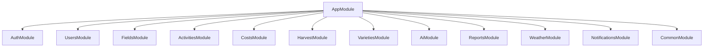

**Estructura interna de cada módulo:**

```
src/modules/
└── fields/
    ├── fields.module.ts            # Definición del módulo
    ├── fields.controller.ts        # Endpoints HTTP
    ├── fields.service.ts           # Lógica de negocio
    ├── fields.repository.ts        # Acceso a datos (Prisma)
    ├── dto/
    │   ├── create-field.dto.ts     # DTO de entrada para crear
    │   ├── update-field.dto.ts     # DTO de entrada para actualizar
    │   └── query-field.dto.ts      # DTO de filtrado/paginación
    ├── entities/
    │   └── field.entity.ts         # Entidad de dominio
    ├── interfaces/
    │   └── fields-repository.interface.ts
    ├── validators/
    │   └── field.validators.ts     # Validadores personalizados
    └── fields.controller.spec.ts   # Tests
```

### 3.3 Controladores

Los controladores definen los endpoints HTTP y delegan toda la lógica a los servicios:

**Responsabilidades:**
- Recibir y validar las peticiones HTTP (a través de DTOs y pipes).
- Delegar la lógica de negocio al servicio correspondiente.
- Formatear la respuesta HTTP (status code, body, headers).
- Manejar excepciones (los filtros de excepciones globalmente).

**Convenciones:**
- Un controlador por módulo.
- Endpoints nombrados en plural (`/fields`, no `/field`).
- HTTP methods: `GET` (lectura), `POST` (creación), `PATCH` (actualización parcial), `DELETE` (eliminación).
- Los endpoints de lectura soportan query parameters para filtrado, paginación y ordenamiento.
- El controlador nunca accede directamente a Prisma; siempre pasa por el servicio.

### 3.4 Servicios

Los servicios contienen toda la **lógica de negocio**:

**Responsabilidades:**
- Implementar las reglas de negocio del dominio.
- Orquestar operaciones que involucran múltiples repositorios.
- Transformar datos entre capas (entity → DTO de respuesta).
- Aplicar validaciones de negocio que van más allá de la validación de formato.

**Convenciones:**
- Un servicio por módulo.
- Los servicios son **inyectables** (decorador `@Injectable()`).
- Los servicios no conocen HTTP; son agnósticos al protocolo.
- Los servicios retornan entidades o DTOs de respuesta, nunca raw database results.

### 3.5 Repositorios

Los repositorios encapsulan toda la **interacción con la base de datos**:

**Responsabilidades:**
- Ejecutar queries Prisma (CRUD).
- Construir queries complejas con filtros, joins y agregaciones.
- Manejar transacciones de base de datos.
- Encapsular la lógica de consultas geoespaciales (PostGIS).

**Convenciones:**
- Cada módulo define una **interfaz de repositorio** y una **implementación Prisma**.
- Esto permite cambiar la estrategia de acceso a datos (ej: migrar a un microservicio) sin modificar el servicio.
- Los repositorios retornan entidades de dominio, no `PrismaClient` types directamente.

### 3.6 DTOs (Data Transfer Objects)

Los DTOs definen el **contrato de datos** entre el cliente y el servidor:

| Tipo de DTO | Uso | Ejemplo |
|---|---|---|
| **Request DTO** | Validar datos de entrada | `CreateFieldDto`, `UpdateActivityDto` |
| **Response DTO** | Definir estructura de respuesta | `FieldResponseDto`, `PaginatedFieldsDto` |
| **Query DTO** | Parametrizar filtros y paginación | `QueryFieldDto` (page, limit, sort, filters) |

**Implementación:**
- Decoradores `class-validator` para validación automática (`@IsString`, `@IsNumber`, `@IsOptional`, etc.).
- Decoradores `class-transformer` para transformación de tipos (`@Type(() => Number)`).
- Los DTOs se validan automáticamente por los pipes de NestJS (`ValidationPipe`).
- Un DTO por operación (crear ≠ actualizar ≠ consultar).

### 3.7 Entidades

Las entidades representan los **objetos de dominio** del sistema:

- Son definidas como clases TypeScript tipadas.
- No se exponen directamente al cliente; se transforman a DTOs de respuesta.
- Contienen la forma lógica de los datos, no la implementación de persistencia.

### 3.8 Validaciones

La estrategia de validación es **multicapa**:

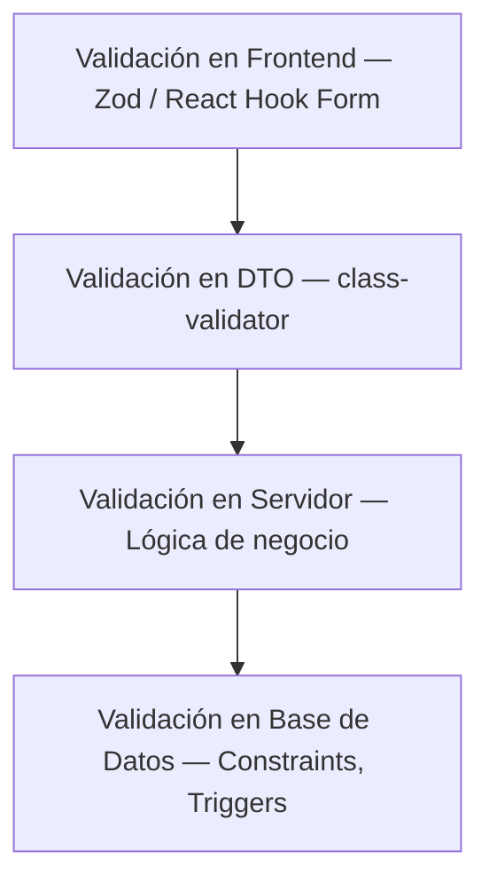

| Capa | Mecanismo | Protege contra |
|---|---|---|
| **Frontend** | Zod schemas, React Hook Form | Entrada inválida, UX negativa |
| **DTO** | class-validator decorators | Request malformado, tipos incorrectos, campos faltantes |
| **Servicio** | Reglas de negocio | Duplicados, estados inválidos, permisos |
| **Base de datos** | Unique constraints, FK, CHECK | Inconsistencia de datos, integridad referencial |

### 3.9 Middlewares

Los middlewares se ejecutan **antes** del controller:

| Middleware | Propósito |
|---|---|
| `HelmetMiddleware` | Headers de seguridad HTTP (CSP, HSTS, X-Frame-Options) |
| `CorsMiddleware` | Configuración de CORS por origen |
| `MorganMiddleware` | Logging de requests HTTP |
| `BodyParserMiddleware` | Parsing de JSON y URL-encoded bodies |
| `CompressionMiddleware` | Compresión gzip de responses |

### 3.10 Guards

Los guards determinan si una petición tiene permiso para acceder a un endpoint:

| Guard | Propósito |
|---|---|
| `JwtAuthGuard` | Verifica la validez del JWT en rutas protegidas |
| `RolesGuard` | Verifica que el usuario tenga el rol requerido |
| `PermissionsGuard` | Verifica permisos específicos (operación a nivel de recurso) |

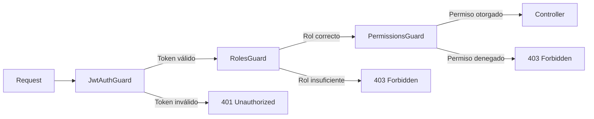

### 3.11 Interceptors

Los interceptors modifican la request o response de forma transversal:

| Interceptor | Propósito |
|---|---|
| `TransformInterceptor` | Envuelve todas las respuestas en un formato estándar `{ data, meta }` |
| `LoggingInterceptor` | Registra tiempo de ejecución de cada endpoint |
| `CacheInterceptor` | Cachea respuestas de lectura (TTL configurable) |
| `SerializeInterceptor` | Transforma entidades a DTOs de respuesta excluyendo campos sensibles |

### 3.12 Filtros de Excepciones

Los filtros capturan y transforman errores en respuestas consistentes:

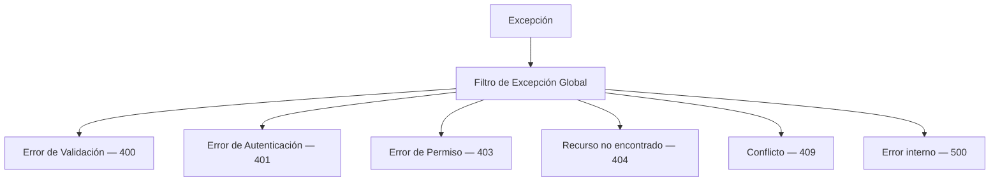

**Formato de respuesta de error:**

```json
{
  "statusCode": 400,
  "message": ["El nombre es requerido", "La superficie debe ser mayor a 0"],
  "error": "Bad Request",
  "timestamp": "2026-07-27T10:30:00.000Z",
  "path": "/api/v1/fields"
}
```

### 3.13 Inyección de Dependencias

NestJS implementa un **contenedor de inyección de dependencias** (IoC) que:

- Desacopla la creación de objetos de su uso.
- Permite reemplazar implementaciones (ej: repositorio Prisma → repositorio en memoria para tests).
- Facilita los unit tests al inyectar mocks.
- Se configura a través de decoradores `@Inject()`, `@Injectable()` y los arrays `providers`, `imports` de los módulos.

---

## 4. Arquitectura de Base de Datos

### 4.1 PostgreSQL como Motor Principal

PostgreSQL se selecciona como motor de base de datos por:

| Característica | Beneficio para SmartCaña |
|---|---|
| **Extensión PostGIS** | Almacenamiento y consulta de polígonos de parcelas, análisis espacial, cálculo de áreas |
| **ACID completo** | Integridad de datos en operaciones transaccionales (costos, cosechas) |
| **JSONB** | Almacenamiento flexible de metadata extensible sin alterar el esquema |
| **Índices avanzados** | GiST (geoespacial), GIN (búsqueda de texto completo), parciales (rendimiento) |
| **Row-Level Security** | Aislamiento de datos por tenant a nivel de base de datos |
| **Migraciones** | Prisma Migrate gestiona el esquema de forma versionada y reproducible |
| **Madurez y comunidad** | Extensa documentación, soporte a largo plazo, ecosistema de herramientas |

### 4.2 PostGIS — Extensión Geoespacial

PostGIS extiende PostgreSQL con capacidades geográficas:

| Funcionalidad | Uso en SmartCaña |
|---|---|
| `GEOMETRY` / `GEOGRAPHY` | Almacenamiento de polígonos de parcelas (coordenadas GPS) |
| `ST_Area` | Cálculo automático de superficie de parcelas |
| `ST_Within` | Determinar si un punto está dentro de una parcela |
| `ST_Intersects` | Encontrar parcelas que se superponen |
| `ST_Distance` | Calcular distancias entre parcelas |
| `ST_Transform` | Conversión entre sistemas de coordenadas (WGS84 ↔ Gauss-Kruger) |
| `GiST Index` | Índices geoespaciales para consultas espaciales performantes |
| `ST_GeomFromGeoJSON` | Importación de geometrías desde GeoJSON |

### 4.3 Estrategia de Modelado

El esquema de base de datos sigue un modelo **relacional normalizado** (3NF) con extensión geoespacial:

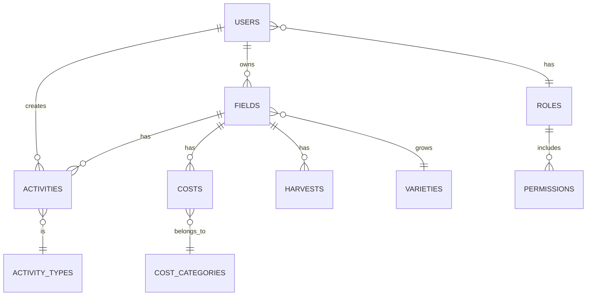

### 4.4 Relaciones

| Tipo de Relación | Ejemplo | Implementación |
|---|---|---|
| **1:N** | Un productor → muchas parcelas | Foreign key en el lado "muchos" |
| **N:M** | Parcelas ↔ Variedades (histórico) | Tabla intermedia con fecha de implantación |
| **1:1** | Usuario → Perfil | Foreign key única con constraint |

**Convenciones de relaciones:**
- Todas las foreign keys se definen explícitamente en el esquema Prisma.
- Las relaciones se cargan bajo demanda (no `include` automático en todas las queries).
- Se utilizan `select` explícitos para optimizar el volumen de datos transferidos.

### 4.5 Estrategia de Índices

| Tipo de Índice | Columnas | Propósito |
|---|---|---|
| **Primary Key** | `id` (UUID) | Identificador único, indexado por defecto |
| **Unique** | `email` (users), `name` (varieties) | Prevención de duplicados |
| **GiST** | `geometry` (fields) | Consultas geoespaciales (intersects, within, distance) |
| **GIN** | `metadata` (JSONB fields) | Búsqueda dentro de campos JSON |
| **B-tree** | `field_id`, `created_at`, `user_id` | Filtrado y ordenamiento frecuente |
| **Parcial** | `active = true` | Filtrado de registros activos sin indexar inactivos |
| **Compuesto** | `(user_id, created_at)` | Queries que filtran por usuario y ordenan por fecha |

### 4.6 Consultas Geográficas

Las consultas geoespaciales son fundamentales para SmartCaña:

| Operación | Query PostGIS | Módulo |
|---|---|---|
| **Parcelas dentro de un radio** | `ST_DWithin(field.geometry, point, radius)` | Mapa — vista de cercanía |
| **Área exacta de parcela** | `ST_Area(field.geometry::geography)` | Cálculo de superficie |
| **Parcelas visibles en viewport** | `field.geometry && ST_MakeEnvelope(west, south, east, north)` | Mapa — carga por viewport |
| **Punto dentro de parcela** | `ST_Within(point, field.geometry)` | Click en mapa → identificar parcela |
| **Superficie total del productor** | `SUM(ST_Area(geometry::geography))` | Dashboard — KPIs |
| **Parcelas por zona geográfica** | `ST_Within(geometry, zona_polygon)` | Filtrado por región |

### 4.7 Estrategia de Escalabilidad

| Nivel de Crecimiento | Estrategia | Herramienta |
|---|---|---|
| **< 100 usuarios** | PostgreSQL single instance, sin optimización extrema | Prisma defaults |
| **100–1.000 usuarios** | Índices optimizados, connection pooling, read replicas | PgBouncer, Prisma connection pool |
| **1.000–10.000 usuarios** | Particionamiento de tablas grandes, caché en Redis | Table partitioning (por campaña) |
| **> 10.000 usuarios** | Sharding por tenant, bases de datos dedicadas | Multi-database routing |

---

## 5. Arquitectura GIS

### 5.1 Stack Geoespacial

| Capa | Tecnología | Propósito |
|---|---|---|
| **Rendering de mapa** | Leaflet | Mapa interactivo con capas, zoom, controles |
| **Binding React** | react-leaflet | Componentes React para Leaflet |
| **Backend geoespacial** | PostGIS | Almacenamiento, consulta y análisis de geometrías |
| **Formato de intercambio** | GeoJSON | Estándar para intercambio de datos geográficos |
| **Tiles base** | OpenStreetMap | Mapa base gratuito y open-source |
| **Coordenadas** | WGS84 (EPSG:4326) | Sistema de coordenadas estándar global |

### 5.2 Polígonos de Parcelas

Cada parcela se almacena como un **polígono cerrado** en formato GeoJSON:

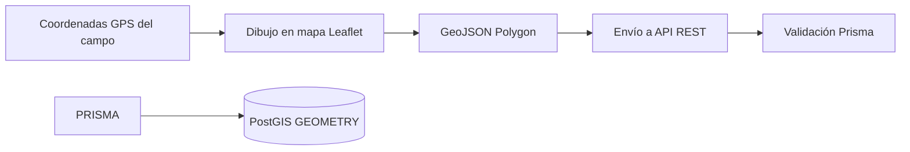

**Flujo de creación de parcela:**
1. El productor dibuja un polígono sobre el mapa (o importa GeoJSON/Shapefile).
2. El frontend captura las coordenadas como GeoJSON.
3. El GeoJSON se envía al backend vía API REST.
4. Prisma lo valida y lo almacena como `geometry` en PostgreSQL/PostGIS.
5. PostGIS calcula automáticamente el área y la genera un índice GiST.

### 5.3 Capas del Mapa

| Capa | Fuente | Descripción |
|---|---|---|
| **Capa base** | OpenStreetMap Tiles | Mapa de referencia general |
| **Parcelas** | Backend API | Polígonos de cada parcela del productor |
| **Rendimiento** | Backend API (calculado) | Color de parcela según rendimiento histórico |
| **Actividad reciente** | Backend API | Overlay que indica actividad reciente por parcela |
| **Cosecha** | Backend API | Estado de cosecha (pendiente, programada, cosechada) |
| **Clima** | OpenWeatherMap | Overlay de precipitación/temperatura (futuro) |

### 5.4 Colores de Parcelas

Los colores de las parcelas se calculan dinámicamente según la capa activa:

| Capa | Criterio de Color | Paleta |
|---|---|---|
| **Rendimiento** | Toneladas/ha en última campaña | Rojo (bajo) → Amarillo (medio) → Verde (alto) |
| **Estado del cultivo** | Fase fenológica | Verde claro (siembra), Verde oscuro (crecimiento), Amarillo (madurez) |
| **Actividad** | Días desde última actividad | Verde (reciente) → Naranja (antiguo) → Rojo (sin actividad) |
| **Cosecha** | Estado de cosecha | Gris (pendiente), Azul (programada), Verde (cosechada) |
| **Superficie** | Hectáreas | Escala continua de azul |

### 5.5 GeoJSON

GeoJSON es el formato estándar de intercambio geoespacial en SmartCaña:

**Uso en el sistema:**
- **Frontend → Backend**: Envío de polígonos nuevos o editados.
- **Backend → Frontend**: Retorno de geometrías para renderizar en Leaflet.
- **Importación**: Soporte para importar parcelas desde archivos GeoJSON.
- **Exportación**: Exportar parcelas del productor en formato GeoJSON.
- **API pública**: Endpoints que retornan datos en formato GeoJSON estándar.

### 5.6 Coordenadas y Sistemas de Referencia

| Parámetro | Valor | Nota |
|---|---|---|
| **Sistema de almacenamiento** | WGS84 (EPSG:4326) | Estándar global para GPS |
| **Sistema de visualización** | Web Mercator (EPSG:3857) | Estándar de tiles web |
| **Conversión** | `ST_Transform` en PostGIS | Automática en cada consulta geoespacial |
| **Precisión** | 6 decimales (~11cm) | Suficiente para delimitación de parcelas |
| **Formato de entrada** | [longitude, latitude] | Convención GeoJSON (lon, lat, no lat, lon) |

### 5.7 Geolocalización del Usuario

- El navegador proporciona la posición GPS del usuario vía Geolocation API.
- Se utiliza para centrar el mapa en la ubicación actual al abrir la vista de campos.
- La geolocalización **no se almacena** en el servidor; se usa solo en tiempo real en el cliente.
- Si el usuario deniega el permiso, el mapa se centra en la posición por defecto (Tucumán, Argentina: -26.8241, -65.2226).

### 5.8 Zoom Inteligente

El sistema de zoom se adapta al contexto del usuario:

| Evento | Comportamiento de Zoom |
|---|---|
| **Carga inicial** | Zoom para mostrar todas las parcelas del productor (bounds fit) |
| **Selección de parcela** | Zoom al polígono de la parcela seleccionada |
| **Dibujo de parcela** | Zoom al nivel de detalle (zoom 16-18) |
| **Cambio de capa** | Recalcula bounds si es necesario |
| **Click encluster** | Zoom para separar las parcelasclusteradas |

---

## 6. Arquitectura IA

### 6.1 Visión General del Asistente

El asistente IA de SmartCaña es un **chatbot especializado en agronomía de caña de azúcar** que combina:

1. **Conocimiento de dominio** (RAG — Retrieval-Augmented Generation): Base de conocimiento agronómica sobre caña de azúcar.
2. **Datos del productor**: Información real de las parcelas, actividades, costos y rendimientos del usuario que consulta.
3. **Modelo de lenguaje**: OpenAI API (GPT-4o o equivalente) para generar respuestas naturales y contextuales.

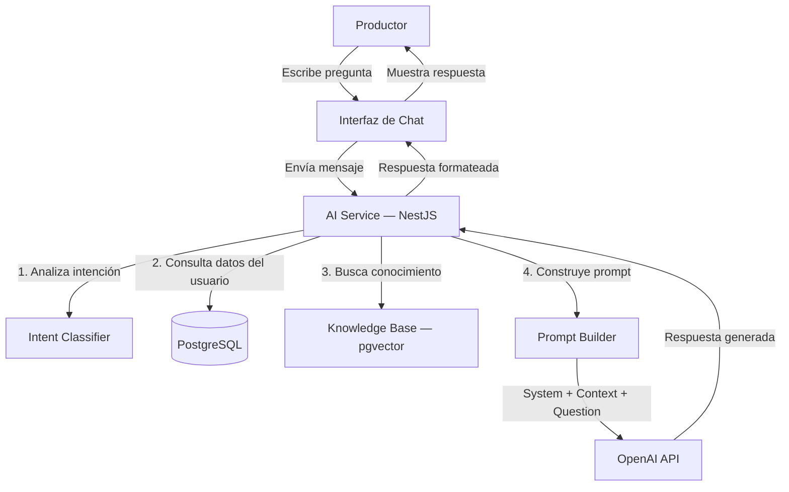

### 6.2 Preguntas que Puede Responder

| Categoría | Ejemplo de Pregunta | Fuente de Datos |
|---|---|---|
| **Producción** | "¿Qué lote produjo más en la última campaña?" | Datos de cosecha del productor |
| **Costos** | "¿Cuánto gasté este año en fertilización?" | Registros de costos del productor |
| **Tareas** | "¿Qué tareas tengo pendientes para esta semana?" | Actividades programadas |
| **Recomendación** | "¿Qué fertilización me recomiendas para el lote 3?" | Análisis de suelo + historial + conocimiento agronómico |
| **Variedades** | "¿Qué variedad me conviene sembrar en mi zona?" | Conocimiento varietal + condiciones del productor |
| **Clima** | "¿Va a llover esta semana? ¿Afecta mi cosecha?" | OpenWeatherMap + conocimiento fenológico |
| **General** | "¿Cuándo es el momento ideal de cosecha para caña de 12 meses?" | Base de conocimiento agronómica |

### 6.3 Comunicación con la Base de Datos

El asistente IA **nunca ejecuta queries directas** a la base de datos. La comunicación se realiza a través de un proceso seguro de múltiples pasos:

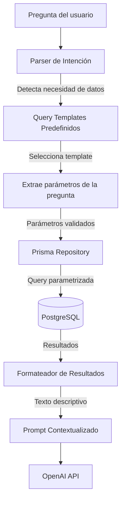

**Mecanismo:**
1. El parser de intención detecta qué datos necesita el usuario.
2. Se selecciona un **template de query predefinido** (nunca se genera SQL dinámico).
3. Los parámetros se extraen de la pregunta y se validan.
4. Prisma ejecuta la query con parámetros seguros.
5. Los resultados se transforman en texto descriptivo para incluir en el prompt.

### 6.4 Protección de la Información

| Capa de Protección | Mecanismo |
|---|---|
| **Autenticación** | Solo usuarios autenticados (JWT válido) pueden interactuar con la IA |
| **Aislamiento de datos** | El asistente solo accede a los datos del productor autenticado (Row-Level Security en queries) |
| **Sin ejecución SQL directa** | Templates de query predefinidos; sin SQL dinámico ni inyección posible |
| **Validación de permisos** | Cada query verifica que el usuario tenga permiso sobre los datos consultados |
| **Rate limiting** | Límite de requests por usuario para evitar abuso de la API de OpenAI |
| **Sin almacenamiento de conversaciones** | Las conversaciones se procesan en tiempo real; no se almacenan permanentemente (MVP) |
| **Redacción de datos sensibles** | Datos como CUIT, información bancaria se excluyen del contexto enviado a OpenAI |
| **Auditoría** | Se registra qué preguntas se realizan (sin contenido) para monitoreo de uso |

### 6.5 Interpretación del Contexto del Productor

El asistente construye un **perfil contextual** que se incluye en cada interacción:

```json
{
  "productor": {
    "nombre": "Juan Péssa",
    "superficie_total_ha": 850,
    "parcelas_activas": 12,
    "ubicacion": "Tucumán, Argentina",
    "zona_agroecologica": "Subtropical húmedo"
  },
  "campana_actual": {
    "anio": 2026,
    "mes_actual": 7,
    "fase_cultivo": "Cosecha zafra 2025/2026"
  },
  "datos_recientes": {
    "ultima_actividad": "Fertilización — Lote 5 — Hace 15 días",
    "proxima_actividad": "Cosecha programada — Lote 3 — 30/07/2026",
    "alertas_activas": 2
  }
}
```

Este contexto permite al asistente:
- Responder preguntas con datos reales del productor.
- Recomendar acciones considerando la fase del cultivo y la ubicación geográfica.
- Priorizar información relevante para el momento de la campaña.
- Adaptar el nivel técnico de la respuesta al perfil del usuario.

---

## 7. Arquitectura de APIs

### 7.1 Estilo API

SmartCaña expone una **API REST** siguiendo las convenciones de diseño web estándar:

| Aspecto | Convención |
|---|---|
| **Protocolo** | HTTPS (HTTP en desarrollo) |
| **Formato** | JSON (application/json) |
| **Versionado** | URI-based: `/api/v1/...` |
| **Autenticación** | Bearer Token (JWT) en header `Authorization` |
| **Documentación** | Swagger (OpenAPI 3.0) accesible en `/api/docs` |

### 7.2 Estructura de Endpoints

```
https://api.smartcana.com.ar/api/v1/
├── /auth
│   ├── POST   /auth/register          # Registro de usuario
│   ├── POST   /auth/login             # Inicio de sesión
│   ├── POST   /auth/refresh           # Renovar access token
│   ├── POST   /auth/logout            # Cerrar sesión
│   └── POST   /auth/forgot-password   # Recuperar contraseña
├── /users
│   ├── GET    /users/me               # Obtener perfil actual
│   ├── PATCH  /users/me               # Actualizar perfil
│   └── PATCH  /users/me/password      # Cambiar contraseña
├── /fields
│   ├── GET    /fields                 # Listar parcelas (paginado, filtrable)
│   ├── POST   /fields                 # Crear parcela
│   ├── GET    /fields/:id             # Detalle de parcela
│   ├── PATCH  /fields/:id             # Actualizar parcela
│   ├── DELETE /fields/:id             # Eliminar parcela (soft delete)
│   ├── GET    /fields/:id/geometry    # Obtener geometría GeoJSON
│   ├── PATCH  /fields/:id/geometry    # Actualizar geometría
│   └── GET    /fields/geojson         # Exportar todas las parcelas como GeoJSON
├── /activities
│   ├── GET    /activities                         # Listar actividades
│   ├── POST   /activities                         # Crear actividad
│   ├── GET    /activities/:id                     # Detalle
│   ├── PATCH  /activities/:id                     # Actualizar
│   ├── DELETE /activities/:id                     # Eliminar
│   └── GET    /fields/:fieldId/activities         # Actividades de una parcela
├── /costs
│   ├── GET    /costs                  # Listar costos
│   ├── POST   /costs                  # Registrar costo
│   ├── GET    /costs/summary          # Resumen de costos
│   ├── GET    /costs/:id              # Detalle
│   ├── PATCH  /costs/:id              # Actualizar
│   └── DELETE /costs/:id              # Eliminar
├── /harvests
│   ├── GET    /harvests               # Listar cosechas
│   ├── POST   /harvests               # Registrar cosecha
│   ├── GET    /harvests/:id           # Detalle
│   ├── PATCH  /harvests/:id           # Actualizar
│   └── GET    /harvests/stats         # Estadísticas de cosecha
├── /varieties
│   ├── GET    /varieties              # Listar variedades (catálogo)
│   ├── GET    /varieties/:id          # Detalle de variedad
│   └── GET    /varieties/compare      # Comparar variedades
├── /reports
│   ├── GET    /reports/campaign       # Reporte de campaña
│   ├── GET    /reports/production     # Reporte de producción
│   ├── GET    /reports/costs          # Reporte de costos
│   └── GET    /reports/export         # Exportar datos (CSV)
├── /ai
│   ├── POST   /ai/chat                # Enviar mensaje al asistente
│   ├── GET    /ai/history             # Historial de conversación
│   └── POST   /ai/suggestions         # Obtener sugerencias proactivas
└── /weather
    ├── GET    /weather/current        # Clima actual por coordenadas
    ├── GET    /weather/forecast       # Pronóstico 5 días
    └── GET    /weather/history        # Histórico por zona
```

### 7.3 Versionado

**Estrategia: URI-based versioning** (`/api/v1/...`)

| Decisión | Justificación |
|---|---|
| **URI path** (`/v1/`) | Más explícito y visible. El cliente sabe exactamente qué versión consume. |
| **Sin versionado por header** | Más complejo de implementar y documentar. No aporta valor en el contexto actual. |
| **Sin versionado por query param** | Difícil de documentar en Swagger y de manejar en rutas. |

**Reglas de versionado:**
- La versión se incrementa solo con cambios **breaking** (estructura de respuesta, eliminación de campos).
- Los cambios compatibles (nuevos campos, nuevos endpoints) se agregan sin incrementar la versión.
- Las versiones anteriores se mantienen por un mínimo de **6 meses** tras el release de una nueva.
- La versión `v1` es la inicial del MVP.

### 7.4 Buenas Prácticas

| Práctica | Implementación |
|---|---|
| **Nombres en plural** | `/fields`, no `/field` |
| **Recursos anidados cuando aplica** | `/fields/:id/activities` (actividades de una parcela) |
| **Filtros vía query params** | `?status=active&sort=-created_at&page=2&limit=20` |
| **Paginación consistente** | Cursor-based o offset-based, con meta de paginación |
| **No exponer IDs internos** | UUIDs en lugar de auto-incrementales |
| **HATEOAS básico** | Links de navegación en respuestas de colecciones |

### 7.5 Formato de Respuesta Estándar

**Respuesta exitosa (recurso único):**

```json
{
  "data": {
    "id": "uuid-1234",
    "name": "Lote El Sauce",
    "areaHectares": 45.2,
    "createdAt": "2026-07-27T10:30:00.000Z"
  }
}
```

**Respuesta exitosa (colección paginada):**

```json
{
  "data": [
    { "id": "uuid-1", "name": "Lote 1" },
    { "id": "uuid-2", "name": "Lote 2" }
  ],
  "meta": {
    "total": 45,
    "page": 1,
    "limit": 20,
    "totalPages": 3,
    "hasNext": true,
    "hasPrev": false
  }
}
```

**Respuesta de error:**

```json
{
  "statusCode": 400,
  "message": ["El nombre es requerido", "La superficie debe ser mayor a 0"],
  "error": "Bad Request",
  "timestamp": "2026-07-27T10:30:00.000Z",
  "path": "/api/v1/fields"
}
```

### 7.6 Manejo de Errores HTTP

| Código | Significado | Uso en SmartCaña |
|---|---|---|
| `200` | OK | Lectura exitosa, actualización exitosa |
| `201` | Created | Creación de recurso exitosa |
| `204` | No Content | Eliminación exitosa (sin body) |
| `400` | Bad Request | Datos de entrada inválidos, validación fallida |
| `401` | Unauthorized | Token ausente, expirado o inválido |
| `403` | Forbidden | Token válido pero sin permisos para la operación |
| `404` | Not Found | Recurso no encontrado |
| `409` | Conflict | Duplicado (email ya registrado, nombre de parcela duplicado) |
| `422` | Unprocessable Entity | Datos válidos pero lógicamente incorrectos |
| `429` | Too Many Requests | Rate limit excedido |
| `500` | Internal Server Error | Error inesperado del servidor |

---

## 8. Arquitectura de Seguridad

### 8.1 Autenticación — JWT + Refresh Tokens

El sistema de autenticación implementa un flujo de **doble token**:

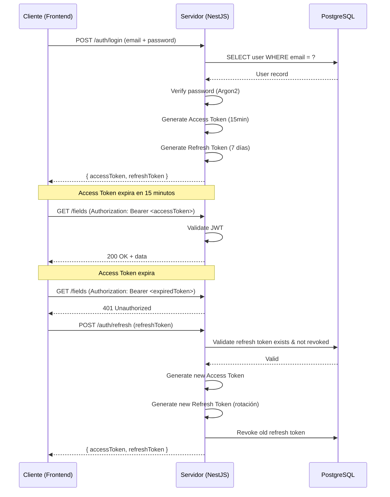

| Token | Duración | Almacenamiento | Propósito |
|---|---|---|---|
| **Access Token** | 15 minutos | Memory (variable de estado) | Acceder a endpoints protegidos |
| **Refresh Token** | 7 días | HttpOnly cookie + DB | Renovar el access token sin re-login |

**Justificación de la duración:**
- Access token de corta duración minimiza el riesgo de robo de token.
- Refresh token de larga duración mejora la experiencia del usuario.
- Rotación de refresh token en cada uso previene reutilización de tokens comprometidos.

### 8.2 Roles y Permisos

El sistema implementa un modelo **RBAC** (Role-Based Access Control):

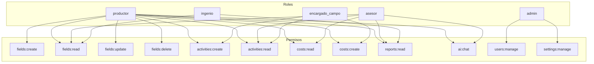

| Rol | Descripción | Acciones Permitidas |
|---|---|---|
| **admin** | Administrador de la plataforma | Gestión completa de usuarios, configuración del sistema |
| **productor** | Productor cañero (rol principal) | CRUD completo de parcelas, actividades, costos, cosechas, reportes, IA |
| **asesor** | Asesor agronómico | Lectura de parcelas/actividades asignadas, reportes, IA |
| **ingenio** | Representante del ingenio | Lectura de datos de productores asociados, reportes de cosecha |
| **encargado_campo** | Encargado de campo | Registro de actividades, costos. Sin acceso a reportes ni configuración |

### 8.3 Hash de Contraseñas

| Aspecto | Implementación |
|---|---|
| **Algoritmo** | Argon2id (ganador del Password Hashing Competition) |
| **Configuración** | memoryCost: 65536, timeCost: 3, parallelism: 4 |
| **Salt** | Generado automáticamente por Argon2 (no se almacena por separado) |
| **Verificación** | `argon2.verify(hash, plainPassword)` |
| **Nunca** | Se almacena la contraseña en texto plano o con hashing débil (MD5, SHA-1) |

### 8.4 Protección CSRF

| Mecanismo | Implementación |
|---|---|
| **SameSite cookies** | `Strict` para refresh tokens en cookie HttpOnly |
| **Origin/Referer check** | Validación del header `Origin` en el backend |
| **CSRF Token** | No se requiere explícitamente ya que la API usa Bearer tokens (stateless) |
| **Doble submit cookie** | Patrón alternativo si se necesita cookie-based auth |

### 8.5 CORS (Cross-Origin Resource Sharing)

| Configuración | Valor |
|---|---|
| **Orígenes permitidos** | `https://smartcana.com.ar`, `https://app.smartcana.com.ar`, `http://localhost:3000` (dev) |
| **Métodos permitidos** | `GET, POST, PATCH, DELETE, OPTIONS` |
| **Headers permitidos** | `Authorization, Content-Type, Accept` |
| **Credenciales** | `true` (para cookies HttpOnly del refresh token) |
| **Max-Age** | `86400` (24 horas, cache preflight) |

### 8.6 Rate Limiting

| Endpoint | Límite | Ventana |
|---|---|---|
| **Login** | 5 intentos | 15 minutos |
| **Registro** | 3 intentos | 1 hora |
| **Refresh Token** | 20 requests | 15 minutos |
| **API general** | 100 requests | 1 minuto |
| **Chat IA** | 30 mensajes | 1 minuto |
| **Exportación** | 5 requests | 1 hora |

**Implementación:** Almacenamiento en Redis con TTL automático.

### 8.7 Validaciones de Seguridad

| Capa | Mecanismo | Protección |
|---|---|---|
| **Entrada** | class-validator (DTOs) | Inyección, XSS, campos inesperados |
| **SQL** | Prisma ORM (parametrización automática) | SQL Injection |
| **XSS** | React (escape automático) + Helmet headers | Cross-Site Scripting |
| **Authentication** | JWT firmado con RS256 | Token forgery |
| **Authorization** | Guards + Row-Level Security | Acceso no autorizado |
| **Rate limiting** | Redis-based throttle | Brute force, DDoS |

### 8.8 Logging y Auditoría

| Evento | Nivel | Datos Registrados |
|---|---|---|
| **Login exitoso** | INFO | user_id, IP, user_agent, timestamp |
| **Login fallido** | WARN | email intentado, IP, reason |
| **Acceso denegado** | WARN | user_id, endpoint, rol, permiso requerido |
| **Error interno** | ERROR | stack_trace, endpoint, request_id |
| **Acción CRUD** | INFO | user_id, acción, recurso, ID del recurso |
| **Uso de IA** | INFO | user_id, tipo de consulta (sin contenido del mensaje) |
| **Exportación de datos** | INFO | user_id, tipo de reporte, formato |

**Herramientas:**
- NestJS Logger integrado para logging estructurado.
- Logs en formato JSON para ingesta en sistemas de monitoreo (futuro: ELK, Datadog).
- Request ID único por petición para correlación de logs.

---

## 9. Arquitectura de Escalabilidad

### 9.1 Estrategia de Escalado

SmartCaña está diseñado para escalar de forma **progresiva**, comenzando con un monolito simple y creciendo según la demanda:

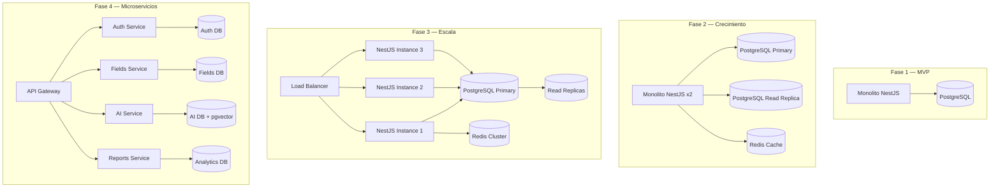

### 9.2 Caché

| Capa | Herramienta | Qué se cachea | TTL |
|---|---|---|---|
| **Frontend** | TanStack Query | Datos de API en el cliente | 30s–5min según endpoint |
| **CDN** | Cloudflare | Assets estáticos (JS, CSS, imágenes) | 1 año (con hash) |
| **Backend** | Redis | Respuestas de catálogos (variedades, tipos de actividad) | 1 hora |
| **Backend** | Redis | Sesiones de rate limiting | Variable (sliding window) |
| **Database** | PgBouncer | Conexiones a PostgreSQL | Pool-based |

### 9.3 Colas (Futuro)

| Cola | Propósito | Implementación |
|---|---|---|
| **Reportes** | Generación de reportes PDF pesados | Bull (Redis-backed) |
| **Emails** | Envío de notificaciones por email | Bull + nodemailer |
| **Procesamiento IA** | Queries pesadas al asistente IA | Bull (rate limit con OpenAI) |
| **Exportación** | Exportaciones CSV/Excel grandes | Bull + streaming |
| **Sincronización** | Sincronización con servicios externos | Bull + retry logic |

### 9.4 CDN (Content Delivery Network)

| Recurso | Estrategia CDN |
|---|---|
| **Assets estáticos** | Cloudflare CDN con cache agresivo (1 año, hash en filename) |
| **Imágenes de usuarios** | Cloudflare R2 (S3-compatible) + CDN edge |
| **Tiles de mapa** | Proveedor de tiles (OSM, con rate limit propio) |
| **API responses** | No cache en CDN; caché en Redis del servidor |

### 9.5 Balanceadores de Carga

En la fase de escala, se utiliza un balanceador de carga:

| Opción | Cuándo |
|---|---|
| **Nginx** | Control total, despliegue en VPS/dedicado |
| **Cloudflare Load Balancer** | Despliegue en la nube, zero-config |
| **Railway / Render** | Despliegue en PaaS con escalado automático |

**Algoritmo de balanceo:** Round Robin con health checks cada 30 segundos.

### 9.6 Contenedores (Futuro)

Docker se utilizará para:

| Componente | Imagen Docker |
|---|---|
| **Frontend** | `node:20-alpine` + build estático → nginx |
| **Backend** | `node:20-alpine` + NestJS production build |
| **PostgreSQL** | `postgres:16-alpine` con extensión PostGIS |
| **Redis** | `redis:7-alpine` |

**Docker Compose** para desarrollo local con todos los servicios.

---

## 10. Arquitectura Cloud

### 10.1 Despliegue del MVP

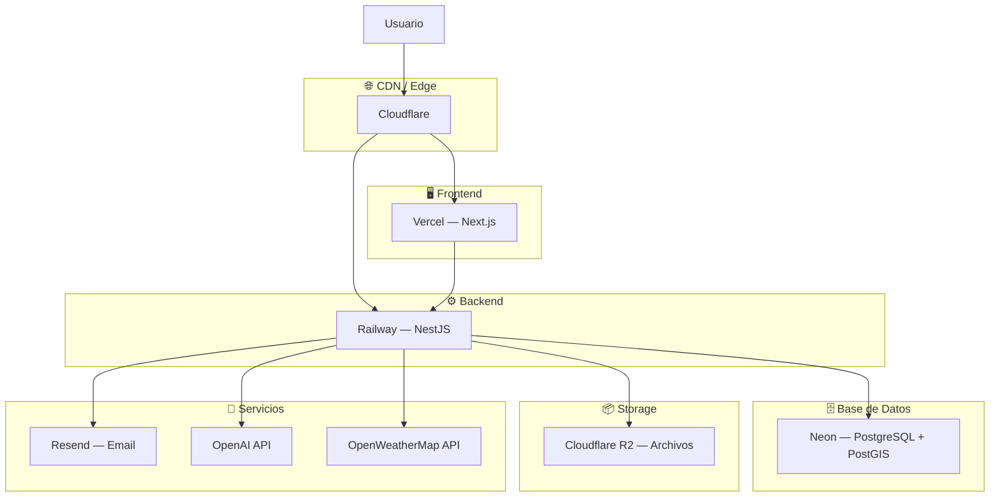

### 10.2 Justificación de Proveedores MVP

| Componente | Proveedor | Justificación |
|---|---|---|
| **Frontend** | Vercel | Deploy automático de Next.js, edge functions, analytics, dominios personalizados. Plan gratuito generoso para MVP |
| **Backend** | Railway | Deploy fácil de NestJS, variables de entorno, health checks, escalo automático. Costo bajo para MVP |
| **Base de datos** | Neon | PostgreSQL serverless con PostGIS, branching para dev, escala a cero, plan gratuito para empezar |
| **CDN** | Cloudflare | CDN global, protección DDoS, DNS gestionado, SSL gratuito |
| **Storage** | Cloudflare R2 | Almacenamiento de archivos (fotos de campo, exports) sin egress fees |
| **Email** | Resend | Transaccional de emails (verificación, notificaciones). API simple, plan gratuito |

### 10.3 Backups

| Componente | Estrategia de Backup | Frecuencia | Retención |
|---|---|---|---|
| **PostgreSQL** | Automático por Neon (point-in-time recovery) | Continuo | 7 días (plan free), 30 días (plan pro) |
| **PostgreSQL (adicional)** | pg_dump a S3/R2 | Diario | 30 días |
| **Código fuente** | GitHub (Git history) | Cada commit | Indefinido |
| **Variables de entorno** | Documentadas en vault (no en código) | Manual | Indefinido |
| **Archivos de usuario** | R2 con versionado habilitado | Automático | 90 días |

### 10.4 CI/CD

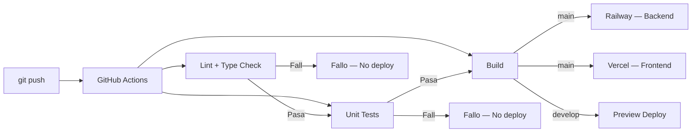

**Pipeline de CI/CD:**

| Fase | Herramienta | Acciones |
|---|---|---|
| **Lint** | ESLint + Prettier | Verificar estilo de código |
| **Type Check** | TypeScript compiler | Verificar tipos |
| **Tests** | Jest + Vitest | Unit tests, integration tests |
| **Build** | Next.js + NestJS build | Compilar para producción |
| **Deploy** | Vercel / Railway | Desplegar automáticamente |

### 10.5 Ambientes

| Ambiente | Propósito | URL |
|---|---|---|
| **Desarrollo** | Desarrollo local (Docker Compose) | `localhost:3000` (FE) / `localhost:4000` (API) |
| **Preview** | PR previews automáticos en Vercel | `pr-123.smartcana.vercel.app` |
| **Staging** | Pruebas finales antes de producción | `staging.smartcana.com.ar` |
| **Producción** | Usuarios reales | `app.smartcana.com.ar` |

---

## 11. Convenciones del Proyecto

### 11.1 Estructura de Carpetas

```
smartcana/
├── apps/
│   ├── web/                    # Frontend — Next.js
│   │   ├── src/
│   │   │   ├── app/
│   │   │   ├── components/
│   │   │   ├── features/
│   │   │   ├── hooks/
│   │   │   ├── lib/
│   │   │   ├── types/
│   │   │   └── styles/
│   │   ├── public/
│   │   ├── next.config.ts
│   │   ├── tailwind.config.ts
│   │   ├── tsconfig.json
│   │   └── package.json
│   │
│   └── api/                    # Backend — NestJS
│       ├── src/
│       │   ├── modules/
│       │   │   ├── auth/
│       │   │   ├── users/
│       │   │   ├── fields/
│       │   │   ├── activities/
│       │   │   ├── costs/
│       │   │   ├── harvests/
│       │   │   ├── varieties/
│       │   │   ├── ai/
│       │   │   ├── reports/
│       │   │   ├── weather/
│       │   │   ├── notifications/
│       │   │   └── common/
│       │   ├── config/
│       │   ├── guards/
│       │   ├── interceptors/
│       │   ├── filters/
│       │   ├── middlewares/
│       │   └── main.ts
│       ├── prisma/
│       │   ├── schema.prisma
│       │   └── migrations/
│       ├── test/
│       ├── tsconfig.json
│       └── package.json
│
├── docs/                       # Documentación
│   ├── 01-vision-del-producto.md
│   └── 02-arquitectura-del-sistema.md
│
├── .github/
│   └── workflows/
│       ├── ci.yml
│       └── cd.yml
│
├── docker-compose.yml
├── .env.example
├── .gitignore
├── .eslintrc.js
├── .prettierrc
└── README.md
```

### 11.2 Nomenclatura — Convenciones de Nombres

| Elemento | Convención | Ejemplo |
|---|---|---|
| **Archivos (componentes)** | PascalCase | `FieldCard.tsx`, `ActivityForm.tsx` |
| **Archivos (helpers, utils)** | kebab-case | `date-utils.ts`, `format-currency.ts` |
| **Archivos (test)** | Mismo nombre + `.spec.ts` | `field-card.spec.ts` |
| **Clases** | PascalCase | `FieldService`, `ActivityRepository` |
| **Interfaces** | PascalCase (sin prefijo `I`) | `FieldRepository`, `CreateFieldPayload` |
| **Funciones** | camelCase | `calculateArea()`, `formatCurrency()` |
| **Variables** | camelCase | `totalCost`, `fieldGeometry` |
| **Constantes** | UPPER_SNAKE_CASE | `MAX_FILE_SIZE`, `DEFAULT_ZOOM` |
| **Componentes React** | PascalCase | `<FieldCard />`, `<ActivityForm />` |
| **Hooks** | camelCase (prefijo `use`) | `useFields()`, `useAuth()` |
| **Endpoints** | kebab-case en URL, camelCase en código | `/api/v1/fields/:fieldId/activities` |
| **Base de datos** | snake_case | `fields`, `activity_types`, `created_at` |
| **DTOs** | Sufijo descriptivo | `CreateFieldDto`, `UpdateActivityDto`, `QueryFieldDto` |

### 11.3 Componentes — Convenciones

| Regla | Ejemplo |
|---|---|
| Un componente por archivo | `FieldCard.tsx` exporta solo `FieldCard` |
| Nombre del archivo = nombre del componente | `ActivityForm.tsx` → `export function ActivityForm()` |
| Componentes funcionales (sin classes) | `function FieldCard() { ... }` |
| Props tipadas como interfaz separada | `interface FieldCardProps { field: Field; onClick: () => void; }` |
| Exports nombrados (no default exports) | `export function FieldCard() {}` |
| Maximum 150 líneas por componente | Si supera, extraer sub-componentes o hooks |

### 11.4 Hooks — Convenciones

| Convención | Ejemplo |
|---|---|
| Prefijo `use` | `useFields()`, `useCreateActivity()` |
| Un hook por archivo | `use-fields.ts` exporta `useFields()` |
| Ubicación en `features/<module>/hooks/` | `features/fields/hooks/use-fields.ts` |
| Hooks compartidos en `src/hooks/` | `src/hooks/use-debounce.ts` |
| Retornar objeto con propiedades desestructurables | `const { data, isLoading, error } = useFields()` |

### 11.5 Tipos e Interfaces — Convenciones

| Elemento | Convención | Ubicación |
|---|---|---|
| **Tipos de dominio** | PascalCase, nombre del dominio | `features/fields/types/field.types.ts` |
| **Tipos de API** | Sufijo `Dto` para entrada, `Response` para salida | `CreateFieldDto`, `FieldResponse` |
| **Tipos compartidos** | Barrel export desde `types/index.ts` | `src/types/index.ts` |
| **Enums** | PascalCase, UPPER_SNAKE_CASE values | `enum FieldStatus { ACTIVE = 'ACTIVE' }` |
| **Utility types** | Prefijo o sufijo descriptivo | `PaginatedResponse<T>`, `ApiResponse<T>` |

### 11.6 DTOs — Convenciones

| Regla | Ejemplo |
|---|---|
| Un DTO por operación | `CreateFieldDto` ≠ `UpdateFieldDto` |
| Decoradores `class-validator` en cada propiedad | `@IsString() @IsNotEmpty() name: string` |
| Transformación con `class-transformer` | `@Type(() => Number) area: number` |
| DTOs de query para filtros | `QueryFieldDto` con `@IsOptional()`, `@Type(() => Number)` |
| No lógica de negocio en DTOs | Solo validación de formato y tipos |

### 11.7 Servicios — Convenciones

| Regla | Ejemplo |
|---|---|
| Un servicio por módulo | `FieldsService` maneja toda la lógica de fields |
| Injectable con `@Injectable()` | NestJS DI container |
| Inyectar repositorio, no Prisma directamente | `constructor(private readonly fieldsRepo: FieldsRepository)` |
| Retornar entidades o DTOs de respuesta | No retornar objetos Prisma raw |
| Un método por operación de negocio | `create()`, `findAll()`, `update()`, `remove()` |

### 11.8 Constantes — Convenciones

```typescript
// features/fields/constants/field.constants.ts
export const FIELD_CONSTANTS = {
  MAX_NAME_LENGTH: 100,
  MIN_AREA_HECTARES: 0.1,
  MAX_AREA_HECTARES: 50000,
  DEFAULT_ZOOM: 15,
  MAX_POLYGON_POINTS: 500,
} as const;

// features/fields/constants/field.enums.ts
export const FIELD_STATUS = {
  ACTIVE: 'ACTIVE',
  FALLOW: 'FALLOW',
  PREPARING: 'PREPARING',
} as const;

export type FieldStatus = typeof FIELD_STATUS[keyof typeof FIELD_STATUS];
```

### 11.9 Helpers — Convenciones

| Regla | Ejemplo |
|---|---|
| Funciones puras (sin side effects) | `calculateArea(polygon: GeoJSON): number` |
| Nombrados con verbo o sustantivo | `formatCurrency()`, `calculateArea()`, `parseGeoJSON()` |
| Ubicados en `lib/` o `features/<module>/utils/` | `lib/geo.ts`, `features/costs/utils/format-cost.ts` |
| Tests unitarios para cada helper | `format-currency.spec.ts` |

---

## 12. Patrones de Diseño

### 12.1 Patrones Seleccionados

| Patrón | Implementación | Justificación |
|---|---|---|
| **Repository** | Capa de acceso a datos en cada módulo | Desacopla la lógica de negocio del motor de persistencia. Permite cambiar Prisma por otro ORM o base de datos sin modificar el servicio |
| **Dependency Injection** | NestJS IoC container | Facilita testing (inyección de mocks), desacoplamiento, y reutilización de componentes. Es el patrón fundamental de NestJS |
| **Facade** | Servicios de NestJS como fachada | Cada servicio expone una API simplificada al controlador, ocultando la complejidad de múltiples repositorios o servicios externos |
| **Strategy** | Estrategias de renderizado, cálculo de costos | Permite intercambiar algoritmos (ej: diferentes fórmulas de cálculo de rendimiento) sin modificar el código que los usa |
| **Observer** | Sistema de notificaciones events | Cuando ocurre un evento (nueva cosecha, alerta climática), se notifican a los suscriptores interesados de forma desacoplada |

### 12.2 Patrones NO Aplicados

| Patrón | Razón de Exclusión |
|---|---|
| **Singleton** | NestJS ya gestiona el ciclo de vida de los providers. Implementar Singleton manualmente es innecesario y dificulta testing |
| **Factory** | No hay creación compleja de objetos que requiera lógica condicional significativa. Los DTOs y entidades se crean directamente |
| **Builder** | No hay objetos con configuración compleja paso a paso. Las queries Prisma ya tienen una API fluida |
| **Decorator** | NestJS lo implementa internamente con sus propios decoradores. No se requiere implementación adicional |
| **Command** | Las operaciones CRUD son directas y no requieren encapsulamiento en objetos de comando. El patrón agregaría complejidad sin beneficio |

### 12.3 Justificación del Repository Pattern

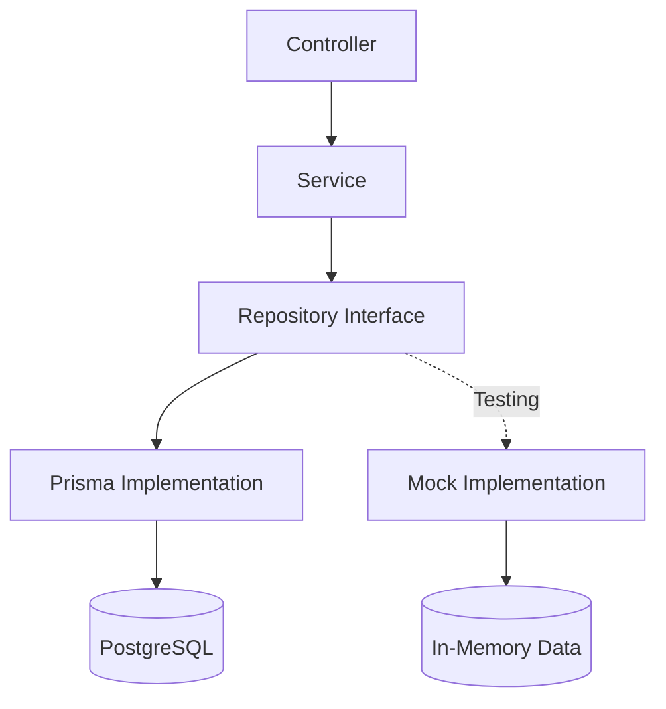

**Beneficios en el contexto de SmartCaña:**
- **Testing**: Se puede testear el servicio sin conexión a base de datos.
- **Intercambiabilidad**: Si se migra a otro ORM, solo cambia la implementación del repositorio.
- **Consistencia**: Todas las queries a la base de datos siguen el mismo patrón.
- **Separación**: El servicio no conoce detalles de implementación de Prisma.

### 12.4 Justificación del Observer Pattern

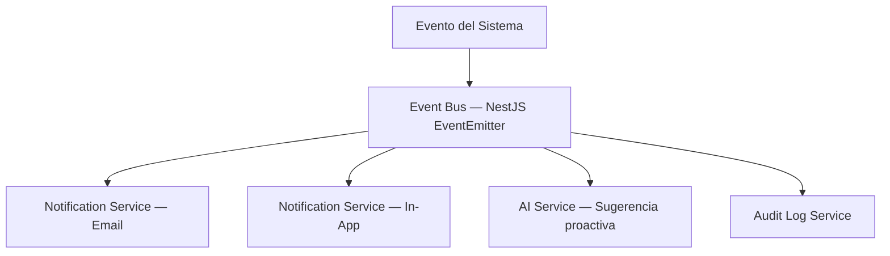

**Eventos del sistema:**
- `field.created` → Notificar al admin, crear sugerencia de IA
- `harvest.registered` → Actualizar estadísticas del dashboard, alertar al ingenio
- `activity.overdue` → Enviar recordatorio al productor
- `cost.threshold.exceeded` → Alerta de exceso de presupuesto

---

## 13. Principios de Desarrollo

### 13.1 SOLID

| Principio | Aplicación en SmartCaña |
|---|---|
| **S — Single Responsibility** | Cada clase, módulo y función tiene una única razón para cambiar. `FieldsService` solo maneja lógica de parcelas; `FieldsRepository` solo accede a datos |
| **O — Open/Closed** | Los módulos se extienden agregando nuevos módulos o providers, no modificando los existentes. Los DTOs permiten validar nuevos campos sin cambiar la lógica del servicio |
| **L — Liskov Substitution** | Las implementaciones de repositorios (Prisma, Mock) son intercambiables sin afectar al servicio que las consume |
| **I — Interface Segregation** | Las interfaces de repositorio definen solo los métodos que el servicio necesita. No se fuerza a implementar métodos no utilizados |
| **D — Dependency Inversion** | Los servicios dependen de abstracciones (interfaces de repositorio), no de implementaciones concretas (Prisma). La DI de NestJS facilita esto |

### 13.2 Clean Code

| Regla | Implementación |
|---|---|
| **Nombres descriptivos** | `calculateAreaHectares()` no `calc()` |
| **Funciones cortas** | Máximo 30 líneas por función |
| **Parámetros limitados** | Máximo 3 parámetros por función; usar objetos para más |
| **Sin magic numbers** | Constantes nombradas en archivos de constantes |
| **Comentarios solo cuando es necesario** | El código debe ser autoexplicativo; comentarios solo para "por qué", no "qué" |
| **Early returns** | Evitar anidamiento excesivo de if/else |
| **DRY** | Extraer lógica repetida a helpers, servicios compartidos o higher-order functions |

### 13.3 Clean Architecture

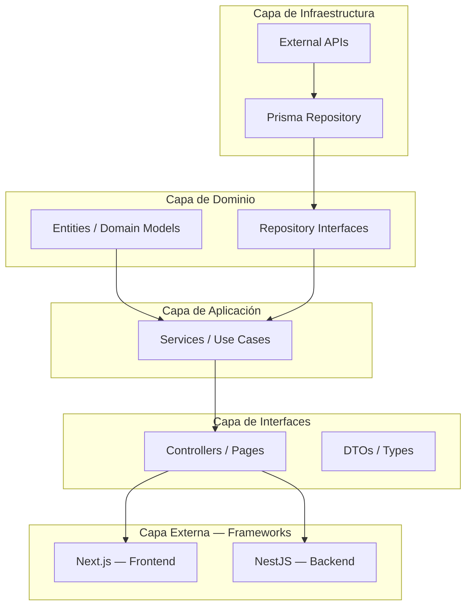

**Regla fundamental:** Las dependencias apuntan hacia adentro. La capa de dominio no conoce nada de la infraestructura.

### 13.4 DRY (Don't Repeat Yourself)

- **Helpers compartidos**: `formatCurrency()`, `formatDate()`, `calculateArea()` se definen una vez y se reutilizan.
- **Componentes base**: `Button`, `Input`, `Card` se usan en todos los formularios.
- **DTOs reutilizables**: `PaginationDto` se usa en todos los endpoints de listado.
- **Constantes centralizadas**: Estados de parcela, tipos de actividad, categorías de costo se definen una vez.

### 13.5 KISS (Keep It Simple, Stupid)

- **Sin abstracciones prematuras**: No se crean capas adicionales hasta que sea necesario.
- **Soluciones directas**: Un endpoint REST para cada operación, sin GraphQL innecesario.
- **Herramientas probadas**: PostgreSQL, NestJS, Next.js — no se experimenta con tecnologías no probadas.
- **Complejidad justificada**: Cada patrón o abstracción debe tener una razón clara de existir.

### 13.6 YAGNI (You Aren't Gonna Need It)

- **No se implementan funcionalidades futuras**: Solo lo que el MVP requiere.
- **No se crea infraestructura para microservicios hoy**: El monolito modular es suficiente.
- **No se implementa GraphQL**: REST es suficiente y más simple.
- **No se agrega caché en Redis hasta que sea necesario**: Para el MVP, las queries optimizadas y la caché de TanStack Query son suficientes. Redis se utilizará únicamente para rate limiting en producción.

### 13.7 Convención estricta de TypeScript

| Regla | Configuración |
|---|---|
| **strict mode** | `"strict": true` en `tsconfig.json` |
| **no any** | `"noImplicitAny": true`, `"@typescript-eslint/no-explicit-any": "error"` |
| **no unused** | `"noUnusedLocals": true`, `"noUnusedParameters": true` |
| **strict null checks** | `"strictNullChecks": true` |
| **no implicit returns** | Todas las funciones retornan explícitamente |
| **Enums as const** | Preferir `as const` objects sobre `enum` tradicional |
| **Tipado explícito** | Variables de función siempre tipadas; inferencia solo en literales obvios |

---

## 14. Estrategia de Versionado

### 14.1 Git Flow

SmartCaña utiliza **Git Flow** adaptado:

```mermaid
graph TB
    DEVELOP["develop"] -->|feature/*| F1["feature/fields-crud"]
    DEVELOP -->|feature/*| F2["feature/activity-form"]
    DEVELOP -->|feature/*| F3["feature/ai-chat"]
    
    F1 -->|PR + Review| DEVELOP
    F2 -->|PR + Review| DEVELOP
    F3 -->|PR + Review| DEVELOP
    
    DEVELOP -->|release/*| R1["release/v1.0.0"]
    R1 -->|Testing| MAIN["main (producción)"]
    R1 -->|merge back| DEVELOP
    
    MAIN -->|hotfix/*| H1["hotfix/fix-login-crash"]
    H1 -->|merge| MAIN
    H1 -->|merge| DEVELOP
```

### 14.2 Branches

| Branch | Propósito | Protegida | Merge |
|---|---|---|---|
| `main` | Producción estable | Sí — sin push directo | Solo desde `release/*` o `hotfix/*` |
| `develop` | Última funcionalidad integrada | Sí — requiere PR + review | Feature branches → develop |
| `feature/*` | Nueva funcionalidad | No | develop ← feature/* |
| `release/*` | Preparación de release | Sí | main ← release/* |
| `hotfix/*` | Fix urgente en producción | No | main ← hotfix/* Y develop ← hotfix/* |

### 14.3 Convenciones de Commits

SmartCaña utiliza **Conventional Commits**:

```
<type>(<scope>): <description>

[optional body]

[optional footer(s)]
```

**Types:**

| Type | Descripción | Emoji |
|---|---|---|
| `feat` | Nueva funcionalidad | ✨ |
| `fix` | Corrección de bug | 🐛 |
| `docs` | Documentación | 📝 |
| `style` | Formato (no afecta lógica) | 💄 |
| `refactor` | Refactorización (sin cambio de funcionalidad) | ♻️ |
| `test` | Tests | ✅ |
| `chore` | Tareas de mantenimiento | 🔧 |
| `perf` | Mejora de rendimiento | ⚡ |
| `ci` | CI/CD | 🏗️ |

**Scopes:**

| Scope | Módulo |
|---|---|
| `auth` | Autenticación |
| `fields` | Gestión de parcelas |
| `activities` | Actividades agronómicas |
| `costs` | Costos |
| `harvest` | Cosecha |
| `varieties` | Variedades |
| `ai` | Asistente IA |
| `reports` | Reportes |
| `weather` | Clima |
| `ui` | Interfaz de usuario |
| `api` | API REST |
| `db` | Base de datos |

**Ejemplos:**
```
feat(fields): add polygon drawing for new parcels
fix(auth): prevent token refresh race condition
docs(api): add Swagger documentation for activities endpoints
refactor(costs): extract cost calculation to shared service
```

### 14.4 Releases

Cada release sigue el **Versionado Semántico (SemVer)**:

```
vMAJOR.MINOR.PATCH
```

| Componente | Cuándo se incrementa | Ejemplo |
|---|---|---|
| **MAJOR** | Cambios breaking en la API, migraciones de DB que rompen compatibilidad | `v2.0.0` — Se reestructura la API de fields |
| **MINOR** | Nuevas funcionalidades compatibles con versiones anteriores | `v1.2.0` — Se agrega módulo de cosecha |
| **PATCH** | Correcciones de bugs, mejoras menores sin cambio de API | `v1.0.1` — Fix en cálculo de área |

**Release notes:** Cada release incluye un `CHANGELOG.md` actualizado con los cambios documentados.

---

## 15. Roadmap Técnico

### 15.1 Visión General

El desarrollo se divide en **12 fases** secuenciales, donde cada fase produce un incremento funcional verificable:

```mermaid
gantt
    title Roadmap Técnico — SmartCaña
    dateFormat YYYY-MM-DD
    axisFormat %b %Y
    
    section Preparación
    Fase 1 — Configuración           :f1, 2026-08-01, 14d
    
    section Core
    Fase 2 — Autenticación           :f2, after f1, 14d
    Fase 3 — Base de Datos           :f3, after f2, 21d
    
    section Funcionalidades
    Fase 4 — Dashboard               :f4, after f3, 14d
    Fase 5 — Campos                  :f5, after f4, 21d
    Fase 6 — Mapa                    :f6, after f5, 21d
    
    section Negocio
    Fase 7 — Costos                  :f7, after f6, 14d
    Fase 8 — Producción y Cosecha    :f8, after f7, 21d
    Fase 9 — Reportes                :f9, after f8, 14d
    
    section Inteligencia
    Fase 10 — IA                     :f10, after f9, 21d
    
    section Optimización
    Fase 11 — Optimización           :f11, after f10, 14d
    Fase 12 — Deploy                 :f12, after f11, 14d
```

### 15.2 Detalle por Fase

#### Fase 1 — Configuración del Proyecto
**Duración estimada:** 2 semanas

| Tarea | Descripción |
|---|---|
| Inicializar monorepo | Estructura de carpetas, package.json raíz |
| Configurar Next.js | App Router, Tailwind, shadcn/ui, TypeScript estricto |
| Configurar NestJS | Módulos base, Swagger, validación global, CORS, Helmet |
| Configurar Prisma | Schema inicial, conexión a PostgreSQL, migración base |
| Configurar Docker | docker-compose.yml con PostgreSQL + PostGIS + Redis |
| Configurar ESLint + Prettier | Reglas de linting y formato unificadas |
| Configurar Git | .gitignore, README, estructura de branches |
| Configurar CI/CD | GitHub Actions básico (lint, test, build) |

#### Fase 2 — Autenticación
**Duración estimada:** 2 semanas

| Tarea | Descripción |
|---|---|
| Modelo de usuarios | Prisma schema para users, roles, refresh_tokens |
| Registro de usuario | Endpoint + formulario con validación |
| Login | JWT access token + refresh token |
| Middleware de auth | JwtAuthGuard, RolesGuard |
| Gestión de perfil | Ver/editar perfil, cambiar contraseña |
| Protección de rutas | Aplicar guards en endpoints existentes |

#### Fase 3 — Base de Datos y Modelado
**Duración estimada:** 3 semanas

| Tarea | Descripción |
|---|---|
| Schema completo | Todas las entidades: fields, activities, costs, harvests, varieties |
| PostGIS setup | Extensión PostGIS, tipo geometry en fields |
| Relaciones | FK, relaciones N:M donde aplique |
| Índices | GiST para geometry, B-tree para campos frecuentes |
| Seed data | Datos iniciales (variedades, tipos de actividad, categorías de costo) |
| Migraciones | Prisma Migrate con versionado |

#### Fase 4 — Dashboard
**Duración estimada:** 2 semanas

| Tarea | Descripción |
|---|---|
| Layout del dashboard | Sidebar, header, área de contenido |
| Dashboard principal | KPIs: total parcelas, actividad reciente, alertas |
| Gráficos resumen | Recharts: evolución de rendimiento, distribución de costos |
| Navegación | Routing completo entre módulos |
| Responsive | Adaptación mobile/tablet del layout |

#### Fase 5 — Gestión de Campos (CRUD)
**Duración estimada:** 3 semanas

| Tarea | Descripción |
|---|---|
| CRUD completo | Crear, leer, actualizar, eliminar parcelas |
| Formulario de parcela | Campos: nombre, variedad, fecha siembra, rango, etc. |
| Lista de parcelas | Tabla paginada con filtros y búsqueda |
| Detalle de parcela | Vista completa con toda la información |
| Asociación variedad | Vincular variedad del catálogo a cada parcela |

#### Fase 6 — Mapa e Integración GIS
**Duración estimada:** 3 semanas

| Tarea | Descripción |
|---|---|
| Mapa base | Leaflet con OpenStreetMap tiles |
| Visualización de parcelas | Renderizar polígonos de todas las parcelas |
| Dibujo de polígonos | Herramienta de dibujo para crear/editar parcelas en el mapa |
| Click en parcela | Identificar parcela al hacer click |
| Capas temáticas | Colores por rendimiento, actividad, cosecha |
| Importación GeoJSON | Carga de parcelas desde archivos GeoJSON |
| Exportación GeoJSON | Descarga de parcelas en formato GeoJSON |
| Zoom inteligente | Auto-zoom a bounds de parcelas, zoom al seleccionar |
| Geolocalización | Centrar mapa en posición del usuario |

#### Fase 7 — Costos
**Duración estimada:** 2 semanas

| Tarea | Descripción |
|---|---|
| CRUD de costos | Registrar gastos por parcela, categoría, fecha |
| Categorías | Insumos, mano de obra, maquinaria, transporte, servicios |
| Resumen de costos | Cálculo de costo por hectárea, por parcela, total |
| Gráficos | Distribución de costos (pie chart), evolución temporal |
| Asociación a actividades | Vincular costos con actividades de campo |

#### Fase 8 — Producción y Cosecha
**Duración estimada:** 3 semanas

| Tarea | Descripción |
|---|---|
| CRUD de actividades | Registrar siembra, fertilización, control, riego, cosecha |
| Historial por parcela | Timeline cronológico de actividades |
| Registro de cosecha | Toneladas, fecha, método, variedad |
| Calendario de cosecha | Vista de calendario con cosechas programadas |
| Estadísticas de producción | Rendimiento por parcela, por campaña, por variedad |
| Actividades programadas | Crear y gestionar tareas pendientes |

#### Fase 9 — Reportes
**Duración estimada:** 2 semanas

| Tarea | Descripción |
|---|---|
| Dashboard de reportes | Selector de tipo de reporte y período |
| Reporte de campaña | Resumen general de la campaña actual |
| Reporte de producción | Rendimiento por parcela, gráficos comparativos |
| Reporte de costos | Desglose de costos, comparativas |
| Exportación CSV | Descarga de datos en formato CSV |
| Exportación PDF | Generación de reportes formateados para impresión |

#### Fase 10 — Asistente IA
**Duración estimada:** 3 semanas

| Tarea | Descripción |
|---|---|
| Interfaz de chat | Panel de chat integrado en la plataforma |
| Integración OpenAI | Conexión con GPT-4o vía API |
| Base de conocimiento | Carga de conocimiento agronómico sobre caña |
| RAG | Búsqueda semántica en base de conocimiento (pgvector) |
| Contexto del productor | Inyectar datos del usuario en el prompt |
| Query templates | Templates predefinidos para consultas de datos |
| Rate limiting | Límite de mensajes por usuario |
| Sugerencias proactivas | Recomendaciones basadas en calendario y datos |

#### Fase 11 — Optimización
**Duración estimada:** 2 semanas

| Tarea | Descripción |
|---|---|
| Performance | Optimización de queries, lazy loading, code splitting |
| SEO | Meta tags, Open Graph, sitemap |
| Accesibilidad | WCAG 2.1 AA — auditoría y correcciones |
| Testing | Cobertura de tests unitarios e integration |
| Error handling | Error boundaries en frontend, logging completo en backend |
| Seguridad | Auditoría de seguridad, penetration testing básico |

#### Fase 12 — Deploy y Lanzamiento
**Duración estimada:** 2 semanas

| Tarea | Descripción |
|---|---|
| Deploy frontend | Vercel con dominio personalizado |
| Deploy backend | Railway con variables de producción |
| Base de datos | Neon producción con backups habilitados |
| CI/CD completo | Pipeline de deploy automático a producción |
| Dominio | Configuración DNS, SSL, CDN |
| Monitoring | Health checks, alertas básicas |
| Documentación final | README actualizado, guía de setup |

---

## Anexo A — Resumen de Decisiones Arquitectónicas

| # | Decisión | Alternativas Consideradas | Elección | Justificación |
|---|---|---|---|---|
| 1 | Arquitectura general | Microservicios, Serverless, Monolito | Monolito modular | Complejidad apropiada para el alcance; preparado para escalar |
| 2 | Frontend framework | React vanilla, Vue, Angular | Next.js | SSR/ISR, App Router, ecosistema, despliegue en Vercel |
| 3 | Backend framework | Express, Fastify, NestJS | NestJS | Arquitectura modular, DI nativa, guards, interceptors, Swagger |
| 4 | ORM | TypeORM, Drizzle, Prisma | Prisma | Type-safe, migraciones, DX superior, ecosistema activo |
| 5 | Base de datos | MySQL, MongoDB, PostgreSQL | PostgreSQL + PostGIS | Soporte geoespacial nativo, ACID, escalabilidad, madurez |
| 6 | Cache | Memcached, Redis, in-memory | Redis (futuro) | No se necesita caché en MVP; Redis se usará para rate limiting y caché cuando crezca la base de usuarios |
| 7 | API style | REST, GraphQL, gRPC | REST | Simple, ampliamente soportado, Swagger integrado, suficiente para el alcance |
| 8 | Auth | Sessions, OAuth, JWT | JWT + Refresh Tokens | Stateless, escalable, estándar para APIs modernas |
| 9 | IA | Claude, Gemini, OpenAI | OpenAI API | Líder del mercado, mejor documentación, GPT-4o multimodal |
| 10 | Despliegue FE | Netlify, Vercel, Cloudflare Pages | Vercel | Optimizado para Next.js, edge functions, analytics |
| 11 | Despliegue BE | Heroku, Railway, AWS | Railway | Simplicity, costo bajo, escalado automático |
| 12 | DB hosting | Supabase, Neon, Railway | Neon | PostgreSQL serverless, branching, plan gratuito generoso |

---

## Anexo B — Mapa de Dependencias Externas

```mermaid
graph TB
    subgraph "SmartCaña"
        FE[Frontend — Next.js]
        BE[Backend — NestJS]
        DB[(PostgreSQL + PostGIS)]
    end

    subgraph "Servicios Externos"
        OAI[OpenAI API — Asistente IA]
        OWM[OpenWeatherMap — Datos climáticos]
        OSM[OpenStreetMap — Tiles de mapa]
        RESEND[Resend — Emails transaccionales]
        VERCEL[Vercel — Hosting frontend]
        RAILWAY[Railway — Hosting backend]
        NEON[Neon — PostgreSQL hosting]
        CLOUDFLARE[Cloudflare — CDN + DNS]
        GITHUB[GitHub — Repositorio + CI/CD]
    end

    FE --> VERCEL
    FE --> CLOUDFLARE
    FE --> OSM
    BE --> RAILWAY
    BE --> NEON
    BE --> OAI
    BE --> OWM
    BE --> RESEND
    BE --> GITHUB
    DB -.-> NEON
```

---

*Documento generado como parte del Proyecto de Tesis Final — TUP UTN, Julio 2026.*
*Versión del documento: v1.0*
*Última actualización: 27 de Julio de 2026*
