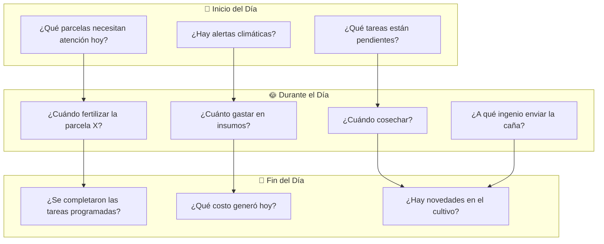
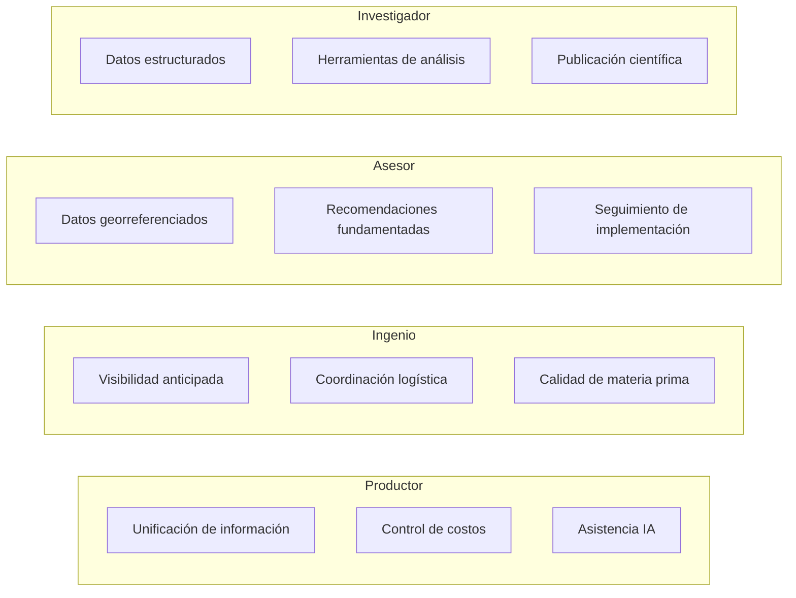
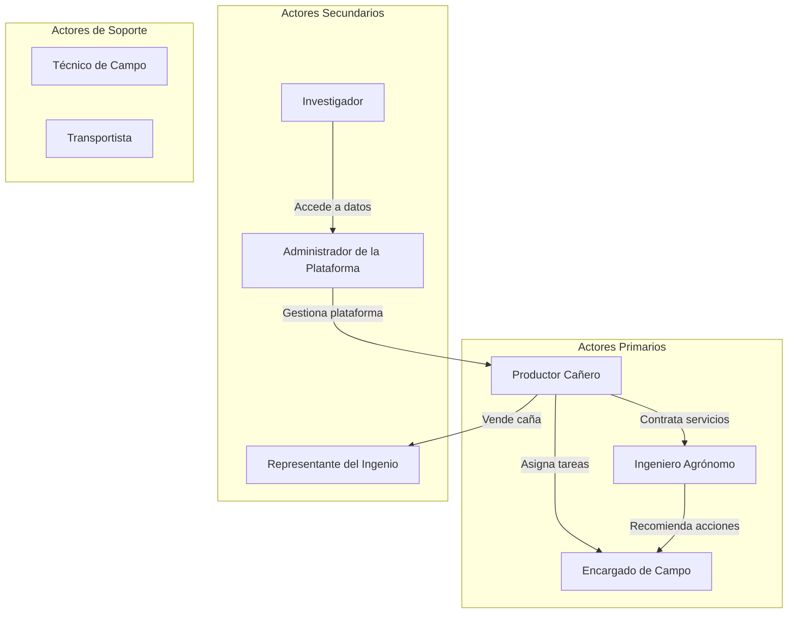
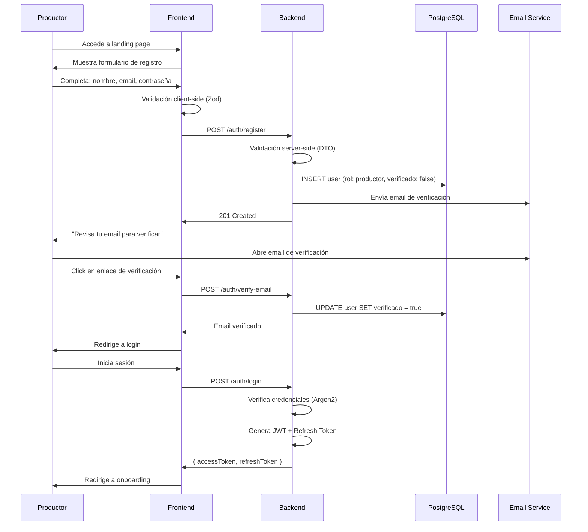
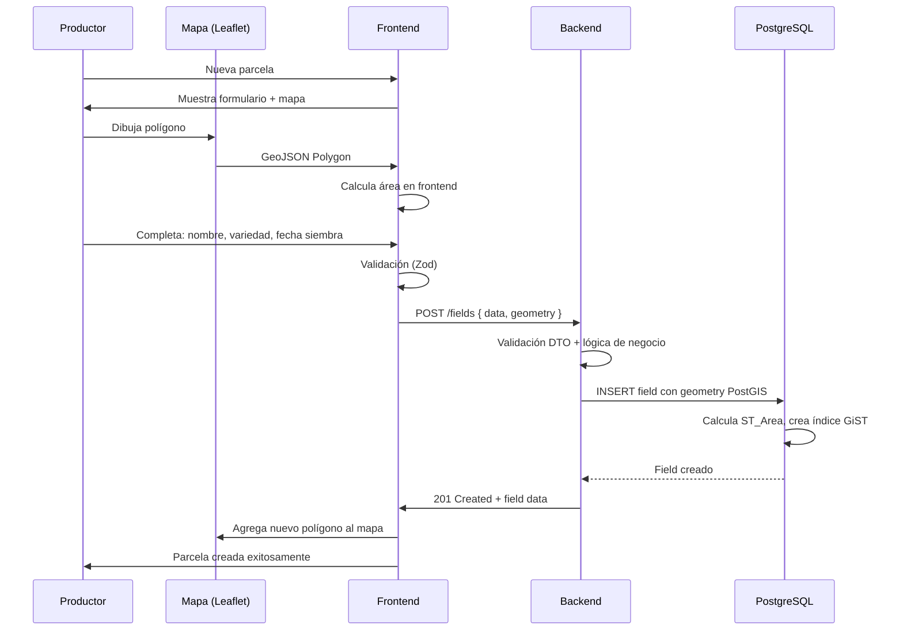
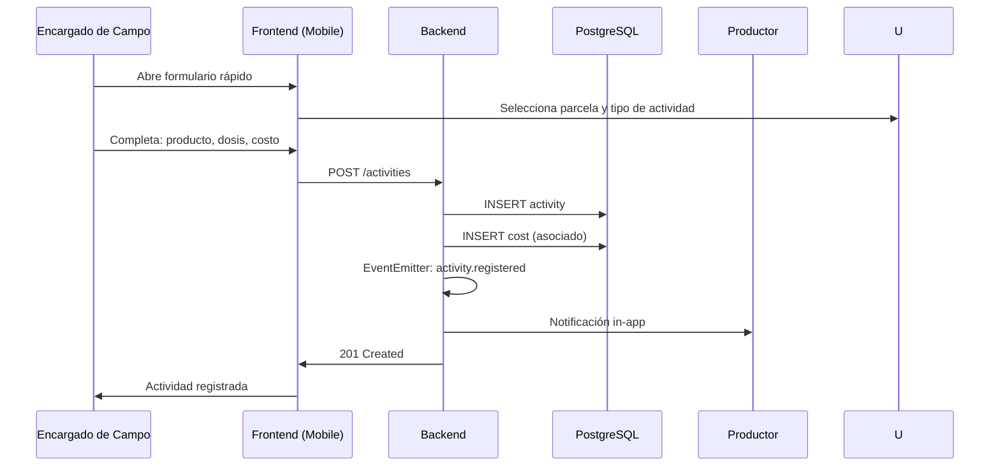
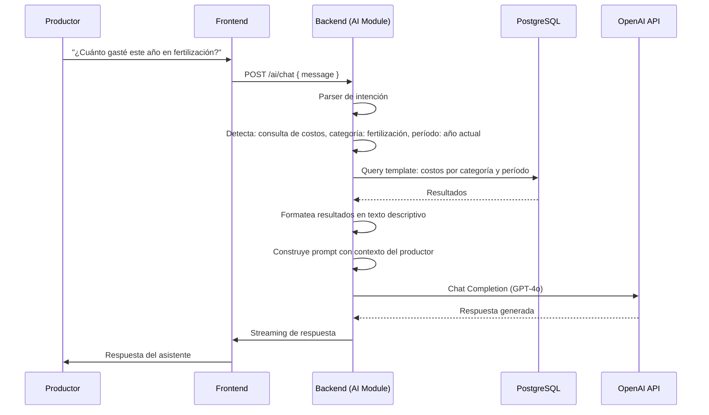
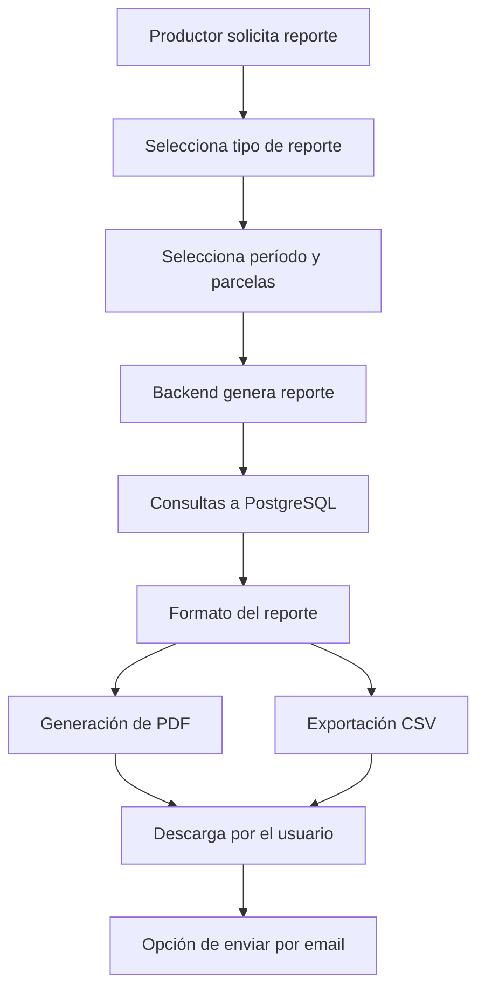

# SmartCaña — Modelo de Negocio y Análisis Funcional

**Plataforma AgTech Inteligente para la Gestión Integral de Cultivos de Caña de Azúcar**

| Campo | Detalle |
|---|---|
| **Nombre del proyecto** | SmartCaña |
| **Tipo de documento** | Modelo de Negocio y Análisis Funcional (v1.0) |
| **Autor** | SmartCaña — Equipo de Desarrollo |
| **Fecha** | Julio 2026 |
| **Contexto** | Tesis Final — Tecnicatura Universitaria en Programación (TUP), UTN |
| **Clasificación** | Documento Confidencial — Uso Académico |

---

## Índice

1. [Modelo de Negocio](#1-modelo-de-negocio)
2. [Actores del Sistema](#2-actores-del-sistema)
3. [Casos de Uso](#3-casos-de-uso)
4. [Historias de Usuario](#4-historias-de-usuario)
5. [Flujo Completo del Sistema](#5-flujo-completo-del-sistema)
6. [Módulos Funcionales](#6-módulos-funcionales)
7. [Reglas de Negocio](#7-reglas-de-negocio)
8. [Roadmap Funcional](#8-roadmap-funcional)
9. [Riesgos Funcionales](#9-riesgos-funcionales)
10. [Oportunidades Futuras](#10-oportunidades-futuras)

---

## 1. Modelo de Negocio

### 1.1 El Problema del Productor Cañero

El productor cañero argentino enfrenta diariamente una realidad fragmentada, ineficiente y arriesgada. Antes de poder entender cómo SmartCañamejoraa su operación, es fundamental comprender en profundidad cómo trabaja hoy, qué información necesita y qué decisiones toma.

#### 1.1.1 Cómo Trabaja el Productor Hoy

La operación diaria de un productor cañero típico se basa en los siguientes procesos:

**Planificación de campaña:**
- El productor, junto con su capataz o ingeniero agrónomo, determina qué parcelas sembrar, qué variedades usar y cuándo iniciar la cosecha.
- Esta planificación se realiza en reuniones presenciales, basándose en la experiencia acumulada, el conocimiento del terreno y, en algunos casos, análisis de suelos realizados por laboratorios externos.
- No existe un registro digital de esta planificación. Las decisiones quedan en la memoria del productor o en cuadernos de campo.

**Registro de actividades:**
- Cada vez que se realiza una actividad en campo —fertilización, control de malezas, riego, cosecha— el encargado de campo toma nota en un cuaderno o planilla de papel.
- Estos registros son incompletos, inconsistentes y frecuentemente se pierden.
- No existe forma de vincular una actividad específica con el rendimiento resultante de la parcela.

**Control de costos:**
- Los gastos se registran de forma dispersa: facturas en cajas, notas en cuadernos, transferencias bancarias sin categorizar.
- El productor no sabe con precisión cuánto le cuesta producir una tonelada de caña en cada parcela.
- No puede comparar la rentabilidad entre parcelas ni entre campañas.

**Coordinación con el ingenio:**
- La comunicación con el ingenio se realiza por teléfono, WhatsApp o visitas presenciales.
- No hay información compartida sobre disponibilidad de caña, volúmenes programados o estados de cosecha.
- El productor no sabe cuándo cosechar para optimizar la llegada al ingenio.
- Los camiones esperan en el patio del ingenio durante horas o días, degradando la calidad de la caña.

**Monitoreo del cultivo:**
- El productor recorre sus parcelas periódicamente para observar el estado del cultivo.
- No tiene una herramienta que le muestre qué parcelas requieren atención urgente.
- Las plagas y enfermedades se detectan cuando ya están avanzadas, no en forma preventiva.

**Toma de decisiones:**
- Las decisiones sobre fertilización, variedad, momento de cosecha y riego se toman basándose en la experiencia.
- No hay datos históricos que permitan evaluar si una decisión pasada fue correcta.
- No hay forma de comparar el rendimiento de diferentes variedades en las condiciones específicas de cada parcela.

#### 1.1.2 Información que Necesita el Productor

| Categoría | Información Necesaria | Estado Actual |
|---|---|---|
| **Parcelas** | Ubicación exacta, superficie, historial de cultivo, análisis de suelo | Dispersa, incompleta, en papel |
| **Actividades** | Qué se hizo, cuándo, dónde, con qué insumos, a qué costo | Registros manuales fragmentados |
| **Producción** | Rendimiento por parcela, toneladas cosechadas, calidad | Conocida a posteriori, sin detalle por parcela |
| **Costos** | Gasto total, gasto por hectárea, gasto por actividad | Desconocida con precisión |
| **Clima** | Pronóstico, alertas de heladas, lluvias acumuladas | Consulta en noticias o apps genéricas |
| **Variedades** | Cuál funciona mejor en mi zona, resistencia a plagas | Conocimiento empírico local |
| **Ingenio** | Disponibilidad, cola de espera, precio offered | Comunicación informal, sin datos |
| **Tendencias** | Evolución de rendimiento, comparación entre campañas | Inexistente |

#### 1.1.3 Decisiones Diarias del Productor

#### 1.1.4 Cómo SmartCaña Mejora Este Proceso

| Problemática Actual | Solución SmartCaña | Beneficio Concreto |
|---|---|---|
| Información en papel y dispersa | Base de datos centralizada, georreferenciada | Acceso instantáneo a toda la información de cada parcela |
| Sin visibilidad geográfica | Mapa interactivo con polígonos y capas | Identificación visual de zonas problemáticas y planificación espacial |
| Costos desconocidos | Registro categorizado y cálculo automático | Conocimiento exacto del costo por hectárea y por tonelada |
| Coordinación deficiente con ingenios | Información compartida, planificación anticipada | Reducción de tiempos de espera y pérdida de calidad |
| Decisiones basadas en experiencia pura | Datos históricos + recomendaciones IA | Decisiones fundamentadas en evidencia |
| Sin alertas tempranas | Sistema de notificaciones climáticas y agronómicas | Prevención de pérdidas por eventos adversos |
| Sin comparación entre campañas | Analítica y reportes comparativos | Identificación de tendencias y mejora continua |
| Sin asesoramiento especializado | Asistente IA con conocimiento de dominio | Recomendaciones agronómicas accesibles 24/7 |

### 1.2 Propuesta de Valor por Segmento

### 1.3 Modelo de Revenue (Futuro Comercial)

Aunque el proyecto actual es una tesis académica, el modelo de negocio a largo plazo se basará en:

| Modelo | Descripción | Target |
|---|---|---|
| **Freemium** | Plan gratuito con funcionalidades básicas (hasta 5 parcelas) | Productores pequeños, prueba del producto |
| **Suscripción mensual** | Planes escalonados según número de parcelas y funcionalidades | Productores medianos y grandes |
| **Enterprise** | Contrato anual con funcionalidades personalizadas, soporte dedicado, integraciones | Ingenios, grandes productores, cooperativas |
| **Comisión por transacción** | Marketplace de insumos y servicios (futuro) | Ecosistema de proveedores |

---

## 2. Actores del Sistema

### 2.1 Mapa de Actores

### 2.2 Definición Detallada por Actor

#### 2.2.1 Productor Cañero (Rol Primario)

| Aspecto | Descripción |
|---|---|
| **Responsabilidades** | Gestión integral de su explotación cañera: planificación, siembra, mantenimiento, cosecha, comercialización |
| **Permisos** | CRUD completo sobre sus parcelas, actividades, costos, cosechas. Acceso a reportes, IA, configuración. Lectura de datos de otros productores solo si autorizados |
| **Objetivos** | Maximizar rendimiento, minimizar costos, tomar decisiones informadas, mejorar la coordinación con el ingenio |
| **Necesidades** | Dashboard resumen, mapa interactivo, registro rápido de actividades, control de costos, asistencia IA, reportes para negociación |
| **Perfil tecnológico** | Variable: desde bajo (productor pequeño) hasta alto (grande productor). La interfaz debe ser intuitiva para todos |
| **Dispositivos** | Desktop en oficina, tablet en campo, smartphone para registros rápidos |

**Subtipos de productor:**

| Subtipo | Superficie | Necesidad Principal | Frecuencia de Uso |
|---|---|---|---|
| Pequeño productor | 40–200 ha | Gestión básica, control de costos | 2-3 veces por semana |
| Mediano productor | 200–600 ha | Analítica, planificación, reportes | Diario |
| Grande productor | 600–10.000+ ha | Gestión integral, agricultura de precisión | Múltiples veces al día |

#### 2.2.2 Encargado de Campo / Capataz

| Aspecto | Descripción |
|---|---|
| **Responsabilidades** | Ejecutar las tareas planificadas, registrar actividades en campo, supervisar el personal, reportar incidencias |
| **Permisos** | Crear y consultar actividades, registrar costos operativos, consultar parcelas asignadas. Sin acceso a configuración ni a datos financieros detallados |
| **Objetivos** | Ejecutar eficientemente las tareas, mantener registros actualizados, comunicar novedades al productor |
| **Necesidades** | Interfaz simple y rápida para registro en campo, vista de tareas pendientes, posibilidad de adjuntar fotos |
| **Dispositivos** | Principalmente smartphone y tablet en campo |

#### 2.2.3 Ingeniero Agrónomo / Asesor Técnico

| Aspecto | Descripción |
|---|---|
| **Responsabilidades** | Asesorar al productor en decisiones técnicas, analizar datos de campo, generar recomendaciones, dar seguimiento a implementación |
| **Permisos** | Lectura de parcelas y actividades de sus clientes asignados. Creación de recomendaciones. Acceso a reportes y IA. Sin acceso a costos detallados (a menos que el productor lo autorice) |
| **Objetivos** | Brindar recomendaciones fundamentadas en datos, monitorear el estado de los cultivos, evaluar la efectividad de las prácticas aplicadas |
| **Necesidades** | Vista panorámica de múltiples productores, capacidad de análisis comparativo, herramientas de visualización geográfica, acceso a datos históricos |
| **Dispositivos** | Desktop y tablet |

#### 2.2.4 Representante del Ingenio

| Aspecto | Descripción |
|---|---|
| **Responsabilidades** | Planificar la recepción de caña, coordinar la logística de acopio, gestionar la relación con proveedores |
| **Permisos** | Lectura de datos de productores asociados (volúmenes programados, estados de cosecha, estimaciones de calidad). Sin acceso a costos ni a información financiera |
| **Objetivos** | Optimizar la capacidad de molienda, reducir tiempos de espera, asegurar calidad de materia prima |
| **Necesidades** | Dashboard de disponibilidad por zona, estimación de volúmenes, calendario de cosecha compartido |
| **Dispositivos** | Desktop en planta |

#### 2.2.5 Administrador de la Plataforma

| Aspecto | Descripción |
|---|---|
| **Responsabilidades** | Gestión técnica de la plataforma, administración de usuarios, configuración de permisos, monitoreo del sistema, soporte a usuarios |
| **Permisos** | Acceso total a la plataforma. Gestión de usuarios, configuración del sistema, logs de auditoría, métricas de uso |
| **Objetivos** | Garantizar la disponibilidad y seguridad del sistema, gestionar la base de usuarios, resolver incidencias |
| **Necesidades** | Panel de administración, métricas de uso, herramientas de soporte, gestión de permisos |
| **Dispositivos** | Desktop |

#### 2.2.6 Investigador

| Aspecto | Descripción |
|---|---|
| **Responsabilidades** | Analizar datos anonimizados para investigación, validar hipótesis agronómicas, publicar resultados |
| **Permisos** | Lectura de datos anonimizados o autorizados. Sin acceso a información identificatoria de productores. Sin acceso a costos |
| **Objetivos** | Obtener datos estructurados para investigación, validar modelos agronómicos, contribuir al conocimiento del cultivo |
| **Necesidades** | Acceso a datos históricos anonimizados, herramientas de exportación en formatos estándar, documentación de la estructura de datos |
| **Dispositivos** | Desktop |

#### 2.2.7 Técnico de Campo

| Aspecto | Descripción |
|---|---|
| **Responsabilidades** | Realizar aplicaciones de agroquímicos, análisis de suelo, monitoreo fitosanitario, levantamientos de datos |
| **Permisos** | Crear actividades específicas (aplicaciones, monitoreo), consultar parcelas asignadas, registrar observaciones de campo |
| **Objetivos** | Ejecutar trabajos técnicos con precisión, mantener registros exactos de aplicaciones, reportar hallazgos |
| **Necesidades** | Interfaz de registro rápido, acceso a historial de la parcela, capacidad de adjuntar evidencia fotográfica |
| **Dispositivos** | Smartphone y tablet en campo |

#### 2.2.8 Transportista

| Aspecto | Descripción |
|---|---|
| **Responsabilidades** | Transportar caña cosechada desde la parcela hasta el ingenio, registrar entregas |
| **Permisos** | Consulta limitada: parcelas programadas para cosecha, ruta al ingenio. Sin acceso a información financiera ni agronómica |
| **Objetivos** | Completar entregas eficientemente, mantener registro de transportes, optimizar rutas |
| **Necesidades** | Información de parcelas con cosecha programada, ubicación del ingenio, estado de la entrega |
| **Dispositivos** | Smartphone |

---

## 3. Casos de Uso

### 3.1 Autenticación y Gestión de Cuenta

| ID | Caso de Uso | Actor Principal | Descripción | Prioridad |
|---|---|---|---|---|
| AU-01 | Registrarse en la plataforma | Productor, Asesor, Investigador | El usuario crea una cuenta proporcionando email, nombre, contraseña y tipo de usuario | Alta |
| AU-02 | Iniciar sesión | Todos los usuarios | El usuario se autentica con email y contraseña | Alta |
| AU-03 | Cerrar sesión | Todos los usuarios | El usuario finaliza su sesión activa | Alta |
| AU-04 | Recuperar contraseña | Todos los usuarios | El usuario solicita un enlace de recuperación por email | Alta |
| AU-05 | Cambiar contraseña | Todos los usuarios | El usuario actualiza su contraseña desde su perfil | Alta |
| AU-06 | Actualizar perfil | Todos los usuarios | El usuario modifica nombre, teléfono, avatar, preferencias | Media |
| AU-07 | Verificar email | Todos los usuarios | El usuario confirma su dirección de email mediante enlace enviado | Alta |
| AU-08 | Gestionar refresh token | Sistema | El sistema renueva tokens de acceso de forma transparente | Alta |

### 3.2 Gestión de Campos y Parcelas

| ID | Caso de Uso | Actor Principal | Descripción | Prioridad |
|---|---|---|---|---|
| CP-01 | Crear parcela | Productor | El productor registra una nueva parcela con nombre, variedad, fecha de siembra y polígono en el mapa | Alta |
| CP-02 | Editar parcela | Productor | El productor modifica los datos de una parcela existente | Alta |
| CP-03 | Eliminar parcela | Productor | El productor elimina una parcela (solo si no tiene actividades asociadas) | Media |
| CP-04 | Visualizar parcela en mapa | Productor, Asesor | El usuario ve la parcela con su polígono en el mapa interactivo | Alta |
| CP-05 | Visualizar lista de parcelas | Productor, Asesor | El usuario ve todas sus parcelas en formato tabla con filtros | Alta |
| CP-06 | Buscar parcela | Productor, Asesor | El usuario busca una parcela por nombre o variedad | Media |
| CP-07 | Dibujar polígono en mapa | Productor | El usuario dibuja los límites de la parcela directamente sobre el mapa | Alta |
| CP-08 | Importar GeoJSON | Productor | El usuario carga parcelas desde un archivo GeoJSON | Baja |
| CP-09 | Exportar GeoJSON | Productor | El usuario descarga sus parcelas en formato GeoJSON | Baja |
| CP-10 | Asociar variedad a parcela | Productor | El productor vincula una variedad del catálogo a la parcela | Alta |
| CP-11 | Ver historial de parcela | Productor, Asesor | El usuario consulta el historial completo de actividades y rendimiento de una parcela | Alta |
| CP-12 | Calcular superficie | Sistema | El sistema calcula automáticamente la superficie de la parcela a partir del polígono | Alta |

### 3.3 Registro de Actividades

| ID | Caso de Uso | Actor Principal | Descripción | Prioridad |
|---|---|---|---|---|
| AC-01 | Registrar fertilización | Encargado, Productor | Se registra una aplicación de fertilizante con producto, dosis, fecha y costo | Alta |
| AC-02 | Registrar control de malezas | Encargado, Productor | Se registra una aplicación de herbicida o control mecánico | Alta |
| AC-03 | Registrar control de plagas | Encargado, Productor | Se registra una aplicación de insecticida o trampa | Alta |
| AC-04 | Registrar control de enfermedades | Encargado, Productor | Se registra una aplicación de fungicida o tratamiento | Alta |
| AC-05 | Registrar riego | Encargado, Productor | Se registra una actividad de riego con volumen y duración | Alta |
| AC-06 | Registrar siembra | Productor | Se registra la siembra de una parcela con variedad, cantidad de semilla y método | Alta |
| AC-07 | Registrar raleo | Encargado, Productor | Se registra la eliminación de plantas excedentes | Media |
| AC-08 | Registrar quema | Encargado, Productor | Se registra una quema controlada previa a cosecha | Media |
| AC-09 | Registrar observación de campo | Técnico, Encargado | Se registra una observación cualitativa (estado fenológico, presencia de plagas, etc.) | Alta |
| AC-10 | Adjuntar fotografía | Técnico, Encargado | Se adjunta una foto a un registro de actividad | Media |
| AC-11 | Editar actividad | Productor | El productor corrige o actualiza un registro de actividad | Alta |
| AC-12 | Eliminar actividad | Productor | El productor elimina un registro de actividad | Media |
| AC-13 | Ver historial de actividades | Productor, Asesor | Se visualiza el historial cronológico de actividades de una parcela | Alta |
| AC-14 | Filtrar actividades | Productor, Asesor | Se filtran actividades por tipo, fecha, parcela o responsable | Alta |
| AC-15 | Usar plantilla de actividad | Encargado, Productor | Se utiliza una plantilla predefinida para registrar actividades frecuentes | Baja |

### 3.4 Control de Costos

| ID | Caso de Uso | Actor Principal | Descripción | Prioridad |
|---|---|---|---|---|
| CO-01 | Registrar gasto | Productor | Se registra un gasto asociado a una parcela, categoría y monto | Alta |
| CO-02 | Editar gasto | Productor | Se modifica un gasto registrado | Alta |
| CO-03 | Eliminar gasto | Productor | Se elimina un gasto registrado | Media |
| CO-04 | Visualizar gastos por parcela | Productor | Se consulta el desglose de gastos de una parcela específica | Alta |
| CO-05 | Visualizar gastos totales | Productor | Se consulta el resumen de gastos de todas las parcelas en un período | Alta |
| CO-06 | Comparar costos entre campañas | Productor, Asesor | Se comparan los costos de una parcela entre diferentes campañas | Media |
| CO-07 | Calcular costo por hectárea | Sistema | El sistema calcula automáticamente el costo por hectárea | Alta |
| CO-08 | Calcular costo por tonelada | Sistema | El sistema calcula el costo por tonelada estimada | Media |
| CO-09 | Exportar costos | Productor | Se exportan los datos de costos en CSV o Excel | Media |
| CO-10 | Ver distribución de costos | Productor | Se visualiza la distribución de costos por categoría (insumos, mano de obra, etc.) | Alta |

### 3.5 Producción y Cosecha

| ID | Caso de Uso | Actor Principal | Descripción | Prioridad |
|---|---|---|---|---|
| PR-01 | Registrar cosecha | Productor, Encargado | Se registra la cosecha de una parcela con toneladas, fecha y método | Alta |
| PR-02 | Editar registro de cosecha | Productor | Se corrige un registro de cosecha | Alta |
| PR-03 | Ver rendimiento por parcela | Productor, Asesor | Se consulta el rendimiento (ton/ha) de cada parcela | Alta |
| PR-04 | Comparar rendimiento entre campañas | Productor, Asesor | Se comparan rendimientos de una parcela entre campañas | Alta |
| PR-05 | Comparar rendimiento entre variedades | Productor, Asesor | Se comparan rendimientos de diferentes variedades en las parcelas del productor | Media |
| PR-06 | Ver estadísticas de cosecha | Productor | Se consulta el resumen de cosecha de la campaña actual | Alta |
| PR-07 | Planificar cosecha | Productor | Se programa una fecha futura de cosecha para una parcela | Media |
| PR-08 | Calcular rendimiento estimado | Sistema | El sistema estima el rendimiento basándose en datos históricos | Baja |

### 3.6 Gestión de Variedades

| ID | Caso de Uso | Actor Principal | Descripción | Prioridad |
|---|---|---|---|---|
| VA-01 | Ver catálogo de variedades | Productor, Asesor | Se consulta el catálogo de variedades disponibles con sus características | Alta |
| VA-02 | Ver detalle de variedad | Productor, Asesor | Se consulta la información completa de una variedad (origen, ciclo, tolerancias) | Alta |
| VA-03 | Comparar variedades | Productor, Asesor | Se comparan dos o más variedades lado a lado | Media |
| VA-04 | Asociar variedad a parcela | Productor | Se vincula una variedad a una parcela con fecha de implantación | Alta |
| VA-05 | Ver historial varietal | Productor, Asesor | Se consulta qué variedades se sembraron en una parcela a lo largo del tiempo | Media |

### 3.7 Mapa e Interacción Geoespacial

| ID | Caso de Uso | Actor Principal | Descripción | Prioridad |
|---|---|---|---|---|
| MP-01 | Visualizar todas las parcelas | Productor, Asesor | Se muestra un mapa con todas las polígonos de las parcelas del usuario | Alta |
| MP-02 | Hacer zoom a parcela | Productor, Asesor | Al seleccionar una parcela, el mapa hace zoom a su extensión | Alta |
| MP-03 | Click en parcela | Productor, Asesor | Al hacer click en un polígono, se muestra información resumen de la parcela | Alta |
| MP-04 | Cambiar capa temática | Productor, Asesor | Se cambia la capa activa (rendimiento, actividad, cosecha, variedad) | Alta |
| MP-05 | Dibujar nuevo polígono | Productor | Se dibujan los límites de una nueva parcela sobre el mapa | Alta |
| MP-06 | Editar polígono | Productor | Se modifican los puntos de un polígono existente | Media |
| MP-07 | Geolocalizar usuario | Productor | El mapa se centra en la ubicación GPS del usuario | Baja |
| MP-08 | Ver parcelas por zoom | Sistema | El mapa carga y muestra parcelas según el nivel de zoom actual | Alta |
| MP-09 | Exportar mapa como imagen | Productor | Se exporta una captura del mapa actual como imagen | Baja |

### 3.8 Monitoreo Climático

| ID | Caso de Uso | Actor Principal | Descripción | Prioridad |
|---|---|---|---|---|
| CL-01 | Ver clima actual | Productor, Encargado | Se consulta el clima actual de la ubicación de las parcelas | Media |
| CL-02 | Ver pronóstico 5 días | Productor, Encargado | Se consulta el pronóstico extendido para la zona | Media |
| CL-03 | Recibir alerta de helada | Productor, Encargado | Se notifica al usuario cuando hay riesgo de helada | Alta |
| CL-04 | Recibir alerta de lluvia intensa | Productor, Encargado | Se notifica ante lluvias que puedan afectar operaciones | Media |
| CL-05 | Ver histórico climático | Productor, Asesor | Se consultan datos climáticos históricos de la zona | Baja |
| CL-06 | Registrar evento climático | Productor, Encargado | Se registra manualmente un evento climático (helada, granizo, sequía) | Media |

### 3.9 Asistente IA

| ID | Caso de Uso | Actor Principal | Descripción | Prioridad |
|---|---|---|---|---|
| IA-01 | Consultar al asistente | Productor, Asesor | El usuario escribe una pregunta en el chat y recibe una respuesta | Alta |
| IA-02 | Solicitar recomendación de fertilización | Productor | El asistente recomienda un plan de fertilización basado en datos de la parcela | Alta |
| IA-03 | Consultar qué lote produjo más | Productor | El asistente identifica la parcela con mayor rendimiento | Alta |
| IA-04 | Consultar cuánto se gastó | Productor | El asistente calcula el gasto total o por categoría en un período | Alta |
| IA-05 | Consultar tareas pendientes | Productor | El asistente lista las actividades pendientes o vencidas | Alta |
| IA-06 | Recomendar variedad | Productor, Asesor | El asistente recomienda variedades según condiciones de la parcela | Media |
| IA-07 | Resumir campaña | Productor, Asesor | El asistente genera un resumen de la campaña actual | Media |
| IA-08 | Recibir sugerencia proactiva | Productor | El asistente envía sugerencias basadas en el calendario agrícola y datos actuales | Media |
| IA-09 | Consultar sobre enfermedades | Productor, Asesor | El asistente responde preguntas sobre plagas y enfermedades de la caña | Alta |
| IA-10 | Obtener alerta de IA | Sistema | El asistente detecta anomalías en los datos y genera alertas automáticas | Baja |

### 3.10 Reportes

| ID | Caso de Uso | Actor Principal | Descripción | Prioridad |
|---|---|---|---|---|
| RP-01 | Ver dashboard principal | Productor | Se muestra el panel de control con KPIs resumen | Alta |
| RP-02 | Generar reporte de campaña | Productor, Asesor | Se genera un resumen completo de la campaña | Alta |
| RP-03 | Generar reporte de producción | Productor, Asesor | Se genera un reporte detallado de rendimiento por parcela | Alta |
| RP-04 | Generar reporte de costos | Productor | Se genera un reporte detallado de costos por parcela y categoría | Alta |
| RP-05 | Exportar a PDF | Productor | Se exporta un reporte en formato PDF para impresión | Alta |
| RP-06 | Exportar a CSV | Productor | Se exportan datos en formato CSV para análisis externo | Media |
| RP-07 | Generar reporte personalizado | Productor | Se selecciona período, parcelas y métricas para un reporte a medida | Baja |
| RP-08 | Imprimir reporte | Productor | Se envía un reporte a impresión | Baja |

### 3.11 Alertas y Notificaciones

| ID | Caso de Uso | Actor Principal | Descripción | Prioridad |
|---|---|---|---|---|
| AL-01 | Recibir alerta climática | Productor, Encargado | Se notifica de eventos climáticos adversos | Alta |
| AL-02 | Recibir alerta de actividad vencida | Productor, Encargado | Se notifica cuando una actividad programada no se completó | Alta |
| AL-03 | Recibir alerta de fertilización | Productor | Se sugiere fertilizar una parcela basándose en el tiempo transcurrido | Media |
| AL-04 | Recibir alerta de cosecha | Productor | Se sugiere fecha de cosecha basándose en la madurez estimada | Media |
| AL-05 | Recibir alerta de enfermedad | Productor, Asesor | Se alerta sobre condiciones favorables para enfermedades conocidas | Baja |
| AL-06 | Ver centro de notificaciones | Todos | El usuario consulta todas las notificaciones activas | Alta |
| AL-07 | Marcar notificación como leída | Todos | El usuario marca una notificación como vista | Alta |
| AL-08 | Configurar preferencias de notificación | Productor | El usuario define qué tipos de notificaciones quiere recibir | Media |

### 3.12 Configuración y Administración

| ID | Caso de Uso | Actor Principal | Descripción | Prioridad |
|---|---|---|---|---|
| CF-01 | Ver perfil de usuario | Todos | El usuario consulta su información de perfil | Alta |
| CF-02 | Editar perfil | Todos | El usuario modifica nombre, email, teléfono | Alta |
| CF-03 | Cambiar contraseña | Todos | El usuario actualiza su contraseña | Alta |
| CF-04 | Gestionar usuarios (admin) | Admin | El admin crea, edita o desactiva usuarios | Alta |
| CF-05 | Asignar roles (admin) | Admin | El admin asigna roles a los usuarios | Alta |
| CF-06 | Ver logs de auditoría (admin) | Admin | El admin consulta el registro de actividades del sistema | Media |
| CF-07 | Configurar moneda y unidad | Productor | El productor define la moneda (ARS/USD) y unidades de medida | Media |
| CF-08 | Gestionar preferencias de mapa | Productor | El productor configura capa por defecto, zoom inicial | Baja |

### 3.13 Gestión de Catálogos (Admin)

| ID | Caso de Uso | Actor Principal | Descripción | Prioridad |
|---|---|---|---|---|
| CG-01 | Gestionar catálogo de variedades | Admin | El admin agrega, edita o elimina variedades del catálogo | Alta |
| CG-02 | Gestionar tipos de actividad | Admin | El admin administra los tipos de actividad disponibles | Alta |
| CG-03 | Gestionar categorías de costo | Admin | El admin administra las categorías de gasto | Alta |
| CG-04 | Gestionar estados de parcela | Admin | El admin define los estados posibles de una parcela | Media |

---

## 4. Historias de Usuario

### 4.1 Autenticación

**HU-AU-01: Registro de usuario**

> Como **productor cañero**
> Quiero **registrarme en la plataforma con mi email y contraseña**
> Para **poder acceder a las herramientas de gestión de mi campo**

**Criterios de aceptación:**
- El formulario solicita nombre, email, contraseña y confirmación de contraseña.
- La contraseña debe tener mínimo 8 caracteres, incluir al menos una mayúscula, un número y un carácter especial.
- El email debe ser válido y no estar registrado previamente.
- Al registrarse correctamente, se envía un email de verificación.
- Se muestra un mensaje de confirmación indicando que se debe verificar el email.
- El usuario puede iniciar sesión después de verificar su email.

---

**HU-AU-02: Inicio de sesión**

> Como **usuario registrado**
> Quiero **iniciar sesión con mi email y contraseña**
> Para **acceder a mi panel de control y datos**

**Criterios de aceptación:**
- El formulario acepta email y contraseña.
- Si las credenciales son correctas, se redirige al dashboard.
- Si son incorrectas, se muestra un mensaje de error genérico (no revelar si el email existe).
- Se implementa rate limiting: después de 5 intentos fallidos, se bloquea temporalmente el formulario por 15 minutos.
- El access token expira en 15 minutos; el refresh token renueva la sesión de forma transparente.

---

**HU-AU-03: Recuperación de contraseña**

> Como **usuario que olvidó su contraseña**
> Quiero **solicitar un enlace de recuperación por email**
> Para **poder restablecer mi contraseña y acceder a la plataforma**

**Criterios de aceptación:**
- El formulario solicita únicamente el email.
- Si el email está registrado, se envía un enlace de recuperación con expiración de 1 hora.
- Si el email no está registrado, se muestra el mismo mensaje de éxito (no revelar información).
- El enlace lleva a un formulario para ingresar nueva contraseña y confirmación.
- La nueva contraseña debe cumplir las mismas reglas que el registro.

### 4.2 Campos

**HU-CP-01: Crear una nueva parcela**

> Como **productor cañero**
> Quiero **registrar una nueva parcela con su nombre, variedad y polígono en el mapa**
> Para **tener un registro digital de cada lote de mi explotación**

**Criterios de aceptación:**
- El formulario permite ingresar: nombre de la parcela, variedad (select del catálogo), fecha de siembra, número de rango, observaciones.
- El usuario puede dibujar el polígono de la parcela directamente sobre el mapa usando herramientas de dibujo.
- El sistema calcula automáticamente la superficie en hectáreas a partir del polígono.
- La superficie calculada debe ser mayor a 0.1 ha y menor a 50,000 ha.
- El nombre de la parcela es obligatorio y no puede duplicarse dentro del mismo productor.
- Al guardar, la parcela aparece en la lista y en el mapa.

---

**HU-CP-02: Visualizar parcelas en el mapa**

> Como **productor cañero**
> Quiero **ver todas mis parcelas dibujadas en un mapa interactivo**
> Para **tener una visión geográfica de mi explotación**

**Criterios de aceptación:**
- El mapa muestra todas las polígonos de las parcelas del productor.
- Cada parcela se muestra con un color según la capa activa.
- Al hacer click en un polígono, se muestra un popup con información resumen (nombre, variedad, superficie, última actividad).
- El mapa permite zoom, pan y selección de parcela.
- Los controles del mapa son accesibles y funcionales en desktop y tablet.

---

**HU-CP-03: Editar datos de una parcela**

> Como **productor cañero**
> Quiero **modificar la información de una parcela existente**
> Para **mantener los datos actualizados**

**Criterios de aceptación:**
- Se pueden editar todos los campos: nombre, variedad, fecha de siembra, número de rango, observaciones.
- Se puede editar el polígono del mapa (mover puntos, agregar puntos).
- La edición de polígono recalcula la superficie automáticamente.
- Los cambios se reflejan inmediatamente en la lista y el mapa.
- Se guarda un registro de la última modificación.

---

**HU-CP-04: Eliminar una parcela**

> Como **productor cañero**
> Quiero **eliminar una parcela que ya no utilizo**
> Para **mantener mi lista limpia y organizada**

**Criterios de aceptación:**
- La eliminación es un soft delete (la parcela se marca como inactiva, no se borra físicamente).
- No se puede eliminar una parcela que tenga actividades o costos registrados en la campaña actual.
- Se muestra un modal de confirmación antes de eliminar.
- La parcela desaparece de la lista y del mapa pero los datos se conservan para reportes históricos.

### 4.3 Actividades

**HU-AC-01: Registrar una fertilización**

> Como **encargado de campo**
> Quiero **registrar rápidamente una aplicación de fertilizante con su dosis y costo**
> Para **mantener un historial preciso de las aplicaciones**

**Criterios de aceptación:**
- El formulario permite seleccionar la parcela, el producto fertilizante, la dosis (kg/ha), la fecha y el costo total.
- La parcela es obligatoria.
- El producto es obligatorio (campo de texto autocompletado o select).
- La dosis es un número positivo.
- El costo es un número positivo o cero.
- Las observaciones son opcionales.
- Se puede adjuntar hasta 3 fotografías.
- Al guardar, la actividad aparece en el historial de la parcela.

---

**HU-AC-02: Ver historial de actividades de una parcela**

> Como **productor cañero**
> Quiero **ver todas las actividades realizadas en una parcela ordenadas cronológicamente**
> Para **entender la secuencia de manejo aplicada**

**Criterios de aceptación:**
- Se muestran todas las actividades de la parcela ordenadas de más reciente a más antigua.
- Cada actividad muestra: tipo, fecha, responsable, producto/dosis (si aplica), costo.
- Se puede filtrar por tipo de actividad, rango de fechas y responsable.
- Los filtros se aplican sin recargar la página.
- Si no hay actividades, se muestra un mensaje informativo con opción de registrar la primera.

---

**HU-AC-03: Registrar una actividad desde el campo (modo rápido)**

> Como **encargado de campo**
> Quiero **poder registrar una actividad de forma rápida desde mi teléfono**
> Para **no perder tiempo con formularios extensos estando en el campo**

**Criterios de aceptación:**
- El formulario rápido muestra solo los campos obligatorios: parcela, tipo de actividad, fecha.
- Los campos opcionales (dosis, costo, observaciones, fotos) se pueden completar después.
- El formulario se adapta a la pantalla del teléfono (diseño responsive).
- La parcela se puede seleccionar desde una lista o desde el mapa.
- El registro completo se puede editar después desde la versión desktop.

### 4.4 Costos

**HU-CO-01: Registrar un gasto**

> Como **productor cañero**
> Quiero **registrar un gasto asociado a una parcela y categoría**
> Para **controlar cuánto gasto en mi producción**

**Criterios de aceptación:**
- El formulario permite ingresar: parcela, categoría (insumos, mano de obra, maquinaria, transporte, servicios, otros), descripción, monto, fecha.
- La parcela es obligatoria.
- La categoría es obligatoria.
- El monto es un número positivo.
- La fecha es obligatoria y no puede ser futura.
- Al guardar, el gasto se refleja en el resumen de costos de la parcela.

---

**HU-CO-02: Comparar costos entre campañas**

> Como **productor cañero**
> Quiero **comparar cuánto gasté en la campaña actual vs. la anterior**
> Para **evaluar si estoy mejorando la eficiencia económica**

**Criterios de aceptación:**
- Se puede seleccionar la parcela y las campañas a comparar.
- Se muestra un gráfico de barras comparando el costo total y por categoría.
- Se muestra el porcentaje de variación entre campañas.
- Los datos se actualizan al cambiar las opciones de selección.
- Se puede exportar la comparativa en CSV.

### 4.5 Producción

**HU-PR-01: Registrar una cosecha**

> Como **productor cañero**
> Quiero **registrar las toneladas cosechadas de una parcela en una fecha determinada**
> Para **tener un registro preciso de mi producción**

**Criterios de aceptación:**
- El formulario permite ingresar: parcela, fecha de cosecha, toneladas, método (manual, mecánico, semimecanizado).
- La parcela es obligatoria.
- Las toneladas son un número positivo.
- La fecha es obligatoria.
- El método de cosecha es obligatorio.
- Al guardar, el rendimiento (ton/ha) se calcula automáticamente.
- La cosecha se refleja en el dashboard y en los reportes de producción.

---

**HU-PR-02: Comparar rendimiento entre campañas**

> Como **productor cañero**
> Quiero **ver cómo varió el rendimiento de mis parcelas entre campañas**
> Para **identificar tendencias y mejorar la productividad**

**Criterios de aceptación:**
- Se muestra un gráfico de líneas con el rendimiento promedio por campaña.
- Se puede filtrar por parcela específica o ver el promedio general.
- Se muestran los valores numéricos y el porcentaje de variación.
- Se puede seleccionar el período de campañas a comparar.

### 4.6 IA

**HU-IA-01: Consultar al asistente sobre datos propios**

> Como **productor cañero**
> Quiero **preguntarle a la IA "¿Qué lote produjo más esta campaña?"**
> Para **obtener respuesta instantánea sin navegar por la plataforma**

**Criterios de aceptación:**
- El asistente recibe la pregunta en lenguaje natural.
- El asistente accede a los datos reales del productor para responder.
- La respuesta incluye el nombre de la parcela, las toneladas y el rendimiento.
- La respuesta se genera en menos de 10 segundos.
- Si la pregunta es ambigua, el asistente pide aclaración.
- El productor puede hacer preguntas de seguimiento.

---

**HU-IA-02: Recibir recomendación de fertilización**

> Como **productor cañero**
> Quiero **que la IA me recomiende un plan de fertilización para una parcela**
> Para **tomar decisiones técnicas fundamentadas**

**Criterios de aceptación:**
- El asistente analiza: historial de fertilización de la parcela, análisis de suelo (si existe), fase del cultivo, variedad.
- La recomendación incluye: tipo de fertilizante, dosis, momento de aplicación, justificación.
- La recomendación se adapta a las condiciones específicas de la parcela.
- Se indica el nivel de confianza de la recomendación.
- El productor puede solicitar alternativas o aclaraciones.

### 4.7 Reportes

**HU-RP-01: Exportar reporte de campaña a PDF**

> Como **productor cañero**
> Quiero **generar un reporte completo de mi campaña en formato PDF**
> Para **presentarlo al ingenio en la negociación de precios**

**Criterios de aceptación:**
- El reporte incluye: resumen de parcelas, rendimiento por parcela, costos totales, actividades realizadas.
- El formato PDF es profesional y print-ready.
- Se puede seleccionar el período y las parcelas a incluir.
- El reporte se genera en menos de 30 segundos.
- Se puede descargar directamente o enviar por email.

### 4.8 Alertas

**HU-AL-01: Recibir alerta de actividad vencida**

> Como **productor cañero**
> Quiero **recibir una notificación cuando una actividad programada no se completó**
> Para **no olvidar tareas importantes del manejo del cultivo**

**Criterios de aceptación:**
- La alerta se genera automáticamente cuando la fecha programada de una actividad supera la fecha actual sin registro.
- La alerta incluye: parcela, actividad, fecha programada, días de retraso.
- La alerta aparece en el centro de notificaciones y, opcionalmente, se envía por email.
- El productor puede marcar la alerta como leída, posponerla o registrar la actividad directamente desde la alerta.

---

**HU-AL-02: Recibir alerta climática**

> Como **productor cañero**
> Quiero **ser notificado cuando haya riesgo de helada o lluvia intensa**
> Para **tomar medidas preventivas a tiempo**

**Criterios de aceptación:**
- El sistema consulta periódicamente los datos climáticos de OpenWeatherMap para la ubicación de las parcelas.
- Se genera una alerta cuando se detecta riesgo de helada (temperatura < 2°C en las próximas 48 horas).
- Se genera una alerta cuando se pronostican lluvias intensas (> 30mm en 24 horas).
- La alerta incluye: tipo de evento, pronóstico, parcelas afectadas, recomendación.
- Las alertas se pueden configurar por tipo (el usuario puede desactivar las que no le interesan).

### 4.9 Configuración

**HU-CF-01: Gestionar usuarios (administrador)**

> Como **administrador de la plataforma**
> Quiero **poder crear, editar y desactivar usuarios**
> Para **gestionar quién tiene acceso a SmartCaña**

**Criterios de aceptación:**
- El admin puede ver la lista de todos los usuarios registrados con filtros por rol, estado y fecha de registro.
- Puede crear un nuevo usuario proporcionando nombre, email, rol y contraseña temporal.
- Puede editar el perfil de cualquier usuario.
- Puede desactivar un usuario (el usuario no puede iniciar sesión pero sus datos se conservan).
- Puede asignar o cambiar el rol de un usuario.
- Todas las acciones del admin se registran en el log de auditoría.

---

## 5. Flujo Completo del Sistema

### 5.1 Flujo General del Productor

```mermaid
graph TB
    subgraph "📋 Registro"
        R1[Visita la landing page] --> R2[Completa formulario de registro]
        R2 --> R3[Recibe email de verificación]
        R3 --> R4[Verifica email]
        R4 --> R5[Cuenta activada]
    end

    subgraph "⚙️ Configuración Inicial"
        R5 --> C1[Selecciona perfil de productor]
        C1 --> C2[Ingresa datos de la explotación]
        C2 --> C3[Configura preferencias]
    end

    subgraph "🗺️ Carga Inicial"
        C3 --> I1[Crea primera parcela]
        I1 --> I2[Dibuja polígono en mapa]
        I2 --> I3[Asocia variedad]
        I3 --> I4[Repite para cada parcela]
    end

    subgraph "🔄 Gestión Diaria"
        I4 --> D1[Consulta dashboard]
        D1 --> D2[Registra actividades de campo]
        D2 --> D3[Registra gastos]
        D3 --> D4[Monitorea mapa]
        D4 --> D5[Consulta alertas]
    end

    subgraph "🤖 Consultas IA"
        D5 --> A1[Pregunta al asistente]
        A1 --> A2[Recibe recomendación]
        A2 --> A3[Aplica decisión]
    end

    subgraph "📊 Reportes"
        A3 --> P1[Genera reporte de campaña]
        P1 --> P2[Exporta a PDF]
        P2 --> P3[Presenta al ingenio]
    end

    subgraph "🏁 Fin de Campaña"
        P3 --> F1[Revisa rendimiento final]
        F1 --> F2[Analiza costos totales]
        F2 --> F3[Planifica próxima campaña]
    end
```

### 5.2 Flujo de Registro y Onboarding

### 5.3 Flujo de Creación de Parcela

### 5.4 Flujo de Registro de Actividad

### 5.5 Flujo de Consulta IA

### 5.6 Flujo de Generación de Reporte

---

## 6. Módulos Funcionales

### 6.1 Dashboard

| Aspecto | Descripción |
|---|---|
| **Objetivo** | Proporcionar al productor una vista resumen del estado actual de su explotación cañera en una sola pantalla |
| **Entradas** | Datosagregadosados de parcelas, actividades, costos, cosechas, alertas climáticas |
| **Salidas** | KPIs: total parcelas, hectáreas en producción, rendimiento promedio, costo promedio/ha, actividad reciente, alertas activas, gráficos de tendencia |

**Funcionalidades:**

| Funcionalidad | Descripción | Prioridad |
|---|---|---|
| KPIs principales | Cuatro indicadores clave: parcelas activas, rendimiento promedio, costo/ha, alertas pendientes | Alta |
| Gráfico de rendimiento | Línea temporal de rendimiento por campaña | Alta |
| Gráfico de costos | Distribución de costos por categoría (pie chart) | Alta |
| Actividad reciente | Lista de las últimas 10 actividades registradas | Alta |
| Próximas tareas | Lista de actividades programadas o pendientes | Alta |
| Alertas activas | Listado de notificaciones sin leer | Alta |
| Resumen de cosecha | Toneladas cosechadas vs. objetivo (si definido) | Media |

**Relaciones con otros módulos:**
- Recopila datos de: Campos, Actividades, Costos, Cosechas, Alertas, Clima.
- Enlaza con: todos los módulos (punto de entrada principal).

### 6.2 Campos

| Aspecto | Descripción |
|---|---|
| **Objetivo** | Gestionar el registro, consulta, edición y eliminación de parcelas con su información georreferenciada |
| **Entradas** | Nombre, variedad, fecha de siembra, número de rango, polígono GeoJSON, observaciones |
| **Salidas** | Lista de parcelas, detalle de parcela, polígono en mapa, superficie calculada, historial |

**Funcionalidades:**

| Funcionalidad | Descripción | Prioridad |
|---|---|---|
| CRUD completo | Crear, leer, actualizar, eliminar parcelas | Alta |
| Dibujo de polígono | Herramienta de dibujo sobre mapa Leaflet | Alta |
| Cálculo automático de área | PostGIS calcula ST_Area del polígono | Alta |
| Lista paginada | Tabla con filtros, búsqueda y ordenamiento | Alta |
| Detalle de parcela | Vista completa con toda la información y mapa | Alta |
| Importación GeoJSON | Carga de parcelas desde archivos GeoJSON | Baja |
| Exportación GeoJSON | Descarga de parcelas en formato GeoJSON | Baja |
| Vista de lista vs. mapa | Toggle entre vista de tabla y vista de mapa | Media |

**Relaciones con otros módulos:**
- Relacionado con: Actividades (una parcela tiene muchas actividades), Costos (asociados a parcela), Cosechas (registro de producción por parcela), Variedades (asociación N:M), Mapa (visualización geoespacial), IA (datos para recomendaciones).

### 6.3 Mapa

| Aspecto | Descripción |
|---|---|
| **Objetivo** | Proporcionar una visualización geoespacial interactiva de las parcelas del productor con capas temáticas |
| **Entradas** | Polígonos de parcelas, datos de rendimiento, actividades, cosecha, clima |
| **Salidas** | Mapa interactivo con polígonos coloreados, popups informativos, herramientas de dibujo |

**Funcionalidades:**

| Funcionalidad | Descripción | Prioridad |
|---|---|---|
| Mapa base OpenStreetMap | Capa base de referencia | Alta |
| Renderizado de polígonos | Polígonos de parcelas con colores dinámicos | Alta |
| Capas temáticas | Rendimiento, actividad, cosecha, variedad, superficie | Alta |
| Popups informativos | Información resumen al click en parcela | Alta |
| Zoom inteligente | Auto-zoom a bounds, zoom a parcela seleccionada | Alta |
| Herramienta de dibujo | Crear y editar polígonos | Alta |
| Geolocalización | Centrar en ubicación del usuario | Baja |
| Capa de clima | Overlay de precipitación/temperatura (futuro) | Baja |

**Relaciones con otros módulos:**
- Visualiza datos de: Campos, Actividades, Costos, Cosechas, Clima.
- Herramienta de entrada para: Campos (dibujo de polígonos).

### 6.4 Actividades

| Aspecto | Descripción |
|---|---|
| **Objetivo** | Registrar, consultar y gestionar todas las actividades agronómicas realizadas en cada parcela |
| **Entradas** | Tipo de actividad, parcela, fecha, responsable, producto, dosis, costo, observaciones, fotografías |
| **Salidas** | Lista de actividades, historial cronológico por parcela, estadísticas de actividad |

**Funcionalidades:**

| Funcionalidad | Descripción | Prioridad |
|---|---|---|
| Registro de actividad | Formulario completo con todos los campos | Alta |
| Formulario rápido (mobile) | Versión simplificada para registro en campo | Alta |
| Historial por parcela | Timeline cronológico de actividades de una parcela | Alta |
| Filtros | Por tipo, fecha, parcela, responsable | Alta |
| Edición y eliminación | Modificación de registros existentes | Alta |
| Adjuntar fotos | Hasta 3 fotografías por actividad | Media |
| Plantillas predefinidas | Atajos para actividades frecuentes | Baja |
| Tipos de actividad | Fertilización, control de malezas, control de plagas, control de enfermedades, riego, siembra, raleo, quema, cosecha, observación | Alta |

**Relaciones con otros módulos:**
- Asociada a: Campos (cada actividad pertenece a una parcela), Costos (puede generar un gasto asociado), Alertas (puede generar alertas de seguimiento).

### 6.5 Producción y Cosecha

| Aspecto | Descripción |
|---|---|
| **Objetivo** | Registrar la producción cosechada, calcular rendimientos y comparar entre campañas |
| **Entradas** | Parcela, fecha de cosecha, toneladas, método de cosecha |
| **Salidas** | Registro de cosecha, rendimiento por parcela, estadísticas de producción, comparativas |

**Funcionalidades:**

| Funcionalidad | Descripción | Prioridad |
|---|---|---|
| Registro de cosecha | Formulario con toneladas, fecha, método | Alta |
| Cálculo de rendimiento | ton/ha calculado automáticamente | Alta |
| Rendimiento por parcela | Vista de rendimiento individual | Alta |
| Comparativa entre campañas | Gráfico de rendimiento histórico | Alta |
| Comparativa entre variedades | Rendimiento por variedad | Media |
| Calendario de cosecha | Vista de calendario con cosechas programadas | Media |
| Estadísticas de campaña | Resumen total de producción | Alta |

**Relaciones con otros módulos:**
- Relacionado con: Campos (cada cosecha es de una parcela), Variedades (rendimiento por variedad), Costos (costo de producción vs. ingreso), IA (predicciones de rendimiento), Dashboard (KPIs).

### 6.6 Costos

| Aspecto | Descripción |
|---|---|
| **Objetivo** | Registrar, categorizar, analizar y comparar los costos de producción por parcela |
| **Entradas** | Parcela, categoría, descripción, monto, fecha |
| **Salidas** | Resumen de costos, distribución por categoría, costo/ha, costo/ton, comparativas |

**Funcionalidades:**

| Funcionalidad | Descripción | Prioridad |
|---|---|---|
| Registro de gasto | Formulario con categoría, monto, fecha, parcela | Alta |
| Categorías predefinidas | Insumos, mano de obra, maquinaria, transporte, servicios, otros | Alta |
| Resumen por parcela | Costo total y desglose de una parcela | Alta |
| Resumen total | Costo total de la explotación | Alta |
| Costo por hectárea | Cálculo automático (costo / superficie) | Alta |
| Costo por tonelada | Cálculo automático (costo / toneladas cosechadas) | Media |
| Distribución de costos | Gráfico de torta por categoría | Alta |
| Comparativa entre campañas | Evolución de costos en el tiempo | Media |
| Exportación | Datos en CSV para análisis externo | Media |

**Relaciones con otros módulos:**
- Asociado a: Campos (cada gasto pertenece a una parcela), Actividades (un gasto puede vincularse a una actividad), Producción (costo vs. rendimiento), IA (análisis de costos), Dashboard (KPIs), Reportes.

### 6.7 Variedades (Catálogo)

| Aspecto | Descripción |
|---|---|
| **Objetivo** | Mantener un catálogo de variedades de caña de azúcar con información agronómica y permitir la comparación |
| **Entradas** | Nombre, origen, ciclo, tolerancias, potencial de rendimiento, características |
| **Salidas** | Catálogo de variedades, detalle de variedad, comparativa |

**Funcionalidades:**

| Funcionalidad | Descripción | Prioridad |
|---|---|---|
| Catálogo de variedades | Lista de variedades con información resumen | Alta |
| Detalle de variedad | Ficha completa con todas las características | Alta |
| Comparativa lado a lado | Selección de 2+ variedades para comparar | Media |
| Asociación a parcela | Vincular variedad con fecha de implantación | Alta |
| Historial varietal | Qué variedades se sembraron en una parcela a lo largo del tiempo | Media |

**Relaciones con otros módulos:**
- Relacionado con: Campos (asociación N:M con fecha), Producción (rendimiento por variedad), IA (recomendación de variedades).

### 6.8 Monitoreo Climático

| Aspecto | Descripción |
|---|---|
| **Objetivo** | Proporcionar datos climáticos relevantes para la toma de decisiones agronómicas |
| **Entradas** | Coordenadas de parcelas, datos de OpenWeatherMap |
| **Salidas** | Clima actual, pronóstico, alertas climáticas, histórico |

**Funcionalidades:**

| Funcionalidad | Descripción | Prioridad |
|---|---|---|
| Clima actual | Temperatura, humedad, viento, condiciones | Media |
| Pronóstico 5 días | Temperatura máxima/mínima, probabilidad de lluvia | Media |
| Alerta de helada | Notificación cuando T < 2°C en próximas 48h | Alta |
| Alerta de lluvia intensa | Notificación cuando lluvia > 30mm/24h | Media |
| Registro de eventos | Registro manual de heladas, granizo, sequías | Media |
| Histórico climático | Datos pasados por zona geográfica | Baja |

**Relaciones con otros módulos:**
- Alimenta a: Alertas (generación de notificaciones), IA (contexto climático para recomendaciones), Dashboard (información resumen).

### 6.9 Asistente IA

| Aspecto | Descripción |
|---|---|
| **Objetivo** | Proporcionar asesoramiento agronómico inteligente mediante un chatbot especializado en caña de azúcar |
| **Entradas** | Preguntas del usuario en lenguaje natural, datos del productor, base de conocimiento |
| **Salidas** | Respuestas contextuales, recomendaciones, alertas, resúmenes |

**Funcionalidades:**

| Funcionalidad | Descripción | Prioridad |
|---|---|---|
| Chat interactivo | Interfaz de conversación con streaming de respuestas | Alta |
| Consultas sobre datos propios | Respuestas basadas en datos reales del productor | Alta |
| Recomendaciones agronómicas | Sugerencias de fertilización, variedad, manejo | Alta |
| Resumen de campaña | Generación de resumen ejecutivo | Media |
| Sugerencias proactivas | Recomendaciones automáticas basadas en calendario | Media |
| Alertas de IA | Detección de anomalías en los datos | Baja |
| Historial de conversación | Registro de preguntas y respuestas | Baja |

**Relaciones con otros módulos:**
- Lee datos de: todos los módulos (para construir contexto).
- Genera alertas que alimentan a: Alertas, Dashboard.

### 6.10 Alertas y Notificaciones

| Aspecto | Descripción |
|---|---|
| **Objetivo** | Mantener al usuario informado sobre eventos importantes, tareas pendientes y condiciones adversas |
| **Entradas** | Eventos del sistema (actividades vencidas, clima, IA), configuración del usuario |
| **Salidas** | Notificaciones in-app, centro de notificaciones, (futuro: emails, push) |

**Funcionalidades:**

| Funcionalidad | Descripción | Prioridad |
|---|---|---|
| Centro de notificaciones | Panel con todas las notificaciones activas | Alta |
| Notificación de actividad vencida | Alerta cuando una tarea programada no se completó | Alta |
| Alerta climática | Notificación de eventos climáticos adversos | Alta |
| Alerta de fertilización | Sugerencia de fertilización basada en tiempo transcurrido | Media |
| Alerta de cosecha | Sugerencia de fecha de cosecha | Media |
| Marcar como leída | El usuario marca notificaciones como vistas | Alta |
| Configurar preferencias | El usuario define qué tipos de notificaciones recibe | Media |

**Relaciones con otros módulos:**
- Recibe eventos de: Actividades (vencimientos), Clima (condiciones adversas), IA (alertas inteligentes), Producción (seguimiento de cosecha).

### 6.11 Reportes

| Aspecto | Descripción |
|---|---|
| **Objetivo** | Generar documentos analíticos y exportables que resumen la información del productor |
| **Entradas** | Datosagregadosados de todos los módulos, selección de período y parcelas por el usuario |
| **Salidas** | Reportes en pantalla, exportación a PDF, exportación a CSV |

**Funcionalidades:**

| Funcionalidad | Descripción | Prioridad |
|---|---|---|
| Reporte de campaña | Resumen general de la campaña | Alta |
| Reporte de producción | Rendimiento por parcela con gráficos | Alta |
| Reporte de costos | Desglose de costos por parcela y categoría | Alta |
| Reporte de actividades | Historial completo de actividades en un período | Media |
| Exportación a PDF | Generación de PDF profesional y print-ready | Alta |
| Exportación a CSV | Descarga de datos en formato tabular | Media |
| Reporte personalizado | Selección de métricas y período | Baja |

**Relaciones con otros módulos:**
- Recopila datos de: todos los módulos.
- Es consumido por: Productor (para gestión interna y negociación con ingenios).

### 6.12 Configuración

| Aspecto | Descripción |
|---|---|
| **Objetivo** | Permitir al usuario gestionar su perfil, preferencias y configuración de la plataforma |
| **Entradas** | Datos de perfil, preferencias de notificación, configuración regional |
| **Salidas** | Perfil actualizado, configuración aplicada |

**Funcionalidades:**

| Funcionalidad | Descripción | Prioridad |
|---|---|---|
| Ver/editar perfil | Nombre, email, teléfono, avatar | Alta |
| Cambiar contraseña | Formulario de cambio con validación | Alta |
| Preferencias de notificación | Configurar qué alertas recibir | Media |
| Configuración regional | Moneda (ARS/USD), idioma, zona horaria | Media |
| Gestión de usuarios (admin) | CRUD de usuarios, asignación de roles | Alta |
| Logs de auditoría (admin) | Registro de acciones del sistema | Media |

**Relaciones con otros módulos:**
- Afecta a: todos los módulos (las preferencias del usuario impactan la experiencia general).

---

## 7. Reglas de Negocio

### 7.1 Reglas de Validación de Datos

| ID | Regla | Justificación |
|---|---|---|
| RN-01 | El nombre de una parcela debe ser único dentro del mismo productor | Evita confusión al identificar lotes |
| RN-02 | La superficie de una parcela debe estar entre 0.1 ha y 50,000 ha | Valores fuera de rango indican error de carga |
| RN-03 | El polígono de una parcela debe tener al menos 3 puntos y estar cerrado | Un polígono válido requiere mínimo un triángulo |
| RN-04 | El email de usuario debe ser único en el sistema | Previene duplicación de cuentas |
| RN-05 | La contraseña debe tener mínimo 8 caracteres, 1 mayúscula, 1 número, 1 carácter especial | Seguridad básica de la cuenta |
| RN-06 | No pueden registrarse costos negativos | Los costos representan gastos, que son valores positivos |
| RN-07 | No pueden registrarse actividades con fecha futura | Las actividades representan hechos ocurridos |
| RN-08 | Las toneladas cosechadas deben ser mayores a 0 | No tiene sentido registrar una cosecha de 0 toneladas |
| RN-09 | La dosis de un producto debe ser un número positivo | La dosis no puede ser negativa ni cero |
| RN-10 | El monto de un gasto debe ser un número positivo o cero | Un gasto de $0 es válido (ej: mano de obra no remunerada) |

### 7.2 Reglas de Integridad de Datos

| ID | Regla | Justificación |
|---|---|---|
| RN-11 | No se puede registrar una cosecha sin una parcela asociada | La cosecha siempre pertenece a un lote específico |
| RN-12 | No se puede registrar una actividad sin una parcela asociada | Toda actividad ocurre en un campo específico |
| RN-13 | No se puede eliminar una parcela que tenga actividades o costos registrados en la campaña actual | Preserva la integridad referencial y el historial |
| RN-14 | No se puede eliminar una actividad que tenga un costo asociado | El costo depende de la actividad |
| RN-15 | Una parcela debe tener al menos una variedad asociada antes de poder registrar cosecha | La producción se vincula a una variedad específica |
| RN-16 | La fecha de cosecha debe ser posterior a la fecha de siembra de la parcela | Cronología lógica del cultivo |
| RN-17 | La fecha de una actividad debe estar entre la fecha de siembra y la fecha actual (o fecha de cosecha si existe) | Actividades fuera del ciclo del cultivo no tienen sentido |
| RN-18 | No pueden existir dos parcelas con polígonos que se superponegan para el mismo productor | Evita ambigüedad en la identificación espacial |

### 7.3 Reglas de Negocio Agronómica

| ID | Regla | Justificación |
|---|---|---|
| RN-19 | La variedad de una parcela puede cambiarse solo si la parcela está en estado de preparación o descanso | No se puede cambiar de variedad con caña en crecimiento |
| RN-20 | La campaña agrícola se define por el período de molienda (generalmente julio-diciembre en Tucumán) | Permite agrupar datos por campaña para comparativas |
| RN-21 | El rendimiento (ton/ha) se calcula como: toneladas cosechadas / superficie de la parcela | Fórmula estándar de rendimiento agrícola |
| RN-22 | La IA solo puede acceder a los datos del productor autenticado | Aislamiento de datos entre usuarios (multi-tenancy) |
| RN-23 | Las recomendaciones de la IA deben indicar que son orientativas y no reemplazan el criterio del profesional | Disclaimer de responsabilidad técnica |
| RN-24 | Las alertas climáticas se generan solo para la ubicación geográfica de las parcelas del productor | Relevancia geográfica de las alertas |

### 7.4 Reglas de Permisos

| ID | Regla | Justificación |
|---|---|---|
| RN-25 | Solo el productor propietario y el admin pueden editar o eliminar una parcela | Protección de la propiedad de datos |
| RN-26 | El encargado de campo solo puede crear y consultar actividades, no costos detallados | Separación de responsabilidades |
| RN-27 | El asesor agrónomo solo puede leer datos de los productores que le están asignados | Aislamiento entre clientes |
| RN-28 | El representante del ingenio solo puede leer datos de productores asociados | Relación comercial específica |
| RN-29 | El investigador solo puede acceder a datos anonimizados | Protección de identidad de productores |
| RN-30 | Solo el admin puede gestionar usuarios y configuración del sistema | Control de acceso administrativo |

### 7.5 Reglas de Expiración y Limpieza

| ID | Regla | Justificación |
|---|---|---|
| RN-31 | Los refresh tokens expiran después de 7 días sin uso | Seguridad de sesiones |
| RN-32 | Los enlaces de recuperación de contraseña expiran después de 1 hora | Prevención de uso no autorizado |
| RN-33 | Las notificaciones no leídas se marcan como leídas después de 30 días | Limpieza automática del centro de notificaciones |
| RN-34 | Los tokens de verificación de email expiran después de 24 horas | Seguridad del proceso de registro |

### 7.6 Reglas de Formato

| ID | Regla | Justificación |
|---|---|---|
| RN-35 | Las fechas se almacenan y muestran en formato ISO 8601 (UTC) | Estándar internacional, evita problemas de zona horaria |
| RN-36 | Los montos monetarios se muestran con 2 decimales | Precisión contable estándar |
| RN-37 | Los rendimientos se muestran con 1 decimal (ton/ha) | Precisión agronómica suficiente |
| RN-38 | Las coordenadas se almacenan con 6 decimales (~11cm de precisión) | Precisión suficiente para delimitación de parcelas |

---

## 8. Roadmap Funcional

### 8.1 Estrategia de Priorización

Las funcionalidades se priorizan utilizando el criterio **MoSCoW**:

| Prioridad | Significado | Criterio |
|---|---|---|
| **Must Have** | Obligatorio para el MVP de la tesis | Sin esto el producto no es usable |
| **Should Have** | Importante pero posiblemente diferible | Agrega valor significativo pero no bloquea |
| **Could Have** | Deseable si hay tiempo | Mejora la experiencia pero no esencial |
| **Won't Have (now)** | No se implementará en esta fase | Para versiones futuras |

### 8.2 MVP — Obligatorio para la Tesis (v1.0)

**Justificación:** Estas funcionalidades conforman el conjunto mínimo que permite al productor gestionar su explotación de forma digital. Sin ellas, el producto no resuelve el problema principal.

| Módulo | Funcionalidad | Justificación |
|---|---|---|
| **Auth** | Registro, login, recuperación de contraseña | Requisito base para cualquier plataforma SaaS |
| **Campos** | CRUD de parcelas con polígonos en mapa | Funcionalidad central: el productor necesita registrar sus lotes |
| **Mapa** | Visualización de parcelas, capas básicas, click en parcela | El diferenciador principal de SmartCaña es la visión geográfica |
| **Actividades** | Registro de fertilización, control, riego, cosecha | El productor necesita documentar sus actividades de campo |
| **Costos** | Registro de gastos por parcela y categoría | Control de costos es una necesidad primaria |
| **Producción** | Registro de cosecha con toneladas y cálculo de rendimiento | La producción es el dato más importante del productor |
| **Variedades** | Catálogo de variedades y asociación a parcelas | Las variedades son fundamentales para la gestión agronómica |
| **Dashboard** | KPIs principales, actividad reciente, alertas | El punto de entrada del productor a la plataforma |
| **Reportes** | Reporte de campaña y producción, exportación PDF/CSV | El productor necesita documentación para negociar con el ingenio |
| **IA** | Chat con consultas sobre datos propios y recomendaciones | Diferenciador clave del producto |
| **Alertas** | Alertas de actividad vencida y climáticas básicas | Prevención de pérdidas |
| **Config** | Perfil, preferencias básicas | Funcionalidad administrativa esencial |

### 8.3 Versión 1.1 — Mejoras de Experiencia

**Justificación:** Mejoras que incrementan significativamente la experiencia del usuario sin agregar complejidad arquitectónica mayor.

| Módulo | Funcionalidad | Justificación |
|---|---|---|
| **Mapa** | Dibujo de polígonos mejorado (snap, undo) | Mejora la usabilidad del dibujo de parcelas |
| **Actividades** | Formulario rápido para mobile | El encargado de campo necesita registrar actividades desde el campo |
| **Actividades** | Plantillas predefinidas | Ahorra tiempo en registros frecuentes |
| **Costos** | Gráfico de distribución por categoría | Visualización intuitiva de la estructura de costos |
| **IA** | Sugerencias proactivas basadas en calendario | Anticipación a necesidades del productor |
| **Alertas** | Configuración de preferencias de notificación | Personalización de la experiencia |
| **Dashboard** | Gráfico de evolución de rendimiento por campaña | Análisis temporal de productividad |
| **Reportes** | Reporte de costos con comparativa entre campañas | Análisis económico avanzado |

### 8.4 Versión 2.0 — Funcionalidades Avanzadas

**Justificación:** Funcionalidades que requieren integración con servicios externos o lógica más compleja, pero que agregan diferenciación significativa.

| Módulo | Funcionalidad | Justificación |
|---|---|---|
| **IA** | RAG con base de conocimiento agronómica (pgvector) | Mejora drástica en la calidad de recomendaciones |
| **IA** | Análisis de anomalías y alertas automáticas | Detección temprana de problemas |
| **Mapa** | Importación/exportación de GeoJSON y Shapefile | Compatibilidad con herramientas GIS existentes |
| **Mapa** | Capa de clima overlay | Visualización integrada de condiciones climáticas |
| **Variedades** | Comparativa de rendimiento por variedad | Análisis varietal para optimizar decisiones de siembra |
| **Cosecha** | Calendario de cosecha con planificación | Coordinación logística con ingenios |
| **Notificaciones** | Emails transaccionales (verificación, alertas) | Comunicación fuera de la plataforma |
| **Config** | Gestión completa de usuarios (admin) | Escalabilidad administrativa |

### 8.5 Versión Comercial — Preparación para Producción

**Justificación:** Funcionalidades necesarias para un lanzamiento comercial con múltiples usuarios y modelo de negocio.

| Módulo | Funcionalidad | Justificación |
|---|---|---|
| **Multi-tenancy** | Aislamiento completo de datos por productor | Seguridad y privacidad para múltiples clientes |
| **Ingenios** | Panel de ingenio con visibilidad de productores asociados | Extensión del ecosistema a la industria |
| **Integraciones** | API pública para integraciones de terceros | Ecosistema abierto |
| **Pagos** | Sistema de suscripciones y facturación | Monetización del producto |
| **Soporte** | Sistema de tickets y chat de soporte | Atención al usuario |
| **Analytics** | Métricas de uso y engagement | Toma de decisiones de producto |
| **Offline** | Modo offline parcial para campo (PWA) | Uso en zonas sin conectividad |

---

## 9. Riesgos Funcionales

### 9.1 Riesgos de Usabilidad

| Riesgo | Probabilidad | Impacto | Solución Propuesta |
|---|---|---|---|
| **El productor no logra dibujar el polígono en el mapa** | Alta | Alto | Tutoriales interactivos, modo asistido con GPS, importación de archivos existentes |
| **El formulario de actividad es demasiado complejo para usar en campo** | Alta | Alto | Formulario rápido mobile con solo campos obligatorios, edición posterior desde desktop |
| **El productor no entiende los KPIs del dashboard** | Media | Alto | Tooltips explicativos, formato simple, comparación con benchmarks del sector |
| **El asistente IA responde incorrectamente o con información irrelevante** | Media | Alto | Fine-tuning con conocimiento de dominio, indicar nivel de confianza, botón de "no me sirvió" |
| **El mapa carga lentamente con muchas parcelas** | Media | Medio | Carga por viewport, simplificación de polígonos, lazy loading |

### 9.2 Riesgos de Adopción

| Riesgo | Probabilidad | Impacto | Solución Propuesta |
|---|---|---|---|
| **El productor prefiere seguir usando papel o WhatsApp** | Alta | Alto | Demostrar valor tangible (ahorro de tiempo, control de costos), onboarding guiado, soporte personalizado |
| **La carga inicial de datos es demasiado trabada** | Alta | Alto | Importación masiva desde GeoJSON/CSV, carga guiada paso a paso, datos de ejemplo |
| **El productor no registra actividades regularmente** | Alta | Alto | Formulario ultra-rápido, recordatorios, gamificación (futuro), valor inmediato de los datos |
| **El productor no vuelve a usar la plataforma después del primer registro** | Media | Alto | Notificaciones push, alertas útiles, valor recurrente del asistente IA |

### 9.3 Riesgos de Integridad de Datos

| Riesgo | Probabilidad | Impacto | Solución Propuesta |
|---|---|---|---|
| **El productor ingresa datos incorrectos (toneladas, costos)** | Alta | Medio | Validación de rangos razonables, alertas por valores atípicos, posibilidad de editar |
| **Se pierden datos por error del usuario** | Baja | Alto | Soft delete, backups automáticos, historial de cambios |
| **El cálculo de rendimiento es inexacto por superficie incorrecta** | Media | Medio | Cálculo automático con PostGIS, validación de polígonos, alertas de inconsistencia |

### 9.4 Riesgos de Disponibilidad

| Riesgo | Probabilidad | Impacto | Solución Propuesta |
|---|---|---|---|
| **El servicio de OpenAI está caído y el chat IA no funciona** | Media | Medio | Mensaje informativo, retry automático, alternativa de respuesta predefinida para preguntas comunes |
| **OpenWeatherMap no responde y las alertas climáticas fallan** | Media | Bajo | Cache de datos recientes, mensaje de "datos no disponibles", reintento automático |
| **La plataforma no carga por problemas de red del productor** | Media | Alto | PWA con modo offline básico (futuro), cache de datos en navegador |

---

## 10. Oportunidades Futuras

### 10.1 Agricultura de Precisión

| Oportunidad | Descripción | Impacto | Complejidad |
|---|---|---|---|
| **Imágenes satelitales NDVI** | Visualización de imágenes multiespectrales para evaluar salud del cultivo | Muy Alto | Alta |
| **Análisis de variabilidad espacial** | Mapas de fertilización variable y zonificación de manejo | Alto | Alta |
| **Integración IoT** | Conexión con sensores de humedad de suelo, temperatura, lluvia en campo | Alto | Alta |
| **Estaciones meteorológicas propias** | Recepción de datos de estaciones instaladas en las parcelas | Alto | Media |
| **Drones y fotogrametría** | Procesamiento de imágenes aéreas para análisis de densidad y fallas | Alto | Muy Alta |
| **Visión artificial** | Detección automática de plagas, enfermedades y malezas en imágenes | Alto | Muy Alta |

### 10.2 Inteligencia Artificial Avanzada

| Oportunidad | Descripción | Impacto | Complejidad |
|---|---|---|---|
| **Predicción de rendimiento** | Modelos de ML que estiman el rendimiento esperado por parcela antes de cosechar | Muy Alto | Alta |
| **Detección temprana de plagas/enfermedades** | Análisis de patrones para alertar sobre riesgos fitosanitarios | Alto | Alta |
| **Optimización de cosecha** | Algoritmos que determinan la fecha óptima de cosecha por parcela | Alto | Alta |
| **Asistente IA mejorado** | IA generativa con capacidades de análisis profundo de datos del productor | Alto | Media |
| **Recomendación automatizada** | Sistema que genera planes de manejo personalizados para cada parcela | Alto | Alta |
| **Predicción de precios** | Modelos que estiman el precio de la caña en función de oferta y demanda | Medio | Alta |

### 10.3 Integración y Ecosistema

| Oportunidad | Descripción | Impacto | Complejidad |
|---|---|---|---|
| **Integración con ERP del ingenio** | Conexión directa con sistemas de gestión de ingenios | Muy Alto | Muy Alta |
| **Trazabilidad blockchain** | Registro inmutable de la cadena productiva | Alto | Muy Alta |
| **Marketplace de insumos** | Plataforma de compra/venta de insumos agrícolas | Alto | Alta |
| **Módulo de bioetanol** | Gestión de la producción de bioetanol a partir de subproductos | Medio | Alta |
| **Plataforma de carbono** | Cuantificación y certificación de créditos de carbono | Alto | Muy Alta |
| **API pública** | Interfaz de programación para integraciones de terceros | Alto | Media |

### 10.4 Experiencia del Usuario

| Oportunidad | Descripción | Impacto | Complejidad |
|---|---|---|---|
| **Aplicación nativa móvil** | App para Android/iOS con funcionalidades offline | Alto | Alta |
| **Modo offline completo** | PWA con sincronización automática cuando hay conectividad | Alto | Alta |
| **Trabajo offline en campo** | Registro de actividades sin conexión, sincronización posterior | Alto | Media |
| **Sincronización automática** | Integración con dispositivos IoT para carga automática de datos | Alto | Alta |
| **Gamificación** | Sistema de logros y recompensas por uso regular de la plataforma | Medio | Media |
| **Comunidad de productores** | Foro o red social para compartir experiencias y buenas prácticas | Medio | Alta |

### 10.5 Sostenibilidad

| Oportunidad | Descripción | Impacto | Complejidad |
|---|---|---|---|
| **Huella hídrica** | Cálculo del consumo de agua por parcela y estrategias de optimización | Alto | Alta |
| **Reducción de emisiones GEI** | Estimación de emisiones por prácticas agronómicas | Alto | Alta |
| **Manejo responsable de agroquímicos** | Registro y optimización de aplicaciones para reducir impacto ambiental | Alto | Media |
| **Certificaciones de sostenibilidad** | Herramientas para obtener certificaciones (Bonsucro, etc.) | Medio | Alta |
| **Economía circular** | Gestión de subproductos y residuos del cultivo | Medio | Alta |

---

## Anexo A — Glosario de Términos Agronómicos

| Término | Definición |
|---|---|
| **Campaña** | Período de molienda de la caña, generalmente de julio a diciembre en Tucumán |
| **Parcela / Lote** | Superficie de terreno cultivada con caña de azúcar |
| **Rendimiento** | Toneladas de caña cosechadas por hectárea (ton/ha) |
| **Variedad** | Tipo genético de caña de azúcar con características específicas |
| **Fertilización** | Aplicación de nutrientes al suelo para mejorar el crecimiento |
| **Control de malezas** | Eliminación de plantas no deseadas que compiten con la caña |
| **Control fitosanitario** | Manejo de plagas y enfermedades del cultivo |
| **Raleo** | Eliminación de plantas excedentes para lograr densidad óptima |
| **Quema** | quemar la caña antes de cosecha para eliminar hojas (práctica en declive) |
| **Molienda** | Proceso industrial de extracción de jugo de caña para producir azúcar |
| **Tonelada de azúcar equivalente (TAE)** | Medida que expresa la caña en función de su contenido de azúcar |
| **Sacarosa** | Azúcar extraído de la caña; su contenido determina la calidad de la materia prima |
| **Zona agroecológica** | Región con condiciones climáticas y edáficas similares para el cultivo |
| **Ciclo del cultivo** | Período desde la siembra hasta la cosecha (generalmente 12-18 meses para caña) |
| **Ratoon** | Brotes que nacen de las raíces después de la primera cosecha, para el siguiente ciclo |

---

*Documento generado como parte del Proyecto de Tesis Final — TUP UTN, Julio 2026.*
*Versión del documento: v1.0*
*Última actualización: 27 de Julio de 2026*
