# SmartCaña — Diseño de Base de Datos

**Plataforma AgTech Inteligente para la Gestión Integral de Cultivos de Caña de Azúcar**

| Campo | Detalle |
|---|---|
| **Nombre del proyecto** | SmartCaña |
| **Tipo de documento** | Diseño de Base de Datos (v1.0) |
| **Autor** | SmartCaña — Equipo de Desarrollo |
| **Fecha** | Julio 2026 |
| **Motor de base de datos** | PostgreSQL 16+ con PostGIS 3.4+ |
| **ORM** | Prisma 5.x |
| **Contexto** | Tesis Final — Tecnicatura Universitaria en Programación (TUP), UTN |
| **Clasificación** | Documento Confidencial — Uso Académico |

---

## Índice

1. [Filosofía de Diseño](#1-filosofía-de-diseño)
2. [Modelo Conceptual](#2-modelo-conceptual)
3. [Modelo Entidad-Relación](#3-modelo-entidad-relación)
4. [Diseño de Tablas](#4-diseño-de-tablas)
5. [Relaciones](#5-relaciones)
6. [Índices](#6-índices)
7. [Estrategia Histórica](#7-estrategia-histórica)
8. [Estrategia Geoespacial](#8-estrategia-geoespacial)
9. [Seguridad](#9-seguridad)
10. [Optimización](#10-optimización)
11. [Diccionario de Datos](#11-diccionario-de-datos)
12. [Preparación para IA](#12-preparación-para-ia)
13. [Escalabilidad Futura](#13-escalabilidad-futura)

---

## 1. Filosofía de Diseño

### 1.1 Principios Rectores

El diseño de la base de datos de SmartCaña se rige por los siguientes principios, ordenados por prioridad:

| Prioridad | Principio | Justificación |
|---|---|---|
| **1** | Integridad | Los datos representan información agronómica y financiera real. Una pérdida o corrupción tiene consecuencias económicas directas para el productor |
| **2** | Normalización (3NF) | Evita redundancias, anomalías de actualización y datos inconsistentes. Todas las tablas alcanzan Tercera Forma Normal salvo excepciones justificadas |
| **3** | Rendimiento | Las consultas más frecuentes (dashboard, mapa, historial) deben ser rápidas incluso con millones de registros. Se prioriza la indexación y el particionado |
| **4** | Escalabilidad | El esquema debe soportar desde un productor con 5 parcelas hasta miles de productores con millones de registros históricos |
| **5** | Mantenibilidad | Nombres claros, documentación de cada columna, consistencia en tipos de datos, convenciones uniformes |
| **6** | Seguridad | Aislamiento de datos entre productores, trazabilidad de cambios, protección de información sensible |

### 1.2 Decisiones Arquitectónicas Clave

#### 1.2.1 PostgreSQL sobre otras alternativas

| Alternativa | Razón de Exclusión |
|---|---|
| **MySQL** | Soporte geoespacial inferior, sin PostGIS, sin índices GiST, sin JSONB nativo |
| **MongoDB** | Sin ACID completo en operaciones multi-documento, sin joins eficientes, relaciones complejas difíciles de modelar |
| **SQL Server** | Costo de licencia, ecosistema menos abierto, no alineado con stack open-source del proyecto |
| **SQLite** | Sin concurrencia, sin PostGIS, sin capacidad de escalar |

#### 1.2.2 PostGIS como extensión geoespacial

PostGIS transforma PostgreSQL en una base de datos geoespacial de nivel profesional. Se selecciona sobre alternativas como:

| Alternativa | Razón de Exclusión |
|---|---|
| **MongoDB GeoJSON** | Sin funciones espaciales avanzadas (ST_Area, ST_Intersects), sin índices GiST, sin precisión geodésica |
| **Elasticsearch geo** | Pensado para búsqueda, no para almacenamiento transaccional. Sin integridad ACID |

#### 1.2.3 UUID como tipo de clave primaria

| Decisión | Justificación |
|---|---|
| **UUID v4** sobre **auto-incremental** | Los UUIDs previenen colisiones en sistemas distribuidos, no revelan información sobre el volumen de datos (seguridad), permiten generación en cliente sin round-trip a la base de datos, y facilitan migraciones futuras a microservicios |
| **UUID almacenado como `uuid` nativo** | PostgreSQL tiene tipo `uuid` nativo (16 bytes), más eficiente que almacenar como string (36 bytes) |

#### 1.2.4 Soft Delete como estrategia de eliminación

| Decisión | Justificación |
|---|---|
| **Soft delete universal** | Ningún registro se elimina físicamente de la base de datos. Se marca como `deleted_at = timestamp`. Esto preserva la integridad histórica, permite auditoría, y previene pérdida accidental de datos |
| **Excepción** | Tablas temporales o de sesión (refresh_tokens, verification_tokens) pueden eliminarse físicamente después de su expiración |

#### 1.2.5 Timestamps automáticos

Toda tabla incluye:

| Campo | Tipo | Propósito |
|---|---|---|
| `created_at` | `timestamp with time zone` | Registro de creación (se asigna una vez) |
| `updated_at` | `timestamp with time zone` | Última modificación (se actualiza automáticamente vía trigger) |
| `deleted_at` | `timestamp with time zone (nullable)` | Soft delete (NULL = activo, valor = eliminado) |

#### 1.2.6 Nomenclatura

| Elemento | Convención | Ejemplo |
|---|---|---|
| **Nombres de tablas** | snake_case, plural | `fields`, `activity_types`, `field_varieties` |
| **Nombres de columnas** | snake_case | `planting_date`, `area_hectares`, `is_active` |
| **Claves primarias** | `id` | `id UUID PRIMARY KEY DEFAULT gen_random_uuid()` |
| **Claves foráneas** | `{tabla}_id` | `field_id`, `user_id`, `variety_id` |
| **Timestamps** | `created_at`, `updated_at`, `deleted_at` | Convención estándar |
| **Enums** | `_type`, `_status`, `_method` como sufijo | `activity_type`, `field_status`, `harvest_method` |
| **Unidades (moneda)** | `amount` con tipo `decimal(12,2)` | `cost_amount`, `price_amount` |

---

## 2. Modelo Conceptual

### 2.1 Entidades Identificadas

El sistema requiere **22 entidades principales** organizadas en 7 dominios:

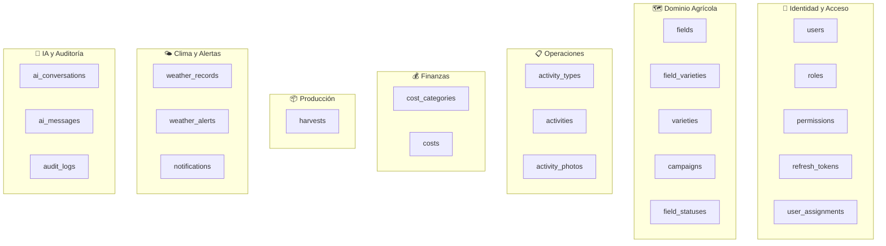

### 2.2 Descripción de Entidades

| # | Entidad | Dominio | Función Principal |
|---|---|---|---|
| 1 | `users` | Identidad | Almacena credenciales y datos básicos de todos los usuarios del sistema |
| 2 | `roles` | Identidad | Catálogo de roles del sistema (admin, productor, asesor, ingenio, encargado) |
| 3 | `permissions` | Identidad | Catálogo de permisos individuales (fields:read, costs:create, etc.) |
| 4 | `refresh_tokens` | Identidad | Almacena tokens de refresco JWT para sesiones activas |
| 5 | `user_assignments` | Identidad | Vincula asesores/productores con productores asignados (relación multi-tenant) |
| 6 | `fields` | Agrícola | Entidad principal que representa una parcela/lote con su geometría PostGIS |
| 7 | `field_varieties` | Agrícola | Tabla puente N:M que registra qué variedad se implantó en cada parcela y cuándo |
| 8 | `varieties` | Agrícola | Catálogo de variedades de caña de azúcar con características agronómicas |
| 9 | `campaigns` | Agrícola | Define cada campaña agrícola (ej: 2025/2026) para agrupar datos históricos |
| 10 | `field_statuses` | Agrícola | Catálogo de estados posibles de una parcela (activo, descanso, preparación) |
| 11 | `activity_types` | Operaciones | Catálogo de tipos de actividad (fertilización, riego, control, etc.) |
| 12 | `activities` | Operaciones | Registro de cada actividad realizada en una parcela |
| 13 | `activity_photos` | Operaciones | Archivos fotográficos asociados a actividades |
| 14 | `cost_categories` | Finanzas | Catálogo de categorías de costo (insumos, mano de obra, maquinaria, etc.) |
| 15 | `costs` | Finanzas | Registro de cada gasto asociado a una parcela y/o actividad |
| 16 | `harvests` | Producción | Registro de cosechas con toneladas, método y rendimiento calculado |
| 17 | `weather_records` | Clima | Datos climáticos históricos y actuales por zona geográfica |
| 18 | `weather_alerts` | Clima | Alertas climáticas generadas automáticamente |
| 19 | `notifications` | Alertas | Notificaciones del sistema para los usuarios |
| 20 | `ai_conversations` | IA | Sesiones de conversación con el asistente IA |
| 21 | `ai_messages` | IA | Mensajes individuales dentro de cada conversación con la IA |
| 22 | `audit_logs` | Auditoría | Registro de todas las operaciones críticas del sistema |

---

## 3. Modelo Entidad-Relación

### 3.1 Diagrama ERD Completo

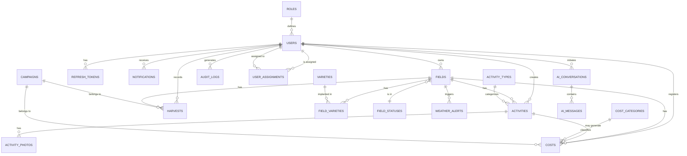

### 3.2 Diagrama de Relaciones Detallado

```mermaid
erDiagram
    users {
        uuid id PK
        string email UK
        string password_hash
        string full_name
        string phone
        uuid role_id FK
        boolean is_verified
        timestamp last_login_at
        jsonb preferences
        timestamp created_at
        timestamp updated_at
        timestamp deleted_at
    }

    roles {
        uuid id PK
        string code UK
        string name
        string description
        timestamp created_at
    }

    permissions {
        uuid id PK
        string code UK
        string name
        string resource
        timestamp created_at
    }

    roles_permissions {
        uuid role_id FK
        uuid permission_id FK
    }

    refresh_tokens {
        uuid id PK
        uuid user_id FK
        string token_hash
        timestamp expires_at
        boolean is_revoked
        timestamp created_at
    }

    user_assignments {
        uuid id PK
        uuid advisor_id FK
        uuid producer_id FK
        uuid assigned_by FK
        timestamp assigned_at
        timestamp expires_at
        timestamp created_at
    }

    fields {
        uuid id PK
        uuid user_id FK
        string name
        string description
        geometry polygon
        decimal area_hectares
        uuid field_status_id FK
        int ratoon_number
        string soil_type
        decimal soil_ph
        jsonb metadata
        timestamp created_at
        timestamp updated_at
        timestamp deleted_at
    }

    field_varieties {
        uuid id PK
        uuid field_id FK
        uuid variety_id FK
        date planting_date
        date end_date
        string note
        timestamp created_at
    }

    varieties {
        uuid id PK
        string code UK
        string name
        string origin
        string cycle
        decimal potential_yield_min
        decimal potential_yield_max
        string disease_tolerance
        string pest_tolerance
        string water_requirement
        string soil_preference
        string description
        jsonb characteristics
        uuid created_by FK
        timestamp created_at
        timestamp updated_at
        timestamp deleted_at
    }

    campaigns {
        uuid id PK
        string code UK
        string name
        date start_date
        date end_date
        boolean is_active
        timestamp created_at
    }

    field_statuses {
        uuid id PK
        string code UK
        string name
        timestamp created_at
    }

    activity_types {
        uuid id PK
        string code UK
        string name
        string icon
        boolean requires_product
        boolean requires_dose
        boolean requires_cost
        timestamp created_at
        timestamp deleted_at
    }

    activities {
        uuid id PK
        uuid field_id FK
        uuid activity_type_id FK
        uuid user_id FK
        uuid campaign_id FK
        date activity_date
        string product_name
        decimal dose_amount
        string dose_unit
        decimal dose_rate
        string observations
        jsonb metadata
        timestamp created_at
        timestamp updated_at
        timestamp deleted_at
    }

    activity_photos {
        uuid id PK
        uuid activity_id FK
        string file_path
        string filename
        string mime_type
        int file_size_bytes
        decimal latitude
        decimal longitude
        timestamp taken_at
        timestamp created_at
    }

    cost_categories {
        uuid id PK
        string code UK
        string name
        string icon
        boolean is_active
        timestamp created_at
        timestamp deleted_at
    }

    costs {
        uuid id PK
        uuid field_id FK
        uuid cost_category_id FK
        uuid user_id FK
        uuid activity_id FK
        uuid campaign_id FK
        date cost_date
        decimal amount
        string currency
        string description
        string provider
        string invoice_number
        jsonb metadata
        timestamp created_at
        timestamp updated_at
        timestamp deleted_at
    }

    harvests {
        uuid id PK
        uuid field_id FK
        uuid user_id FK
        uuid campaign_id FK
        date harvest_date
        decimal tons
        decimal estimated_yield
        string method
        string quality_grade
        decimal sucrose_percentage
        string observations
        uuid variety_id FK
        timestamp created_at
        timestamp updated_at
        timestamp deleted_at
    }

    weather_records {
        uuid id PK
        decimal latitude
        decimal longitude
        timestamp recorded_at
        decimal temperature
        decimal humidity
        decimal pressure
        decimal wind_speed
        decimal precipitation
        string condition
        string source
        jsonb raw_data
        timestamp created_at
    }

    weather_alerts {
        uuid id PK
        uuid user_id FK
        uuid field_id FK
        uuid campaign_id FK
        string alert_type
        string severity
        string title
        string description
        timestamp alert_from
        timestamp alert_until
        jsonb alert_data
        boolean is_read
        timestamp created_at
    }

    notifications {
        uuid id PK
        uuid user_id FK
        string notification_type
        string title
        string body
        string reference_type
        uuid reference_id
        boolean is_read
        timestamp read_at
        jsonb metadata
        timestamp created_at
    }

    ai_conversations {
        uuid id PK
        uuid user_id FK
        string title
        string context_summary
        int message_count
        timestamp last_message_at
        timestamp created_at
        timestamp updated_at
    }

    ai_messages {
        uuid id PK
        uuid conversation_id FK
        string role
        text content
        jsonb metadata
        int tokens_used
        timestamp created_at
    }

    audit_logs {
        uuid id PK
        uuid user_id FK
        string action
        string resource
        uuid resource_id
        string description
        jsonb previous_values
        jsonb new_values
        inet ip_address
        string user_agent
        timestamp created_at
    }
```

---

## 4. Diseño de Tablas

### 4.1 users

| Aspecto | Detalle |
|---|---|
| **Objetivo** | Almacenar las credenciales y datos básicos de todos los usuarios del sistema |
| **Descripción** | Tabla central de identidad. Cada fila representa un usuario registrado. Soporta soft delete para desactivación sin pérdida de datos históricos |

| Campo | Tipo | PK | FK | Unique | Not Null | Default | Descripción |
|---|---|---|---|---|---|---|---|
| id | uuid | ✓ | | | ✓ | gen_random_uuid() | Identificador único del usuario |
| email | varchar(255) | | | ✓ | ✓ | | Email del usuario, usado como login |
| password_hash | varchar(255) | | | | ✓ | | Hash Argon2id de la contraseña |
| full_name | varchar(255) | | | | ✓ | | Nombre completo del usuario |
| phone | varchar(50) | | | | | | Teléfono de contacto |
| avatar_url | varchar(500) | | | | | | URL del avatar (futuro) |
| role_id | uuid | | ✓ | | ✓ | | Rol del usuario (FK → roles) |
| is_verified | boolean | | | | ✓ | false | Indica si el email fue verificado |
| is_active | boolean | | | | ✓ | true | Indica si la cuenta está activa |
| last_login_at | timestamptz | | | | | | Último inicio de sesión |
| preferences | jsonb | | | | | '{}' | Preferencias del usuario (moneda, idioma, notificaciones) |
| created_at | timestamptz | | | | ✓ | now() | Fecha de creación |
| updated_at | timestamptz | | | | ✓ | now() | Última modificación |
| deleted_at | timestamptz | | | | | | Soft delete (NULL = activo) |

**Restricciones adicionales:**
- CHECK (length(email) >= 5)
- CHECK (length(full_name) >= 2)

### 4.2 roles

| Aspecto | Detalle |
|---|---|
| **Objetivo** | Catálogo de roles del sistema para control de acceso RBAC |
| **Descripción** | Define los roles disponibles. Se cargan con seed data y rara vez se modifican |

| Campo | Tipo | PK | FK | Unique | Not Null | Default | Descripción |
|---|---|---|---|---|---|---|---|
| id | uuid | ✓ | | | ✓ | gen_random_uuid() | |
| code | varchar(50) | | | ✓ | ✓ | | Código del rol: admin, producer, advisor, mill, field_manager |
| name | varchar(100) | | | | ✓ | | Nombre legible: Administrador, Productor, Asesor, etc. |
| description | text | | | | | | Descripción del rol |
| created_at | timestamptz | | | | ✓ | now() | |

**Seed data:** admin, producer, advisor, mill, field_manager, technician, transporter, researcher

### 4.3 permissions

| Aspecto | Detalle |
|---|---|
| **Objetivo** | Catálogo de permisos individuales del sistema |
| **Descripción** | Define acciones específicas que pueden realizarse (fields:create, costs:read, etc.) |

| Campo | Tipo | PK | FK | Unique | Not Null | Default | Descripción |
|---|---|---|---|---|---|---|---|
| id | uuid | ✓ | | | ✓ | gen_random_uuid() | |
| code | varchar(100) | | | ✓ | ✓ | | Código con formato resource:action (fields:create) |
| name | varchar(200) | | | | ✓ | | Nombre legible |
| resource | varchar(50) | | | | ✓ | | Recurso al que aplica (fields, costs, activities, etc.) |
| created_at | timestamptz | | | | ✓ | now() | |

### 4.4 roles_permissions

| Aspecto | Detalle |
|---|---|
| **Objetivo** | Tabla puente N:M entre roles y permisos |
| **Descripción** | Define qué permisos tiene cada rol |

| Campo | Tipo | PK | FK | Unique | Not Null | Default | Descripción |
|---|---|---|---|---|---|---|---|
| role_id | uuid | ✓ | ✓ | | ✓ | | FK → roles |
| permission_id | uuid | ✓ | ✓ | | ✓ | | FK → permissions |

**Restricciones:**
- PRIMARY KEY (role_id, permission_id)
- FK → roles(id) ON DELETE CASCADE
- FK → permissions(id) ON DELETE CASCADE

### 4.5 refresh_tokens

| Aspecto | Detalle |
|---|---|
| **Objetivo** | Almacenar tokens de refresco JWT para gestión de sesiones |
| **Descripción** | Cada fila representa un refresh token activo. Los tokens se rotan en cada uso y se revocan al cerrar sesión. Esta tabla NO tiene soft delete; los tokens expirados se eliminan físicamente |

| Campo | Tipo | PK | FK | Unique | Not Null | Default | Descripción |
|---|---|---|---|---|---|---|---|
| id | uuid | ✓ | | | ✓ | gen_random_uuid() | |
| user_id | uuid | | ✓ | | ✓ | | FK → users(id) ON DELETE CASCADE |
| token_hash | varchar(255) | | | ✓ | ✓ | | Hash del token (nunca se almacena el token plano) |
| expires_at | timestamptz | | | | ✓ | | Fecha de expiración (7 días desde creación) |
| is_revoked | boolean | | | | ✓ | false | Indica si fue revocado por rotación o logout |
| created_at | timestamptz | | | | ✓ | now() | |

**Estrategia de limpieza:** Job programado que elimina físicamente los tokens expirados y revocados con más de 24 horas.

### 4.6 user_assignments

| Aspecto | Detalle |
|---|---|
| **Objetivo** | Gestionar la relación entre asesores/productores y los productores que tienen asignados |
| **Descripción** | Permite que un asesor agronómico acceda a los datos de múltiples productores, o que un representante de ingenio vea los datos de productores asociados |

| Campo | Tipo | PK | FK | Unique | Not Null | Default | Descripción |
|---|---|---|---|---|---|---|---|
| id | uuid | ✓ | | | ✓ | gen_random_uuid() | |
| advisor_id | uuid | | ✓ | | ✓ | | FK → users(id) — usuario que accede |
| producer_id | uuid | | ✓ | | ✓ | | FK → users(id) — productor al que accede |
| assigned_by | uuid | | ✓ | | ✓ | | FK → users(id) — admin que creó la asignación |
| assigned_at | timestamptz | | | | ✓ | now() | |
| expires_at | timestamptz | | | | | | Fecha de expiración (NULL = permanente) |

**Restricciones:**
- UNIQUE (advisor_id, producer_id)
- FK → users(id) ON DELETE CASCADE
- CHECK (advisor_id <> producer_id) — No auto-asignación

### 4.7 fields

| Aspecto | Detalle |
|---|---|
| **Objetivo** | Entidad principal que representa una parcela o lote de caña de azúcar |
| **Descripción** | Cada fila representa una parcela con su geometría (polígono), datos agronómicos y estado actual. Es la tabla más importante del sistema, alrededor de la cual giran actividades, costos, cosechas y alertas |

| Campo | Tipo | PK | FK | Unique | Not Null | Default | Descripción |
|---|---|---|---|---|---|---|---|
| id | uuid | ✓ | | | ✓ | gen_random_uuid() | |
| user_id | uuid | | ✓ | | ✓ | | FK → users(id) — propietario de la parcela |
| name | varchar(200) | | | ✓ | ✓ | | Nombre de la parcela (único por productor) |
| description | text | | | | | | Descripción o notas generales |
| geometry | geometry(Polygon, 4326) | | | | ✓ | | Polígono PostGIS en WGS84 |
| area_hectares | decimal(12,4) | | | | ✓ | | Superficie calculada por ST_Area |
| field_status_id | uuid | | ✓ | | ✓ | | Estado actual (FK → field_statuses) |
| planting_date | date | | | | | | Fecha de siembra de la campaña actual |
| ratoon_number | int | | | | ✓ | 1 | Número de rango (1 = planta, 2+ = soca/resoca) |
| soil_type | varchar(100) | | | | | | Tipo de suelo (arcilloso, franco, arenoso) |
| soil_ph | decimal(4,2) | | | | | | pH del suelo (0-14) |
| metadata | jsonb | | | | | '{}' | Metadata extensible (análisis de suelo, etc.) |
| created_at | timestamptz | | | | ✓ | now() | |
| updated_at | timestamptz | | | | ✓ | now() | |
| deleted_at | timestamptz | | | | | | Soft delete |

**Restricciones:**
- UNIQUE (user_id, name) — Nombre único por productor
- UNIQUE (user_id, id) — Para FK compuestas
- CHECK (area_hectares >= 0.1 AND area_hectares <= 50000)
- CHECK (ratoon_number >= 1)
- CHECK (soil_ph IS NULL OR (soil_ph >= 0 AND soil_ph <= 14))
- CHECK (geometry IS NOT NULL AND ST_IsValid(geometry))

**Nota sobre unique constraint:** La unicidad del nombre por productor se implementa con UNIQUE (user_id, name) WHERE deleted_at IS NULL — un índice parcial que permite nombres repetidos entre registros eliminados.

### 4.8 field_varieties

| Aspecto | Detalle |
|---|---|
| **Objetivo** | Registrar históricamente qué variedades se implantaron en cada parcela |
| **Descripción** | Tabla puente N:M con información temporal. Una parcela puede tener múltiples variedades a lo largo del tiempo (campañas diferentes), y una variedad puede implantarse en múltiples parcelas |

| Campo | Tipo | PK | FK | Unique | Not Null | Default | Descripción |
|---|---|---|---|---|---|---|---|
| id | uuid | ✓ | | | ✓ | gen_random_uuid() | |
| field_id | uuid | | ✓ | | ✓ | | FK → fields(id) ON DELETE CASCADE |
| variety_id | uuid | | ✓ | | ✓ | | FK → varieties(id) |
| planting_date | date | | | | ✓ | | Fecha de implantación |
| end_date | date | | | | | | Fecha de fin de ciclo (cuando se cambió o cosechó) |
| note | text | | | | | | Nota sobre el desempeño de la variedad |
| created_at | timestamptz | | | | ✓ | now() | |

**Restricciones:**
- CHECK (end_date IS NULL OR end_date >= planting_date) — No se puede terminar antes de plantar

### 4.9 varieties

| Aspecto | Detalle |
|---|---|
| **Objetivo** | Catálogo de variedades de caña de azúcar con características agronómicas |
| **Descripción** | Cada fila representa una variedad registrada en el sistema. Alimentado inicialmente con las variedades comunes de Tucumán (LCP 85-384, TUCCP 77-42, etc.) |

| Campo | Tipo | PK | FK | Unique | Not Null | Default | Descripción |
|---|---|---|---|---|---|---|---|
| id | uuid | ✓ | | | ✓ | gen_random_uuid() | |
| code | varchar(50) | | | ✓ | ✓ | | Código de la variedad (LCP 85-384) |
| name | varchar(200) | | | | ✓ | | Nombre completo |
| origin | varchar(100) | | | | | | Origen o institución creadora |
| cycle | varchar(50) | | | | | | Ciclo: precoz, medio, tardío |
| potential_yield_min | decimal(8,2) | | | | | | Rendimiento potencial mínimo (ton/ha) |
| potential_yield_max | decimal(8,2) | | | | | | Rendimiento potencial máximo (ton/ha) |
| disease_tolerance | text | | | | | | Tolerancia a enfermedades |
| pest_tolerance | text | | | | | | Tolerancia a plagas |
| water_requirement | varchar(100) | | | | | | Requerimiento hídrico |
| soil_preference | varchar(200) | | | | | | Preferencia de suelo |
| description | text | | | | | | Descripción general |
| characteristics | jsonb | | | | | '{}' | Características adicionales (altura, tallo, etc.) |
| created_by | uuid | | ✓ | | | | FK → users(id) — admin que creó la variedad |
| created_at | timestamptz | | | | ✓ | now() | |
| updated_at | timestamptz | | | | ✓ | now() | |
| deleted_at | timestamptz | | | | | | Soft delete |

### 4.10 campaigns

| Aspecto | Detalle |
|---|---|
| **Objetivo** | Definir los períodos de campaña agrícola para agrupar datos históricos |
| **Descripción** | Cada campaña representa un ciclo productivo. En Tucumán, la campaña generalmente va de julio a diciembre (período de molienda), pero se flexibiliza para adaptarse a cada productor |

| Campo | Tipo | PK | FK | Unique | Not Null | Default | Descripción |
|---|---|---|---|---|---|---|---|
| id | uuid | ✓ | | | ✓ | gen_random_uuid() | |
| code | varchar(20) | | | ✓ | ✓ | | Código: "2025-2026", "2026" |
| name | varchar(100) | | | | ✓ | | Nombre: "Campaña 2025/2026" |
| start_date | date | | | | ✓ | | Inicio de la campaña |
| end_date | date | | | | | | Fin de la campaña (NULL si activa) |
| is_active | boolean | | | | ✓ | false | Indica si es la campaña actual |
| created_at | timestamptz | | | | ✓ | now() | |

**Restricciones:**
- CHECK (end_date IS NULL OR end_date > start_date)
- Solo una campaña puede tener is_active = true a la vez

### 4.11 field_statuses

| Aspecto | Detalle |
|---|---|
| **Objetivo** | Catálogo de estados posibles de una parcela |
| **Descripción** | Define el estado agronómico actual de la parcela. Se cargan con seed data |

| Campo | Tipo | PK | FK | Unique | Not Null | Default | Descripción |
|---|---|---|---|---|---|---|---|
| id | uuid | ✓ | | | ✓ | gen_random_uuid() | |
| code | varchar(50) | | | ✓ | ✓ | | active, fallow, preparing, harvested, resting |
| name | varchar(100) | | | | ✓ | | En producción, En descanso, En preparación, Cosechado |

**Seed data:**
- `active` — En producción (con caña en crecimiento)
- `fallow` — En descanso (barbecho)
- `preparing` — En preparación (labranza)
- `harvested` — Cosechado (esperando nuevo ciclo)
- `resting` — En reposo prolongado

### 4.12 activity_types

| Aspecto | Detalle |
|---|---|
| **Objetivo** | Catálogo de tipos de actividad agronómica disponibles |
| **Descripción** | Define qué tipos de actividades pueden registrarse. Cada tipo especifica qué campos son requeridos, permitiendo validación dinámica en frontend y backend |

| Campo | Tipo | PK | FK | Unique | Not Null | Default | Descripción |
|---|---|---|---|---|---|---|---|
| id | uuid | ✓ | | | ✓ | gen_random_uuid() | |
| code | varchar(50) | | | ✓ | ✓ | | fertilization, weed_control, pest_control, disease_control, irrigation, planting, thinning, burning, harvest, observation |
| name | varchar(100) | | | | ✓ | | Fertilización, Control de malezas, etc. |
| icon | varchar(50) | | | | | | Nombre del ícono para UI |
| requires_product | boolean | | | | ✓ | false | Indica si requiere producto/dosis |
| requires_dose | boolean | | | | ✓ | false | Indica si requiere dosis |
| requires_cost | boolean | | | | ✓ | false | Indica si requiere costo asociado |
| created_at | timestamptz | | | | ✓ | now() | |
| deleted_at | timestamptz | | | | | | Soft delete |

### 4.13 activities

| Aspecto | Detalle |
|---|---|
| **Objetivo** | Registro de cada actividad agronómica realizada en una parcela |
| **Descripción** | Tabla central de operaciones. Cada fila representa una actividad realizada en una fecha específica en una parcela. Es la tabla de mayor volumen de registros junto a costs |

| Campo | Tipo | PK | FK | Unique | Not Null | Default | Descripción |
|---|---|---|---|---|---|---|---|
| id | uuid | ✓ | | | ✓ | gen_random_uuid() | |
| field_id | uuid | | ✓ | | ✓ | | FK → fields(id) |
| activity_type_id | uuid | | ✓ | | ✓ | | FK → activity_types(id) |
| user_id | uuid | | ✓ | | ✓ | | FK → users(id) — responsable |
| campaign_id | uuid | | ✓ | | | | FK → campaigns(id) — se asigna automáticamente |
| activity_date | date | | | | ✓ | | Fecha de la actividad |
| product_name | varchar(200) | | | | | | Nombre del producto utilizado |
| dose_amount | decimal(12,4) | | | | | | Cantidad de dosis |
| dose_unit | varchar(50) | | | | | | Unidad de dosis (kg, l, g) |
| dose_rate | decimal(12,4) | | | | | | Dosis por hectárea |
| observations | text | | | | | | Observaciones del responsable |
| metadata | jsonb | | | | | '{}' | Datos extensibles (condiciones climáticas al momento, etc.) |
| created_at | timestamptz | | | | ✓ | now() | |
| updated_at | timestamptz | | | | ✓ | now() | |
| deleted_at | timestamptz | | | | | | Soft delete |

**Restricciones:**
- CHECK (activity_date <= CURRENT_DATE) — No actividades futuras
- CHECK (dose_amount IS NULL OR dose_amount > 0)
- CHECK (dose_rate IS NULL OR dose_rate > 0)

### 4.14 activity_photos

| Aspecto | Detalle |
|---|---|
| **Objetivo** | Almacenar las referencias a fotografías adjuntas a actividades |
| **Descripción** | Permite adjuntar evidencia visual a las actividades de campo. Las imágenes se almacenan en Cloudflare R2; la tabla guarda la referencia |

| Campo | Tipo | PK | FK | Unique | Not Null | Default | Descripción |
|---|---|---|---|---|---|---|---|
| id | uuid | ✓ | | | ✓ | gen_random_uuid() | |
| activity_id | uuid | | ✓ | | ✓ | | FK → activities(id) ON DELETE CASCADE |
| file_path | varchar(500) | | | | ✓ | | Ruta en R2 |
| filename | varchar(200) | | | | ✓ | | Nombre original del archivo |
| mime_type | varchar(50) | | | | ✓ | | image/jpeg, image/png |
| file_size_bytes | int | | | | ✓ | | Tamaño en bytes |
| latitude | decimal(10,7) | | | | | | Latitud GPS donde se tomó la foto |
| longitude | decimal(10,7) | | | | | | Longitud GPS donde se tomó la foto |
| taken_at | timestamptz | | | | | | Fecha/hora de la toma (del EXIF) |
| created_at | timestamptz | | | | ✓ | now() | |

### 4.15 cost_categories

| Aspecto | Detalle |
|---|---|
| **Objetivo** | Catálogo de categorías de costo |
| **Descripción** | Define las categorías contables para clasificar gastos. Se cargan con seed data |

| Campo | Tipo | PK | FK | Unique | Not Null | Default | Descripción |
|---|---|---|---|---|---|---|---|
| id | uuid | ✓ | | | ✓ | gen_random_uuid() | |
| code | varchar(50) | | | ✓ | ✓ | | inputs, labor, machinery, transport, services, other |
| name | varchar(100) | | | | ✓ | | Insumos, Mano de obra, Maquinaria, Transporte, Servicios, Otros |
| icon | varchar(50) | | | | | | Icono para UI |
| is_active | boolean | | | | ✓ | true | |
| created_at | timestamptz | | | | ✓ | now() | |
| deleted_at | timestamptz | | | | | | Soft delete |

### 4.16 costs

| Aspecto | Detalle |
|---|---|
| **Objetivo** | Registro de gastos asociados a parcelas |
| **Descripción** | Cada fila representa un gasto. Puede estar asociado directamente a una parcela o a una actividad específica. Esta tabla es crítica para el análisis de rentabilidad |

| Campo | Tipo | PK | FK | Unique | Not Null | Default | Descripción |
|---|---|---|---|---|---|---|---|
| id | uuid | ✓ | | | ✓ | gen_random_uuid() | |
| field_id | uuid | | ✓ | | ✓ | | FK → fields(id) |
| cost_category_id | uuid | | ✓ | | ✓ | | FK → cost_categories(id) |
| user_id | uuid | | ✓ | | ✓ | | FK → users(id) — quien registró |
| activity_id | uuid | | ✓ | | | | FK → activities(id) — costo vinculado a actividad |
| campaign_id | uuid | | ✓ | | ✓ | | FK → campaigns(id) |
| cost_date | date | | | | ✓ | | Fecha del gasto |
| amount | decimal(12,2) | | | | ✓ | | Monto del gasto |
| currency | varchar(3) | | | | ✓ | 'ARS' | Moneda (ARS, USD) |
| description | varchar(500) | | | | | | Descripción del gasto |
| provider | varchar(200) | | | | | | Proveedor o beneficiario |
| invoice_number | varchar(100) | | | | | | Número de factura o comprobante |
| metadata | jsonb | | | | | '{}' | Datos adicionales |
| created_at | timestamptz | | | | ✓ | now() | |
| updated_at | timestamptz | | | | ✓ | now() | |
| deleted_at | timestamptz | | | | | | Soft delete |

**Restricciones:**
- CHECK (amount >= 0)
- CHECK (cost_date <= CURRENT_DATE) — No gastos futuros
- CHECK (currency IN ('ARS', 'USD'))

### 4.17 harvests

| Aspecto | Detalle |
|---|---|
| **Objetivo** | Registrar la cosecha de caña de azúcar por parcela |
| **Descripción** | Cada fila representa un evento de cosecha. El rendimiento (ton/ha) se calcula automáticamente al insertar o actualizar |

| Campo | Tipo | PK | FK | Unique | Not Null | Default | Descripción |
|---|---|---|---|---|---|---|---|
| id | uuid | ✓ | | | ✓ | gen_random_uuid() | |
| field_id | uuid | | ✓ | | ✓ | | FK → fields(id) |
| user_id | uuid | | ✓ | | ✓ | | FK → users(id) — quien registró |
| campaign_id | uuid | | ✓ | | ✓ | | FK → campaigns(id) |
| variety_id | uuid | | ✓ | | | | FK → varieties(id) — variedad cosechada |
| harvest_date | date | | | | ✓ | | Fecha de cosecha |
| tons | decimal(12,2) | | | | ✓ | | Toneladas cosechadas |
| estimated_yield | decimal(10,2) | | | | | | Rendimiento calculado (tons / area_hectares) |
| method | varchar(50) | | | | ✓ | | Manual, Mecánico, Semimecanizado |
| quality_grade | varchar(20) | | | | | | Grado de calidad (A, B, C) |
| sucrose_percentage | decimal(5,2) | | | | | | Porcentaje de sacarosa |
| observations | text | | | | | | Observaciones |
| created_at | timestamptz | | | | ✓ | now() | |
| updated_at | timestamptz | | | | ✓ | now() | |
| deleted_at | timestamptz | | | | | | Soft delete |

**Restricciones:**
- CHECK (tons > 0)
- CHECK (harvest_date <= CURRENT_DATE)
- CHECK (method IN ('manual', 'mechanic', 'semi-mechanic'))
- CHECK (sucrose_percentage IS NULL OR (sucrose_percentage >= 0 AND sucrose_percentage <= 100))

### 4.18 weather_records

| Aspecto | Detalle |
|---|---|
| **Objetivo** | Almacenar datos climáticos históricos y actuales |
| **Descripción** | Datos obtenidos de OpenWeatherMap. Se almacenan con coordenadas geográficas para permitir consultas por zona. Esta tabla puede crecer rápidamente; se recomienda particionado por mes |

| Campo | Tipo | PK | FK | Unique | Not Null | Default | Descripción |
|---|---|---|---|---|---|---|---|
| id | uuid | ✓ | | | ✓ | gen_random_uuid() | |
| latitude | decimal(10,7) | | | | ✓ | | Latitud de la medición |
| longitude | decimal(10,7) | | | | ✓ | | Longitud de la medición |
| recorded_at | timestamptz | | | | ✓ | | Fecha/hora de la medición |
| temperature | decimal(5,2) | | | | | | Temperatura en °C |
| humidity | decimal(5,2) | | | | | | Humedad relativa en % |
| pressure | decimal(7,2) | | | | | | Presión atmosférica en hPa |
| wind_speed | decimal(6,2) | | | | | | Velocidad del viento en m/s |
| precipitation | decimal(6,2) | | | | | | Precipitación en mm |
| condition | varchar(100) | | | | | | Descripción de la condición (despejado, lluvioso, etc.) |
| source | varchar(50) | | | | ✓ | 'OpenWeatherMap' | Fuente del dato |
| raw_data | jsonb | | | | | | Datos crudos del proveedor |
| created_at | timestamptz | | | | ✓ | now() | |

**Índice:** GiST en coordenadas para búsqueda espacial, compuesto en (recorded_at, latitude, longitude).

### 4.19 weather_alerts

| Aspecto | Detalle |
|---|---|
| **Objetivo** | Alertas climáticas generadas automáticamente |
| **Descripción** | Alertas como riesgo de helada, lluvia intensa, vientos fuertes. Se generan por sistema y se asocian a usuarios y parcelas |

| Campo | Tipo | PK | FK | Unique | Not Null | Default | Descripción |
|---|---|---|---|---|---|---|---|
| id | uuid | ✓ | | | ✓ | gen_random_uuid() | |
| user_id | uuid | | ✓ | | ✓ | | FK → users(id) |
| field_id | uuid | | ✓ | | | | FK → fields(id) — parcela afectada (opcional) |
| alert_type | varchar(50) | | | | ✓ | | frost, heavy_rain, strong_wind, drought |
| severity | varchar(20) | | | | ✓ | | low, medium, high, critical |
| title | varchar(200) | | | | ✓ | | Título de la alerta |
| description | text | | | | ✓ | | Descripción detallada |
| alert_from | timestamptz | | | | ✓ | | Inicio del evento |
| alert_until | timestamptz | | | | | | Fin del evento estimado |
| alert_data | jsonb | | | | | | Datos adicionales (temperatura pronosticada, etc.) |
| is_read | boolean | | | | ✓ | false | |
| created_at | timestamptz | | | | ✓ | now() | |

### 4.20 notifications

| Aspecto | Detalle |
|---|---|
| **Objetivo** | Centro de notificaciones del sistema |
| **Descripción** | Notificaciones generadas por diversos eventos: actividad vencida, alerta climática, sugerencia IA, etc. |

| Campo | Tipo | PK | FK | Unique | Not Null | Default | Descripción |
|---|---|---|---|---|---|---|---|
| id | uuid | ✓ | | | ✓ | gen_random_uuid() | |
| user_id | uuid | | ✓ | | ✓ | | FK → users(id) |
| notification_type | varchar(50) | | | | ✓ | | activity_due, weather_alert, ai_suggestion, harvest_reminder |
| title | varchar(200) | | | | ✓ | | Título |
| body | text | | | | ✓ | | Cuerpo |
| reference_type | varchar(50) | | | | | | Tipo de recurso referenciado (activity, field, harvest) |
| reference_id | uuid | | | | | | ID del recurso referenciado |
| is_read | boolean | | | | ✓ | false | |
| read_at | timestamptz | | | | | | Fecha de lectura |
| metadata | jsonb | | | | | '{}' | Metadata adicional |
| created_at | timestamptz | | | | ✓ | now() | |

### 4.21 ai_conversations

| Aspecto | Detalle |
|---|---|
| **Objetivo** | Gestionar sesiones de conversación con el asistente IA |
| **Descripción** | Cada fila representa una sesión de chat. Agrupa múltiples mensajes (preguntas y respuestas). Permite al usuario retomar conversaciones anteriores |

| Campo | Tipo | PK | FK | Unique | Not Null | Default | Descripción |
|---|---|---|---|---|---|---|---|
| id | uuid | ✓ | | | ✓ | gen_random_uuid() | |
| user_id | uuid | | ✓ | | ✓ | | FK → users(id) |
| title | varchar(200) | | | | | | Título generado automáticamente |
| context_summary | text | | | | | | Resumen del contexto de la conversación |
| message_count | int | | | | ✓ | 0 | Contador de mensajes (desnormalizado) |
| last_message_at | timestamptz | | | | | | Última interacción |
| created_at | timestamptz | | | | ✓ | now() | |
| updated_at | timestamptz | | | | ✓ | now() | |

### 4.22 ai_messages

| Aspecto | Detalle |
|---|---|
| **Objetivo** | Almacenar cada mensaje individual de las conversaciones con la IA |
| **Descripción** | Contiene tanto las preguntas del usuario como las respuestas del asistente. Los tokens_used permiten monitorear el consumo de la API de OpenAI |

| Campo | Tipo | PK | FK | Unique | Not Null | Default | Descripción |
|---|---|---|---|---|---|---|---|
| id | uuid | ✓ | | | ✓ | gen_random_uuid() | |
| conversation_id | uuid | | ✓ | | ✓ | | FK → ai_conversations(id) ON DELETE CASCADE |
| role | varchar(20) | | | | ✓ | | user, assistant, system |
| content | text | | | | ✓ | | Contenido del mensaje |
| metadata | jsonb | | | | | '{}' | Metadatos (tipo de consulta, datos recuperados, etc.) |
| tokens_used | int | | | | | | Tokens consumidos (para monitoreo de costos) |
| created_at | timestamptz | | | | ✓ | now() | |

**Restricciones:**
- CHECK (role IN ('user', 'assistant', 'system'))

### 4.23 audit_logs

| Aspecto | Detalle |
|---|---|
| **Objetivo** | Registrar operaciones críticas del sistema para trazabilidad y seguridad |
| **Descripción** | Tabla append-only (solo inserción, nunca modificación). Registra cada acción importante: inicios de sesión, creación/eliminación de recursos, cambios de configuración |

| Campo | Tipo | PK | FK | Unique | Not Null | Default | Descripción |
|---|---|---|---|---|---|---|---|
| id | uuid | ✓ | | | ✓ | gen_random_uuid() | |
| user_id | uuid | | ✓ | | | | FK → users(id) — NULL para acciones del sistema |
| action | varchar(50) | | | | ✓ | | create, read, update, delete, login, logout, export |
| resource | varchar(50) | | | | ✓ | | fields, activities, costs, harvests, users, etc. |
| resource_id | uuid | | | | | | ID del recurso afectado |
| description | text | | | | | | Descripción legible |
| previous_values | jsonb | | | | | | Valores previos (en update) |
| new_values | jsonb | | | | | | Nuevos valores (en create/update) |
| ip_address | inet | | | | | | Dirección IP del cliente |
| user_agent | text | | | | | | User-Agent del cliente |
| created_at | timestamptz | | | | ✓ | now() | |

---

## 5. Relaciones

### 5.1 Relaciones Uno a Uno (1:1)

| Relación | Tabla A | Tabla B | Detalle |
|---|---|---|---|
| Un usuario tiene un perfil | users | — | Los datos de perfil están embebidos en users (no hay tabla separada para simplificar) |
| Una actividad puede tener un costo directo | activities | costs | Un costo opcionalmente vinculado a una actividad |

**Justificación:** No se justifican tablas 1:1 separadas en este diseño. Los pocos casos (perfil de usuario) se manejan con columnas dentro de la misma tabla para evitar joins innecesarios.

### 5.2 Relaciones Uno a Muchos (1:N)

| Relación | Tabla "Uno" | Tabla "Muchos" | Campo FK |
|---|---|---|---|
| Usuario → Parcelas | users | fields | fields.user_id |
| Usuario → Actividades | users | activities | activities.user_id |
| Usuario → Costos | users | costs | costs.user_id |
| Usuario → Cosechas | users | harvests | harvests.user_id |
| Usuario → Notificaciones | users | notifications | notifications.user_id |
| Usuario → Conversaciones IA | users | ai_conversations | ai_conversations.user_id |
| Usuario → Tokens de refresco | users | refresh_tokens | refresh_tokens.user_id |
| Parcela → Actividades | fields | activities | activities.field_id |
| Parcela → Costos | fields | costs | costs.field_id |
| Parcela → Cosechas | fields | harvests | harvests.field_id |
| Parcela → Alertas climáticas | fields | weather_alerts | weather_alerts.field_id |
| Tipo de actividad → Actividades | activity_types | activities | activities.activity_type_id |
| Categoría de costo → Costos | cost_categories | costs | costs.cost_category_id |
| Campaña → Costos | campaigns | costs | costs.campaign_id |
| Campaña → Cosechas | campaigns | harvests | harvests.campaign_id |
| Campaña → Actividades | campaigns | activities | activities.campaign_id |
| Conversación IA → Mensajes | ai_conversations | ai_messages | ai_messages.conversation_id |
| Actividad → Fotos | activities | activity_photos | activity_photos.activity_id |
| Rol → Usuarios | roles | users | users.role_id |

**Justificación:** La mayoría de las relaciones del sistema son 1:N. Una parcela tiene muchas actividades a lo largo del tiempo; un usuario tiene muchas parcelas. Este patrón es natural en un modelo relacional y se implementa con foreign keys en el lado "muchos".

### 5.3 Relaciones Muchos a Muchos (N:M)

| Relación | Tabla A | Tabla Puente | Tabla B | Justificación |
|---|---|---|---|---|
| Parcelas ↔ Variedades | fields | field_varieties | varieties | Una parcela tiene diferentes variedades a lo largo del tiempo, y una variedad se implanta en múltiples parcelas. La tabla puente incluye fecha de implantación para tracking histórico |
| Roles ↔ Permisos | roles | roles_permissions | permissions | Cada rol agrupa múltiples permisos, y un permiso puede estar en múltiples roles. Tabla puente estándar RBAC |
| Usuarios ↔ Productores (asignaciones) | users | user_assignments | users | Un asesor puede tener múltiples productores asignados y un productor puede tener múltiples asesores. Tabla puente auto-referencial |

### 5.4 Relaciones Geográficas

| Relación | Descripción | Implementación |
|---|---|---|
| Parcela ↔ Zona | Una parcela está dentro de una zona geográfica | Consulta espacial: ST_Within(field.geometry, zone.geometry) |
| Parcela ↔ Parcela cercana | Parcelas próximas entre sí | Consulta espacial: ST_DWithin(a.geometry, b.geometry, radius) |
| Alerta climática ↔ Parcela | Una alerta afecta una zona que contiene parcelas | La alerta tiene coordenadas; se cruza con parcelas vía ST_Within |
| Registro climático ↔ Zona | Datos climáticos por coordenadas | weather_records.latitude/longitude + búsqueda espacial |

### 5.5 Relaciones Históricas

| Relación | Descripción | Implementación |
|---|---|---|
| Parcela ↔ Campañas | Una parcela participa en múltiples campañas | Se obtiene por las actividades/cosechas vinculadas a campañas |
| Variedad ↔ Parcela (histórico) | Qué variedad estuvo en cada parcela y cuándo | field_varieties con planting_date y end_date |
| Actividad ↔ Campaña | Una actividad pertenece a una campaña | activities.campaign_id |
| Costo ↔ Campaña | Un costo se asigna a una campaña | costs.campaign_id |

---

## 6. Índices

### 6.1 Índices Primarios

Todas las tablas tienen índice automático en su clave primaria `id` (UUID). PostgreSQL crea un índice único en la primary key por defecto.

### 6.2 Índices de Búsqueda Común

| Tabla | Columnas | Tipo | Propósito | Query Ejemplo |
|---|---|---|---|---|
| users | email | B-tree (unique) | Búsqueda por email en login | `SELECT * FROM users WHERE email = '...'` |
| fields | user_id, deleted_at | B-tree compuesto | Listar parcelas activas de un productor | `SELECT * FROM fields WHERE user_id = ? AND deleted_at IS NULL` |
| fields | user_id, name | B-tree compuesto (unique partial) | Validar nombre único por productor | `SELECT * FROM fields WHERE user_id = ? AND name = ?` |
| activities | field_id, activity_date | B-tree compuesto | Historial cronológico de una parcela | `SELECT * FROM activities WHERE field_id = ? ORDER BY activity_date DESC` |
| activities | user_id, activity_date | B-tree compuesto | Actividades recientes de un usuario | `SELECT * FROM activities WHERE user_id = ? ORDER BY activity_date DESC LIMIT 10` |
| activities | campaign_id | B-tree | Filtrar actividades por campaña | `SELECT * FROM activities WHERE campaign_id = ?` |
| activities | activity_type_id, field_id | B-tree compuesto | Filtrar por tipo en parcela específica | `SELECT * FROM activities WHERE activity_type_id = ? AND field_id = ?` |
| costs | field_id, cost_date | B-tree compuesto | Costos de una parcela por fecha | `SELECT * FROM costs WHERE field_id = ? ORDER BY cost_date DESC` |
| costs | campaign_id | B-tree | Costos agregados por campaña | `SELECT * FROM costs WHERE campaign_id = ?` |
| costs | cost_category_id | B-tree | Costos por categoría | `SELECT * FROM costs WHERE cost_category_id = ?` |
| harvests | field_id, campaign_id | B-tree compuesto | Cosechas de una parcela en una campaña | `SELECT * FROM harvests WHERE field_id = ? AND campaign_id = ?` |
| harvests | campaign_id | B-tree | Producción total por campaña | `SELECT * FROM harvests WHERE campaign_id = ?` |
| notifications | user_id, is_read, created_at | B-tree compuesto parcial | Notificaciones no leídas de un usuario | `SELECT * FROM notifications WHERE user_id = ? AND is_read = false ORDER BY created_at DESC` |
| ai_messages | conversation_id, created_at | B-tree compuesto | Mensajes de una conversación ordenados | `SELECT * FROM ai_messages WHERE conversation_id = ? ORDER BY created_at ASC` |
| audit_logs | user_id, created_at | B-tree compuesto | Auditoría por usuario | `SELECT * FROM audit_logs WHERE user_id = ? ORDER BY created_at DESC` |
| audit_logs | resource, resource_id | B-tree compuesto | Auditoría de un recurso específico | `SELECT * FROM audit_logs WHERE resource = ? AND resource_id = ?` |
| weather_records | recorded_at | B-tree | Registros climáticos por fecha | `SELECT * FROM weather_records WHERE recorded_at >= ? ORDER BY recorded_at` |
| refresh_tokens | token_hash | B-tree (unique) | Validación de token de refresco | `SELECT * FROM refresh_tokens WHERE token_hash = ?` |
| refresh_tokens | user_id | B-tree | Revocar tokens de un usuario | `SELECT * FROM refresh_tokens WHERE user_id = ?` |

### 6.3 Índices Geoespaciales

| Tabla | Columnas | Tipo | Propósito | Query Ejemplo |
|---|---|---|---|---|
| fields | geometry | GiST | Todas las consultas espaciales: identificación por click, parcelas en viewport, parcelas cercanas | `SELECT * FROM fields WHERE geometry && ST_MakeEnvelope(...)` |
| fields | geometry | GiST con ST_GeomFromGeoJSON | Importación de parcelas desde GeoJSON | `SELECT ST_GeomFromGeoJSON('...')` |

**Justificación:** El índice GiST es el tipo de índice recomendado por PostGIS para datos geométricos. Permite consultas eficientes de intersección, contención, proximidad y cálculo de área. Sin este índice, las consultas geoespaciales harían full table scan, lo que sería inaceptable con más de 1,000 parcelas.

### 6.4 Índices JSONB

| Tabla | Columnas | Tipo | Propósito |
|---|---|---|---|
| users | preferences | GIN | Búsqueda dentro de preferencias de usuario |
| fields | metadata | GIN | Búsqueda dentro de metadatos de parcela (ej: análisis de suelo) |
| varieties | characteristics | GIN | Búsqueda de variedades por características específicas |

**Justificación:** GIN (Generalized Inverted Index) es el tipo de índice óptimo para documentos JSONB. Permite consultas como `metadata @> '{"soil_type": "franco"}'` de forma eficiente.

### 6.5 Índices Parciales

| Tabla | Columnas | Condición WHERE | Propósito |
|---|---|---|---|
| fields | user_id, name | `deleted_at IS NULL` | Garantiza nombre único solo entre parcelas activas |
| activities | field_id, activity_date | `deleted_at IS NULL` | Historial de actividades activas |
| notifications | user_id, created_at | `is_read = false` | Notificaciones no leídas |

**Justificación:** Los índices parciales reducen el tamaño del índice al incluir solo registros que cumplen la condición. Esto mejora el rendimiento de las consultas más frecuentes (solo registros activos) y reduce el espacio de almacenamiento.

### 6.6 Índices Únicos

| Tabla | Columnas | Propósito |
|---|---|---|
| users | email | Garantizar email único |
| varieties | code | Garantizar código de variedad único |
| campaigns | code | Garantizar código de campaña único |
| field_statuses | code | Garantizar código de estado único |
| activity_types | code | Garantizar código de tipo de actividad único |
| cost_categories | code | Garantizar código de categoría de costo único |
| roles | code | Garantizar código de rol único |
| permissions | code | Garantizar código de permiso único |
| fields | user_id + name (partial) | Nombre único por productor (solo activos) |

---

## 7. Estrategia Histórica

### 7.1 Principio de Preservación Total

SmartCaña **nunca pierde información**. Toda modificación o eliminación se gestiona de forma que los datos históricos permanezcan accesibles para análisis, reportes y consultas IA.

### 7.2 Soft Delete Universal

Toda tabla del dominio (excluyendo tablas temporales como refresh_tokens) implementa soft delete:

```mermaid
graph TB
    subgraph "Eliminación Física (NO)"
        A[DELETE FROM fields WHERE id = ?] --> X[❌ Datos perdidos permanentemente]
    end

    subgraph "Eliminación Lógica (SÍ)"
        B[UPDATE fields SET deleted_at = NOW() WHERE id = ?] --> Y[✅ Datos preservados]
        Y --> Z1[Reportes históricos: excluir deleted]
        Y --> Z2[Vista activa: WHERE deleted_at IS NULL]
        Y --> Z3[Admin: puede ver registros eliminados]
    end
```

**Comportamiento por capa:**
- **API (NestJS):** Todos los servicios filtran `WHERE deleted_at IS NULL` por defecto.
- **Prisma:** Se utiliza un middleware global que agrega el filtro de soft delete automáticamente.
- **Consultas IA:** Tienen acceso a datos históricos (incluyendo eliminados) para responder preguntas sobre campañas pasadas.
- **Reportes:** Pueden incluir datos de parcelas eliminadas si el usuario selecciona "incluir históricos".

### 7.3 Preservación por Campaña

La campaña agrícola es la unidad de agrupación histórica:

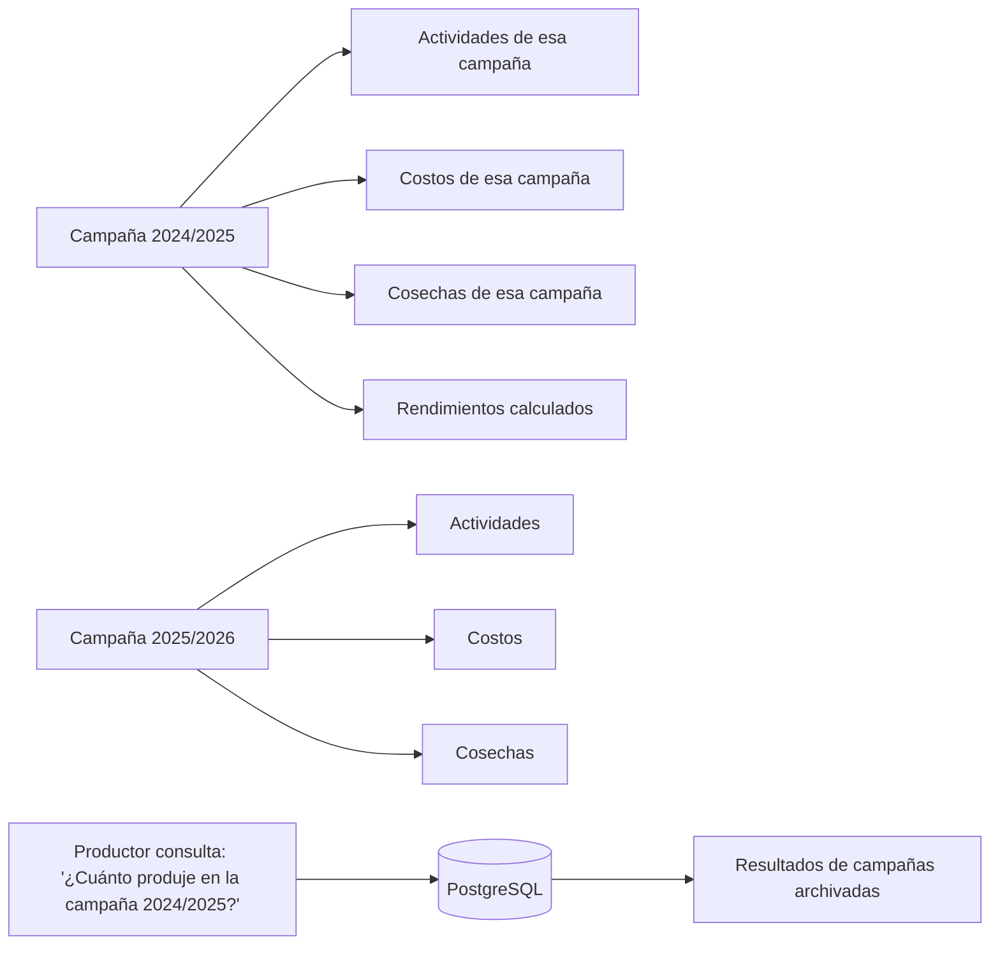

**Mecanismo:**
- Cada actividad, costo y cosecha se asigna a una campaña mediante `campaign_id`.
- Las campañas pasadas se marcan como `is_active = false`.
- Los datos nunca se eliminan, solo se archivan por campaña.
- Los reportes históricos funcionan seleccionando la campaña correspondiente.

### 7.4 Auditoría de Cambios

La tabla `audit_logs` captura:

| Evento | Datos Capturados | Retención |
|---|---|---|
| Creación de parcela | new_values = {nombre, area, etc.} | Indefinida |
| Modificación de parcela | previous_values + new_values | Indefinida |
| Eliminación de parcela | previous_values | Indefinida |
| Inicio de sesión | ip_address, user_agent | 1 año |
| Exportación de reportes | tipo de reporte, formato | 1 año |
| Consulta IA | tipo de consulta (sin contenido) | 1 año |
| Cambio de rol/permiso | previous_values + new_values | Indefinida |

### 7.5 Historial de Conversaciones IA

Las conversaciones con el asistente IA se conservan indefinidamente:

- **ai_conversations**: Metadatos de la sesión (título, resumen, conteo de mensajes).
- **ai_messages**: Cada mensaje individual con su rol (user/assistant/system).
- **metadata en ai_messages**: Almacena el tipo de consulta detectada (producción, costos, recomendación) para análisis posteriores.
- **Uso**: El usuario puede retomar conversaciones anteriores. La IA puede referenciar preguntas previas para dar respuestas contextuales.

### 7.6 Estrategia de Archivado

Para tablas de alto volumen (weather_records, audit_logs, ai_messages):

| Volumen | Estrategia | Herramienta |
|---|---|---|
| < 1M registros | Permanecen en la misma tabla | Índices optimizados |
| 1M–10M registros | Particionado por período | PostgreSQL declarative partitioning |
| 10M–100M registros | Particionado + compressión | pg_partman, TOAST |
| > 100M registros | Archivado a tabla separada + Foreign Data Wrappers | FDW + lectura bajo demanda |

---

## 8. Estrategia Geoespacial

### 8.1 Stack Geoespacial en Base de Datos

| Capa | Tecnología | Función |
|---|---|---|
| **Almacenamiento** | PostGIS geometry type | Polígonos de parcelas en WGS84 (EPSG:4326) |
| **Cálculos** | Funciones PostGIS | Área, intersección, distancia, transformación |
| **Índice** | GiST | Consultas espaciales performantes |
| **Intercambio** | GeoJSON (ST_AsGeoJSON, ST_GeomFromGeoJSON) | Comunicación con frontend (Leaflet) |
| **Sistema de coordenadas** | WGS84 (EPSG:4326) | Estándar GPS, intercambio con Leaflet |

### 8.2 Almacenamiento de Parcelas

Cada parcela almacena su geometría como un polígono cerrado:

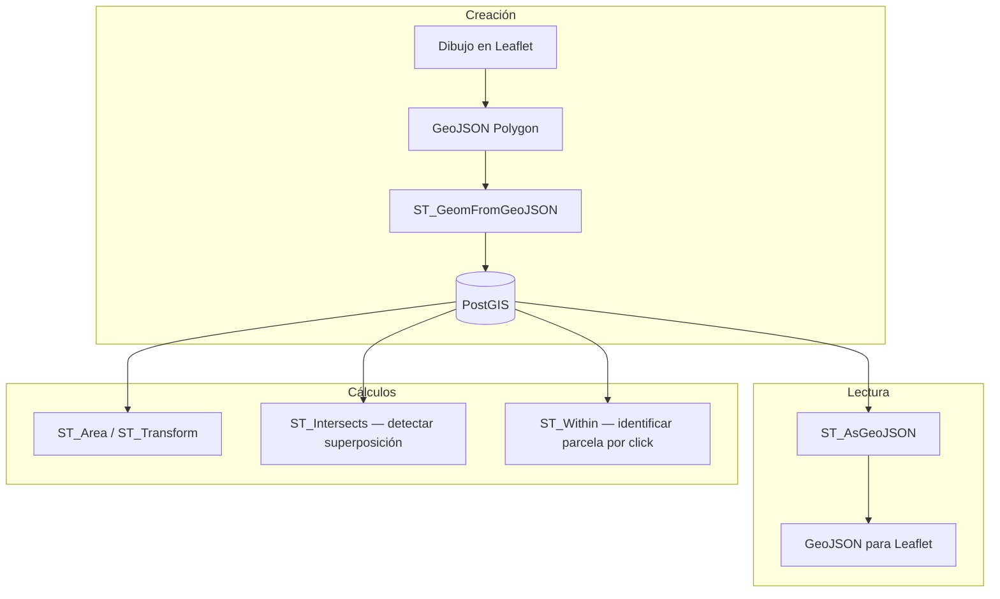

### 8.3 Funciones PostGIS Utilizadas

| Función | Propósito | Frecuencia |
|---|---|---|
| `ST_GeomFromGeoJSON(text)` | Convertir GeoJSON de entrada en geometría PostGIS | Alta (cada creación/edición de parcela) |
| `ST_AsGeoJSON(geometry, precision)` | Convertir geometría a GeoJSON para frontend | Muy alta (cada carga de mapa) |
| `ST_Area(geometry::geography)` | Calcular superficie en metros cuadrados → convertir a hectáreas | Alta (cada creación/edición) |
| `ST_Within(geometry, geometry)` | Determinar si un punto está dentro de un polígono | Alta (click en mapa) |
| `ST_Intersects(geometry, geometry)` | Detectar superposición entre parcelas | Media (validación de nuevas parcelas) |
| `ST_DWithin(geometry, geometry, radius)` | Encontrar parcelas cercanas a un punto | Baja (búsqueda por cercanía) |
| `ST_MakeEnvelope(xmin, ymin, xmax, ymax, srid)` | Crear bounding box para consulta por viewport | Alta (carga de parcelas en viewport) |
| `ST_Transform(geometry, target_srid)` | Convertir entre sistemas de coordenadas | Media (cálculos de área precisos) |
| `ST_IsValid(geometry)` | Validar que el polígono es geométricamente válido | Alta (validación al guardar) |
| `ST_Simplify(geometry, tolerance)` | Simplificar polígonos para rendimiento en mapas | Baja (futuro: niveles de zoom) |

### 8.4 Precisión y Sistemas de Coordenadas

| Aspecto | Valor | Justificación |
|---|---|---|
| **Sistema de almacenamiento** | EPSG:4326 (WGS84) | Estándar GPS, intercambiable con Leaflet, GeoJSON nativo |
| **Sistema de cálculo de área** | EPSG:4326 con cast a geography | `ST_Area(geometry::geography)` calcula área real en la superficie del elipsoide |
| **Precisión de coordenadas** | 6 decimales (~11cm) | Suficiente para delimitación de parcelas agrícolas (precisión submétrica) |
| **Precisión de área** | 4 decimales (~0.0001 ha) | Suficiente para cálculos de rendimiento y costos por hectárea |

**Nota técnica:** El cast `geometry::geography` convierte la geometría a un tipo que calcula distancias y áreas sobre el elipsoide terrestre (WGS84), dando resultados más precisos que la geometría plana. Esto es crítico para parcelas de gran tamaño donde la curvatura terrestre afecta el cálculo.

### 8.5 Validación de Polígonos

Almacenar o actualizar una geometría requiere:

1. `ST_IsValid(geometry)` — Verificar que el polígono es geométricamente válido (no autointersectante, cerrado).
2. `ST_NRings(geometry) >= 1` — Asegurar que tiene al menos un anillo.
3. `ST_NPoints(geometry) >= 4` — Mínimo 4 puntos (3 para triángulo + 1 para cerrar).
4. `NOT ST_IsEmpty(geometry)` — La geometría no debe estar vacía.

### 8.6 Consulta por Viewport (Carga de Mapa)

Una de las consultas más frecuentes es cargar parcelas visibles en el viewport del mapa:

```sql
SELECT id, name, ST_AsGeoJSON(geometry, 6) as geojson
FROM fields
WHERE user_id = ?
  AND deleted_at IS NULL
  AND geometry && ST_MakeEnvelope(?, ?, ?, ?, 4326)
```

El operador `&&` utiliza el índice GiST para encontrar rápidamente las parcelas cuyo bounding box intersecta el viewport.

### 8.7 Identificación por Click

Cuando el usuario hace click en el mapa:

```sql
SELECT id, name, area_hectares, ...
FROM fields
WHERE user_id = ?
  AND deleted_at IS NULL
  AND ST_Within(ST_SetSRID(ST_MakePoint(?, ?), 4326), geometry)
```

### 8.8 Cálculo de Área

El área se calcula automáticamente al crear o modificar una parcela:

```sql
-- Convertir metros cuadrados a hectáreas
ROUND(ST_Area(geometry::geography) / 10000, 4)
```

Este cálculo se realiza en un trigger BEFORE INSERT/UPDATE, y el resultado se almacena en `fields.area_hectares` para evitar recalcularlo en cada consulta.

---

## 9. Seguridad

### 9.1 Integridad de Datos

| Mecanismo | Implementación | Protege contra |
|---|---|---|
| **Foreign Keys** | Todas las relaciones tienen FK definidas explícitamente | Huérfanos, integridad referencial |
| **CHECK constraints** | Validaciones en columna (valores positivos, rangos) | Datos inválidos |
| **UNIQUE constraints** | Unicidad en columnas críticas (email, nombre de parcela) | Duplicados |
| **NOT NULL** | Campos obligatorios | Datos incompletos |
| **Triggers** | Actualización automática de `updated_at`, cálculo de `area_hectares` | Inconsistencia de datos calculados |
| **Transacciones** | Todas las operaciones que afectan múltiples tablas usan transacciones ACID | Inconsistencia en operaciones compuestas |
| **Constraints de negocio** | Validaciones en capa de aplicación (NestJS) + constraints en BD | Violaciones de reglas de negocio |

### 9.2 Respaldo (Backup)

| Tipo | Herramienta | Frecuencia | Retención |
|---|---|---|---|
| **Full backup** | pg_dump | Diario | 30 días |
| **WAL archiving** | Continuous archiving | Continuo | 7 días (point-in-time recovery) |
| **Snapshot (Neon)** | Automático plataforma | Cada hora | 7 días |

### 9.3 Transacciones

Todas las operaciones que modifican múltiples tablas se envuelven en transacciones:

| Operación | Tablas involucradas | Riesgo sin transacción |
|---|---|---|
| Crear actividad + costo asociado | activities + costs | Costo huérfano o actividad sin costo |
| Crear parcela | fields + field_varieties | Variedad sin parcela asociada |
| Registrar cosecha y actualizar estado | harvests + fields (status) | Cosecha registrada con estado incorrecto |
| Eliminar parcela (soft delete) | fields + activities + costs + harvests | Datos inconsistentes |

### 9.4 Auditoría (Trazabilidad)

La tabla `audit_logs` es **append-only**: una vez insertado un registro, nunca se modifica ni elimina. Esto garantiza:

- **No repudio**: El usuario no puede negar haber realizado una acción.
- **Trazabilidad forense**: Se puede reconstruir exactamente qué ocurrió y cuándo.
- **Detección de anomalías**: Patrones sospechosos (múltiples logins fallidos, accesos fuera de horario).

### 9.5 Soft Delete vs. Hard Delete

| Escenario | Estrategia | Justificación |
|---|---|---|
| Parcela eliminada por el productor | Soft delete | Conservar historial de actividades, costos y cosechas |
| Actividad mal registrada | Soft delete | Permitir recuperación, preservar IDs para referencias |
| Token de refresco expirado | Hard delete | Sin valor histórico, ocupa espacio innecesario |
| Notificación leída después de 30 días | Hard delete | Sin valor histórico, limpieza automática |
| Mensaje IA en conversación eliminada | Delete en cascada | Si el usuario elimina la conversación, los mensajes no tienen sentido |

### 9.6 Logs de Seguridad

| Evento | Almacenamiento | Retención |
|---|---|---|
| Login exitoso | audit_logs action='login' | 1 año |
| Login fallido | audit_logs action='login_failed' | 1 año |
| Cambio de contraseña | audit_logs action='password_change' | Indefinido |
| Acceso denegado (403) | audit_logs action='access_denied' | 1 año |
| Exportación de datos | audit_logs action='export' | 1 año |
| CRUD en recursos críticos | audit_logs action='create/update/delete' | Indefinido |

---

## 10. Optimización

### 10.1 Particionado de Tablas

A medida que el sistema crece, ciertas tablas alcanzarán volúmenes que afectan el rendimiento:

| Tabla | Criterio de Particionado | Estimación de Crecimiento | Cuándo Implementar |
|---|---|---|---|
| `weather_records` | Por mes (RANGE en recorded_at) | ~4,320 registros/mes/zona → 1M+/año con 20 zonas | Desde el inicio (alto volumen) |
| `activities` | Por campaña (RANGE en activity_date) | ~500 actividades/parcela/año → 500K/año con 1,000 parcelas activas | > 100K registros |
| `costs` | Por campaña (RANGE en cost_date) | Similar a activities | > 100K registros |
| `audit_logs` | Por mes (RANGE en created_at) | ~10 logs/usuario/día → 300K/mes con 1,000 usuarios | > 1M registros |
| `ai_messages` | Por mes (RANGE en created_at) | ~50 mensajes/usuario/mes → 50K/mes con 1,000 usuarios | > 500K registros |

**Implementación con PostgreSQL declarative partitioning:**

```sql
CREATE TABLE activities (
    id UUID,
    field_id UUID NOT NULL,
    ...
    activity_date DATE NOT NULL,
    ...
) PARTITION BY RANGE (activity_date);

CREATE TABLE activities_2025_q1 PARTITION OF activities
    FOR VALUES FROM ('2025-01-01') TO ('2025-04-01');

CREATE TABLE activities_2025_q2 PARTITION OF activities
    FOR VALUES FROM ('2025-04-01') TO ('2025-07-01');
```

### 10.2 Consultas Optimizadas

| Patrón de Consulta | Optimización |
|---|---|
| **Dashboard KPIs** | Vistas materializadas agregadas por campaña, actualizadas diariamente |
| **Lista de parcelas con último rendimiento** | Subquery optimizada con DISTINCT ON (field_id) y orden por campaign_id DESC |
| **Actividades recientes (últimas 10)** | Índice compuesto (user_id, activity_date DESC) + LIMIT |
| **Costos totales por parcela en campaña** | Índice compuesto (field_id, campaign_id) + agregación simple |
| **Mapa — parcelas en viewport** | Índice GiST + operador && (bounding box) |
| **Notificaciones no leídas** | Índice parcial (is_read = false) + COUNT rápido |
| **Búsqueda de parcelas por nombre** | Índice trgm (trigram) para búsqueda de texto parcial (pg_trgm) |

### 10.3 Estrategia de Cache

A nivel de base de datos, el cache se implementa en la capa de aplicación (Redis) y en la capa de ORM (Prisma):

| Dato Cacheable | TTL | Estrategia de Invalidación |
|---|---|---|
| Catálogos (variedades, tipos de actividad, categorías) | 1 hora | TTL fijo; cambios poco frecuentes |
| KPIs del dashboard | 5 minutos | TTL fijo; datos agregados |
| Lista de parcelas del productor | 30 segundos | Invalidar al crear/editar parcela |
| Historial de actividades de parcela | 30 segundos | Invalidar al crear actividad |
| Datos climáticos actuales | 10 minutos | TTL fijo; datos externos |

### 10.4 Materialized Views (Futuro)

Para consultas agregadas frecuentes, se implementarán vistas materializadas:

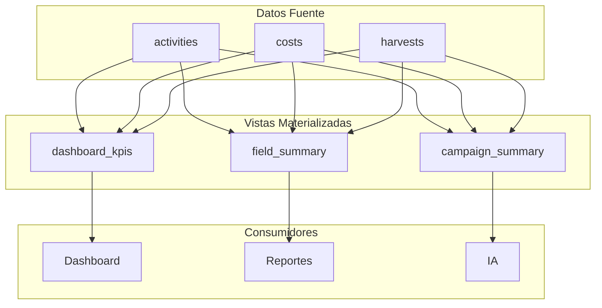

**Vistas propuestas:**

| Vista | Columnas | Actualización |
|---|---|---|
| `mv_field_kpis` | field_id, campaign_id, total_activities, total_costs, total_harvest_tons, avg_yield | Diaria (o en demanda) |
| `mv_producer_summary` | user_id, campaign_id, field_count, active_fields, total_area, avg_yield, total_costs | Diaria |
| `mv_variety_performance` | variety_id, campaign_id, avg_yield, max_yield, field_count | Diaria |

### 10.5 Connection Pooling

- **Herramienta:** PgBouncer (transaction pooling) o pool de conexiones de Prisma.
- **Propósito:** Gestionar eficientemente las conexiones concurrentes, evitando agotar el límite de conexiones de PostgreSQL.
- **Configuración MVP:** Pool de 20 conexiones concurrentes. Escalar a 100+ con PgBouncer a medida que crece la base de usuarios.

### 10.6 Estrategia de Escalabilidad por Nivel

| Nivel | Productores | Parcelas | Estrategia |
|---|---|---|---|
| **Prototipo** | < 10 | < 100 | Instancia única, sin optimización especial |
| **MVP** | < 100 | < 1,000 | Índices optimizados, pool de conexiones |
| **Crecimiento** | 100–1,000 | 1,000–10,000 | Particionado por campaña, vistas materializadas, cache Redis |
| **Escala** | 1,000–10,000 | 10,000–100,000 | Read replicas, PgBouncer, particionado por mes |
| **Empresarial** | 10,000+ | 100,000+ | Sharding por tenant, Foreign Data Wrappers, TimescaleDB (opcional para clima) |

---

## 11. Diccionario de Datos

### 11.1 users (Usuarios)

| Aspecto | Detalle |
|---|---|
| **Función** | Corazón de la identidad del sistema. Almacena credenciales, datos personales y preferencias de cada usuario |
| **Relaciones** | 1:N con fields, activities, costs, harvests, notifications, ai_conversations, audit_logs. N:1 con roles |
| **Importancia** | Crítica. Sin esta tabla no hay autenticación ni aislamiento de datos entre productores |
| **Volumen esperado** | 10–10,000 registros (dependiendo de la adopción) |
| **Campos sensibles** | password_hash (nunca exponer en respuestas), email (PII protegida) |

### 11.2 roles (Roles)

| Aspecto | Detalle |
|---|---|
| **Función** | Define los niveles de acceso del sistema. Cada usuario tiene exactamente un rol |
| **Relaciones** | 1:N con users. N:M con permissions (vía roles_permissions) |
| **Importancia** | Alta. Base del modelo RBAC del sistema |
| **Volumen esperado** | Fijo (~8 registros) |

### 11.3 permissions (Permisos)

| Aspecto | Detalle |
|---|---|
| **Función** | Catálogo de acciones específicas que pueden realizarse en el sistema |
| **Relaciones** | N:M con roles (vía roles_permissions) |
| **Importancia** | Alta. Define granularmente qué puede hacer cada usuario |
| **Volumen esperado** | Fijo (~20–30 registros) |

### 11.4 refresh_tokens (Tokens de Refresco)

| Aspecto | Detalle |
|---|---|
| **Función** | Gestiona sesiones activas. Almacena el hash de cada refresh token para validación y rotación |
| **Relaciones** | N:1 con users |
| **Importancia** | Alta. Crítica para la seguridad de la autenticación |
| **Volumen esperado** | Proporcional a usuarios activos. Cada usuario puede tener 1–3 tokens válidos |

### 11.5 user_assignments (Asignaciones)

| Aspecto | Detalle |
|---|---|
| **Función** | Permite que asesores agronómicos, ingenios y otros roles accedan a los datos de productores específicos |
| **Relaciones** | N:1 con users (como advisor). N:1 con users (como producer) |
| **Importancia** | Media-alta. Habilita el multi-tenancy entre usuarios sin compartir credenciales |
| **Volumen esperado** | Proporcional al número de relaciones asesor-productor |

### 11.6 fields (Parcelas)

| Aspecto | Detalle |
|---|---|
| **Función** | Entidad principal del dominio agrícola. Cada fila representa un lote de caña de azúcar con su ubicación geográfica exacta |
| **Relaciones** | N:1 con users. 1:N con activities, costs, harvests, weather_alerts. N:M con varieties (vía field_varieties) |
| **Importancia** | Crítica. Es la entidad central del sistema. Todas las demás entidades del dominio giran en torno a las parcelas |
| **Volumen esperado** | 5–50,000 parcelas. Cada productor típico tiene 5–50 parcelas |
| **Campo clave** | `geometry` — El polígono PostGIS es la característica más importante y diferenciadora |

### 11.7 field_varieties (Variedades por Parcela — Histórico)

| Aspecto | Detalle |
|---|---|
| **Función** | Registra el historial completo de qué variedades se implantaron en cada parcela y cuándo |
| **Relaciones** | N:1 con fields. N:1 con varieties |
| **Importancia** | Alta. Permite análisis histórico de rendimiento por variedad y rotación de cultivos |
| **Volumen esperado** | 1–2 registros por parcela por campaña |

### 11.8 varieties (Variedades)

| Aspecto | Detalle |
|---|---|
| **Función** | Catálogo de variedades de caña de azúcar. Contiene información agronómica de cada variedad |
| **Relaciones** | 1:N con field_varieties. 1:N con harvests |
| **Importancia** | Alta. Base de conocimiento varietal para recomendaciones IA y análisis comparativo |
| **Volumen esperado** | 10–200 registros (catálogo semi-fijo) |

### 11.9 campaigns (Campañas)

| Aspecto | Detalle |
|---|---|
| **Función** | Define los períodos agrícolas. Permite agrupar y comparar datos entre campañas |
| **Relaciones** | 1:N con activities, costs, harvests |
| **Importancia** | Alta. Sin campañas, no es posible hacer análisis histórico ni comparativas interanuales |
| **Volumen esperado** | 1–20 registros (crece 1–2 por año) |

### 11.10 field_statuses (Estados de Parcela)

| Aspecto | Detalle |
|---|---|
| **Función** | Catálogo de estados agronómicos de una parcela |
| **Relaciones** | 1:N con fields |
| **Importancia** | Media. Proporciona semántica agronómica al estado de la parcela |
| **Volumen esperado** | Fijo (~5 registros) |

### 11.11 activity_types (Tipos de Actividad)

| Aspecto | Detalle |
|---|---|
| **Función** | Catálogo de tipos de actividad agronómica. Define qué campos requiere cada tipo |
| **Relaciones** | 1:N con activities |
| **Importancia** | Alta. Estandariza los tipos de actividad y permite validación dinámica |
| **Volumen esperado** | Fijo (~15 registros) |

### 11.12 activities (Actividades)

| Aspecto | Detalle |
|---|---|
| **Función** | Registro de cada operación realizada en el campo. Tabla de mayor volumen operacional |
| **Relaciones** | N:1 con fields. N:1 con activity_types. N:1 con users. 1:N con activity_photos |
| **Importancia** | Crítica. Representa el historial de manejo de cada parcela. Es la tabla más consultada después de fields |
| **Volumen esperado** | Muy alto. 100–500 actividades por parcela por campaña |

### 11.13 activity_photos (Fotos de Actividades)

| Aspecto | Detalle |
|---|---|
| **Función** | Almacena referencias a fotografías adjuntas a actividades de campo |
| **Relaciones** | N:1 con activities |
| **Importancia** | Media. Proporciona evidencia visual para auditoría y seguimiento |
| **Volumen esperado** | 0–3 fotos por actividad. Moderado |

### 11.14 cost_categories (Categorías de Costo)

| Aspecto | Detalle |
|---|---|
| **Función** | Catálogo de categorías contables para clasificar gastos |
| **Relaciones** | 1:N con costs |
| **Importancia** | Alta. Estandariza la clasificación de costos para análisis financiero |
| **Volumen esperado** | Fijo (~6 registros) |

### 11.15 costs (Costos)

| Aspecto | Detalle |
|---|---|
| **Función** | Registro de gastos asociados a parcelas. Permite calcular rentabilidad por parcela |
| **Relaciones** | N:1 con fields. N:1 con cost_categories. N:1 con users. N:1 con campaigns. N:1 con activities (opcional) |
| **Importancia** | Crítica. El control de costos es una de las funcionalidades más valoradas por el productor |
| **Volumen esperado** | Muy alto. Similar a activities en volumen |

### 11.16 harvests (Cosechas)

| Aspecto | Detalle |
|---|---|
| **Función** | Registro de eventos de cosecha. Calcula rendimiento automáticamente |
| **Relaciones** | N:1 con fields. N:1 con users. N:1 con campaigns. N:1 con varieties |
| **Importancia** | Crítica. El rendimiento es el KPI más importante del productor |
| **Volumen esperado** | 1–2 registros por parcela por campaña. Moderado |

### 11.17 weather_records (Registros Climáticos)

| Aspecto | Detalle |
|---|---|
| **Función** | Almacena datos climáticos históricos y actuales por coordenadas geográficas |
| **Relaciones** | Ninguna directa (consultada espacialmente) |
| **Importancia** | Media. Datos auxiliares para contexto agronómico y alertas |
| **Volumen esperado** | Muy alto. Es la tabla de mayor crecimiento potencial |

### 11.18 weather_alerts (Alertas Climáticas)

| Aspecto | Detalle |
|---|---|
| **Función** | Alertas climáticas generadas automáticamente y asociadas a usuarios/parcelas |
| **Relaciones** | N:1 con users. N:1 con fields |
| **Importancia** | Media-alta. Las alertas de helada y lluvia intensa tienen alto valor preventivo |
| **Volumen esperado** | Moderado. 5–20 alertas por semana por zona |

### 11.19 notifications (Notificaciones)

| Aspecto | Detalle |
|---|---|
| **Función** | Centro de notificaciones del sistema. Agrupa alertas de todos los módulos |
| **Relaciones** | N:1 con users |
| **Importancia** | Alta. Mantiene al usuario informado y comprometido con la plataforma |
| **Volumen esperado** | Alto. 5–20 notificaciones por usuario por día |

### 11.20 ai_conversations (Conversaciones IA)

| Aspecto | Detalle |
|---|---|
| **Función** | Agrupa sesiones de chat con el asistente IA |
| **Relaciones** | N:1 con users. 1:N con ai_messages |
| **Importancia** | Media-alta. Permite historial de consultas y mejora continua del asistente |
| **Volumen esperado** | Moderado. 5–20 conversaciones por usuario por mes |

### 11.21 ai_messages (Mensajes IA)

| Aspecto | Detalle |
|---|---|
| **Función** | Cada mensaje individual dentro de una conversación con la IA |
| **Relaciones** | N:1 con ai_conversations |
| **Importancia** | Media. Almacena el contenido de cada interacción para contexto histórico |
| **Volumen esperado** | Alto. 10–50 mensajes por conversación. Proporcional al uso de IA |

### 11.22 audit_logs (Logs de Auditoría)

| Aspecto | Detalle |
|---|---|
| **Función** | Registro inmutable de todas las operaciones críticas del sistema |
| **Relaciones** | N:1 con users |
| **Importancia** | Alta. Fundamental para seguridad, trazabilidad y cumplimiento |
| **Volumen esperado** | Muy alto. ~10–100 registros por usuario por día |

---

## 12. Preparación para IA

### 12.1 Información que Utilizará la IA

El asistente IA necesita acceder a datos estructurados de múltiples tablas para responder preguntas contextuales:

| Tipo de Consulta | Tablas Necesarias | Columnas Clave |
|---|---|---|
| **"¿Qué lote produjo más?"** | harvests, fields, campaigns | harvests.tons, fields.name, fields.area_hectares, harvests.campaign_id |
| **"¿Cuánto gasté este año?"** | costs, fields, campaigns | costs.amount, costs.cost_category_id, costs.campaign_id |
| **"¿Qué tareas tengo pendientes?"** | activities | activities.activity_date (pasada sin completar), activities.deleted_at IS NULL |
| **"¿Qué fertilización recomiendas?"** | field_varieties, varieties, activities, fields | Historial de fertilización, variedad actual, fecha de última fertilización |
| **"Resumir campaña actual"** | harvests, costs, activities, fields, campaigns | Agregaciones por campaign_id |
| **"¿Conviene cosechar el lote 3?"** | harvests (última), activities (recientes), weather_records | Días desde última actividad, condiciones climáticas, rendimiento histórico |

### 12.2 Cómo Accederá la IA

La IA **nunca ejecuta consultas SQL directas**. El acceso es mediado por el backend:

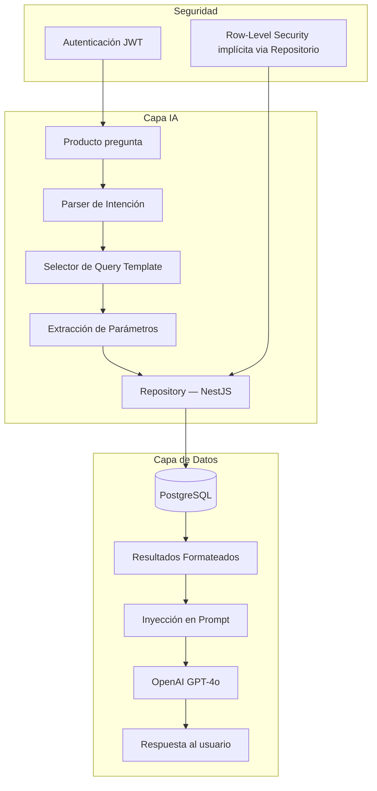

**Mecanismo detallado:**

1. El **Parser de Intención** analiza la pregunta del usuario y determina qué datos necesita (producción, costos, tareas, etc.).
2. Se selecciona un **template de query predefinido** en TypeScript (nunca SQL dinámico generado por IA).
3. Se extraen parámetros de la pregunta (año, parcela, categoría) y se validan.
4. El **Repository** de NestJS ejecuta la query con Prisma, filtrando siempre por `user_id` del usuario autenticado.
5. Los resultados se transforman a texto descriptivo y se inyectan en el prompt del LLM.
6. El LLM genera una respuesta natural.

### 12.3 Interpretación del Historial

Para que la IA pueda interpretar el historial, la base de datos está diseñada para facilitar consultas temporales y agregadas:

| Patrón de Consulta | Implementación | Ejemplo de Uso IA |
|---|---|---|
| **Agregación por campaña** | `GROUP BY campaign_id` | "¿Cómo fue mi rendimiento este año vs. el anterior?" |
| **Comparativa temporal** | `WHERE campaign_id IN (?, ?)` | "¿Mejoró el rendimiento del lote 3?" |
| **Historial de prácticas** | `WHERE field_id = ? AND activity_type_id = ? ORDER BY activity_date` | "¿Cuándo fue la última fertilización del lote 5?" |
| **Rendimiento por variedad** | `JOIN field_varieties ON ... GROUP BY variety_id` | "¿Qué variedad rinde más en mi campo?" |
| **Costos por categoría** | `JOIN cost_categories ... GROUP BY category` | "¿En qué gasté más este año?" |
| **Estado actual de parcela** | `JOIN field_statuses` | "¿Qué parcelas están listas para cosechar?" |

### 12.4 Generación de Recomendaciones

Las recomendaciones de la IA se basan en tres fuentes de datos:

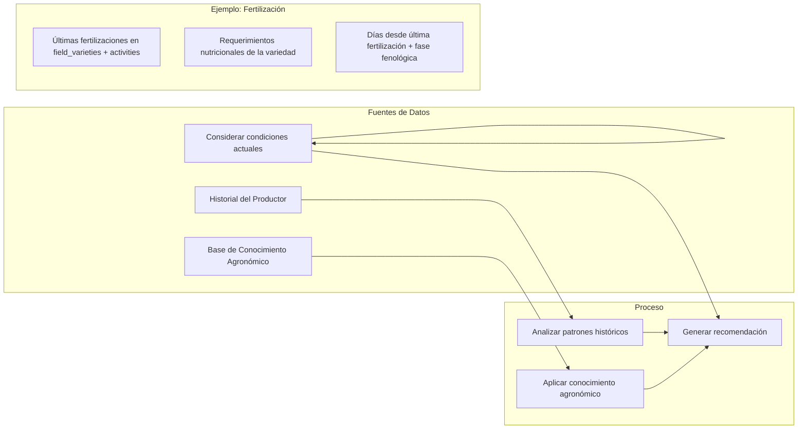

### 12.5 Estructura de Retroalimentación

El sistema debe permitir que la IA aprenda de las interacciones:

- **ai_messages.metadata** almacena el tipo de consulta detectada para análisis de uso.
- **ai_messages.metadata** puede almacenar si la respuesta fue útil (feedback del usuario).
- Los patrones de consulta frecuentes identifican qué datos necesita la IA más a menudo.
- Los resultados agregados de consultas similares se pueden cachear para respuestas más rápidas.

---

## 13. Escalabilidad Futura

### 13.1 Aplicación Móvil Nativa

La base de datos está preparada para soportar una app nativa:

| Necesidad | Preparación Actual | Acción Adicional |
|---|---|---|
| **Sincronización offline** | UUIDs generables en cliente, timestamps en cada fila | Tabla de sync_logs para tracking de cambios pendientes |
| **Registro rápido en campo** | Formularios ligeros con pocos campos obligatorios | Endpoints de actividades optimizados |
| **Fotos desde el móvil** | activity_photos existente | Compresión en cliente, upload progresivo |
| **Geolocalización** | Coordenadas en activity_photos | Almacenar posición del técnico al registrar |

**Tabla adicional para móvil:**

| Tabla | Propósito |
|---|---|
| `sync_queue` | Cola de operaciones pendientes de sincronizar cuando el dispositivo recupere conectividad |

### 13.2 IoT — Sensores de Campo

| Tipo de Sensor | Dato a Almacenar | Tabla Propuesta |
|---|---|---|
| **Humedad de suelo** | timestamp, field_id, profundidad, porcentaje de humedad | `sensor_soil_moisture` |
| **Temperatura ambiente** | timestamp, field_id, temperatura, humedad | `sensor_weather` (fusionar con weather_records) |
| **Pluviómetro** | timestamp, field_id, mm acumulados | `sensor_rainfall` |
| **Estación meteorológica** | timestamp, field_id, datos completos | `weather_records` (existente) |

**Diseño genérico para sensores:**

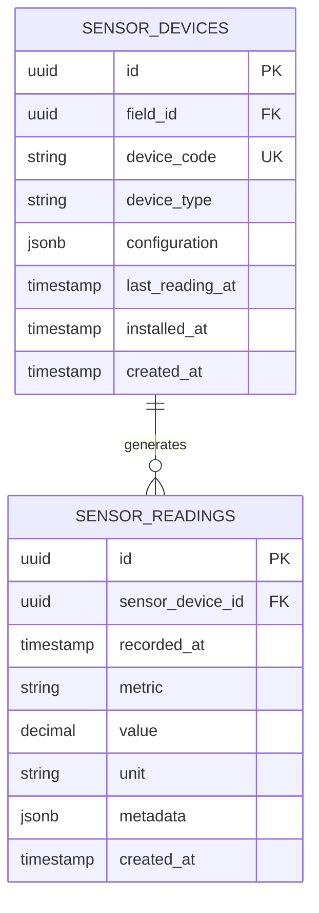

### 13.3 Drones e Imágenes Satelitales

| Tipo de Dato | Almacenamiento | Tabla Propuesta |
|---|---|---|
| **Ortofoto NDVI** | Archivo (Cloudflare R2) + metadatos en BD | `satellite_images` |
| **Índice de vegetación** | Valor numérico por parcela/fecha | `field_vegetation_index` |
| **Mapa de prescripción** | GeoJSON + archivo | `prescription_maps` |

**Tabla adicional:**

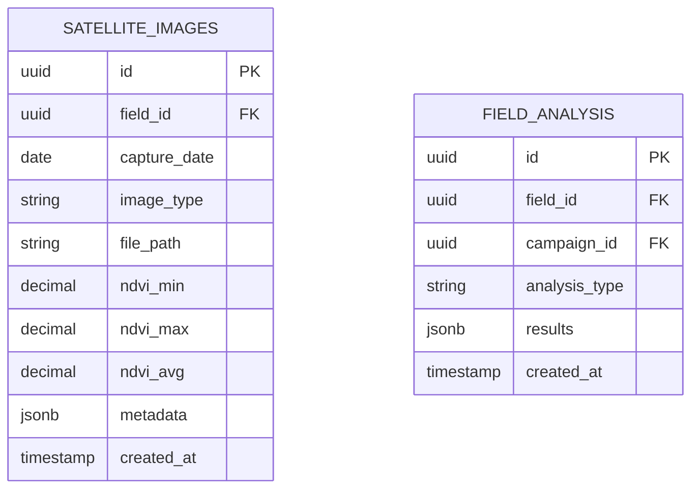

### 13.4 Machine Learning

La base de datos está diseñada para alimentar modelos de ML:

| Modelo de ML | Datos de Entrenamiento | Tablas Fuente |
|---|---|---|
| **Predicción de rendimiento** | harvests.tons + fields.area + soil + variety + weather_records | harvests, fields, field_varieties, varieties, weather_records |
| **Detección temprana de plagas** | activities (tipo control) + field_varieties + observaciones | activities, field_varieties |
| **Optimización de fecha de cosecha** | harvests.sucrose_percentage + harvests.date + weather_records | harvests, weather_records |
| **Recomendación de fertilización** | activities (fertilización) + field_varieties + yields | activities, field_varieties, harvests |

**Preparación para features de ML:**
- Todas las tablas tienen `timestamptz` para series temporales.
- Las campañas proporcionan la partición temporal para training/testing.
- `metadata` en JSONB permite agregar features sin alterar el esquema.
- Los datos históricos se conservan indefinidamente (soft delete).

### 13.5 Integración con Ingenios

| Necesidad del Ingenio | Datos Requeridos | Tablas Fuente |
|---|---|---|
| **Volumen programado** | harvests programadas + fields por productor | harvests, fields |
| **Calidad estimada** | harvests.sucrose_percentage + varieties | harvests, field_varieties |
| **Estado de cosecha** | harvests.status + activities | harvests, activities |
| **Disponibilidad por zona** | fields.geometry + harvests | Consulta espacial |

**Tabla adicional para relación ingenio-productor:**

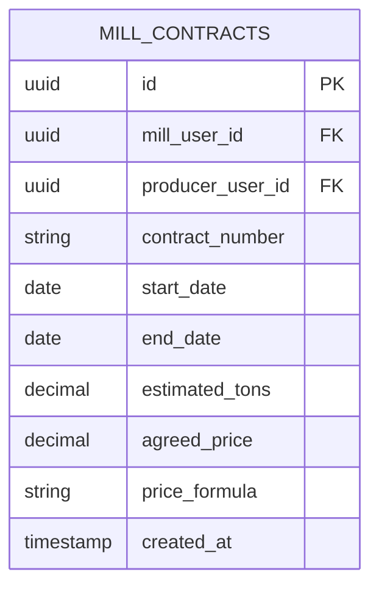

### 13.6 Nuevos Cultivos

El diseño actual es específico para caña de azúcar, pero la arquitectura permite extensión:

| Elemento | Extensible a | Cambio Necesario |
|---|---|---|
| varieties | Otros cultivos | Agregar `crop_type` a varieties |
| fields | Genérico | Sin cambios (la geometría es universal) |
| activity_types | Genérico | Agregar tipos específicos del nuevo cultivo |
| harvests | Genérico | Agregar unidades específicas del cultivo |
| field_varieties | Genérico | Sin cambios |
| cost_categories | Genérico | Sin cambios |

Para soportar múltiples cultivos en el futuro, se puede agregar una tabla `crops` y relacionarla con `varieties`, `fields` y `activity_types`.

---

## Anexo A — Resumen de Tablas

| # | Tabla | Tipo | Volumen Esperado | Soft Delete | Particionado Futuro |
|---|---|---|---|---|---|
| 1 | users | Maestra | Bajo (10–10K) | Sí | No |
| 2 | roles | Catálogo | Muy bajo (~8) | No | No |
| 3 | permissions | Catálogo | Muy bajo (~30) | No | No |
| 4 | roles_permissions | Puente | Muy bajo (~80) | No | No |
| 5 | refresh_tokens | Transaccional | Bajo | No (hard delete) | No |
| 6 | user_assignments | Transaccional | Bajo | Sí | No |
| 7 | fields | Maestra | Medio (100–50K) | Sí | No |
| 8 | field_varieties | Histórica | Medio | Sí | Por campaña |
| 9 | varieties | Catálogo | Bajo (10–200) | Sí | No |
| 10 | campaigns | Maestra | Muy bajo (1–20) | No | No |
| 11 | field_statuses | Catálogo | Muy bajo (~5) | No | No |
| 12 | activity_types | Catálogo | Muy bajo (~15) | No | No |
| 13 | activities | Transaccional | Muy alto | Sí | Por campaña |
| 14 | activity_photos | Archivo | Medio | Sí | No |
| 15 | cost_categories | Catálogo | Muy bajo (~6) | No | No |
| 16 | costs | Transaccional | Muy alto | Sí | Por campaña |
| 17 | harvests | Transaccional | Alto | Sí | Por campaña |
| 18 | weather_records | Series temporales | Muy alto | No | Por mes |
| 19 | weather_alerts | Transaccional | Medio | Sí | No |
| 20 | notifications | Transaccional | Alto | Sí | Por mes |
| 21 | ai_conversations | Histórica | Medio | Sí | No |
| 22 | ai_messages | Histórica | Alto | Sí | Por mes |
| 23 | audit_logs | Auditoría | Muy alto | No (append-only) | Por mes |

## Anexo B — Tipos de Dato Recomendados para Prisma

| Tipo PostgreSQL | Tipo Prisma | Uso |
|---|---|---|
| `uuid` | `String @db.Uuid` | Claves primarias y foráneas |
| `varchar(255)` | `String` | Texto corto |
| `text` | `String` | Texto largo |
| `decimal(12,2)` | `Decimal` | Montos monetarios |
| `decimal(12,4)` | `Decimal` | Áreas y dosis |
| `decimal(5,2)` | `Decimal` | Porcentajes |
| `boolean` | `Boolean` | Flags |
| `timestamptz` | `DateTime` | Fechas con zona horaria |
| `date` | `DateTime` | Fechas sin hora |
| `jsonb` | `Json` | Metadatos flexibles |
| `geometry(Polygon, 4326)` | `Unsupported` | Geometría PostGIS (manejo vía raw queries) |
| `inet` | `String` | Direcciones IP |

---

*Documento generado como parte del Proyecto de Tesis Final — TUP UTN, Julio 2026.*
*Versión del documento: v1.0*
*Última actualización: 27 de Julio de 2026*
